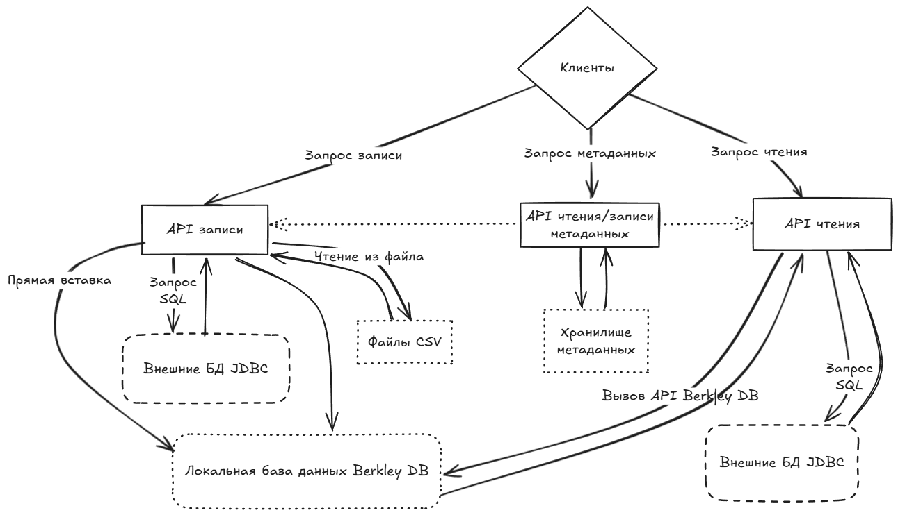
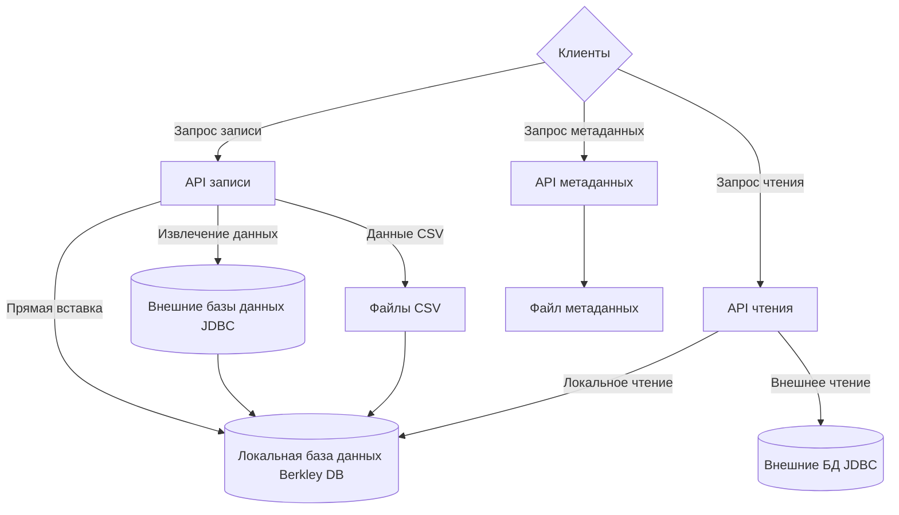
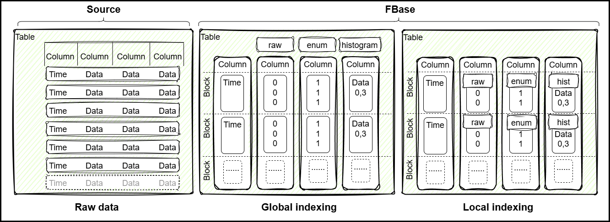
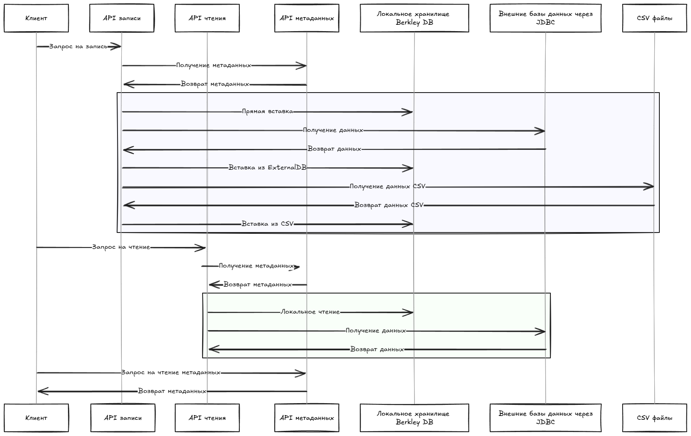
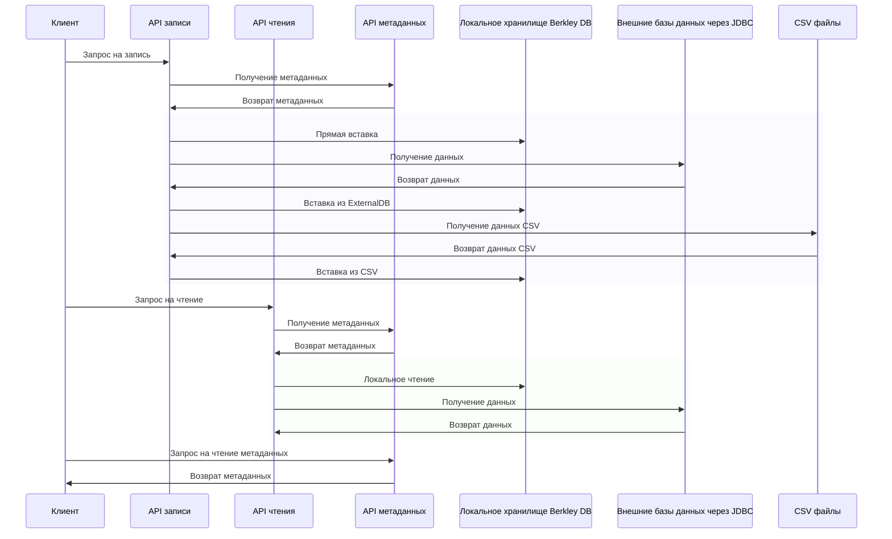

# FBase


Гибридная колоночная БД для хранения данных временных рядов на Java

## Оглавление

- [Описание программы](#описание-программы)
  - [Общие сведения](#общие-сведения)
  - [Направления прикладного использования](#направления-прикладного-использования)
  - [Минимальные технические требования](#Минимальные-технические-требования)
  - [Начало работы с проектом](#начало-работы-с-проектом)
    - [Сборка проекта](#сборка-проекта)
    - [Использование проекта](#использование-проекта)
    - [Подготовка окружения для запуска модульных тестов](#подготовка-окружения-для-запуска-модульных-тестов)
    - [Подготовка окружения для запуска интеграционных тестов](#подготовка-окружения-для-запуска-интеграционных-тестов)
      - [PostgreSQL](#postgresql)
      - [Oracle](#oracle)
      - [MS SQL](#ms-sql)
      - [Clickhouse](#clickhouse)
      - [Загрузка тестовых данных в Clickhouse](#загрузка-тестовых-данных-в-clickhouse)
  - [Описание логической структуры](#описание-логической-структуры)
    - [Архитектура БД](#архитектура-БД)
      - [Формат хранения данных](#формат-хранения-данных)
    - [Алгоритмы](#алгоритмы)
      - [Алгоритм инициализации БД](#алгоритм-инициализации-бд)
    - [API программы](#api-программы)
      - [Диаграмма последовательности API](#диаграмма-последовательности-api)
      - [Используемые методы](#используемые-методы)
        - [Интерфейс FStore](#интерфейс-fstore)
        - [Класс FBase](#класс-fbase)
        - [Параметры](#параметры)
          - [Тип таблицы - enum TType](#тип-таблицы---enum-ttype)
          - [Тип индексирования таблицы - enum IType](#тип-индексирования-таблицы---enum-itype)
          - [Тип backend таблицы - enum BType](#тип-backend-таблицы---enum-btype)
          - [Тип функции группировки данных - enum GroupFunction](#тип-функции-группировки-данных---enum-groupfunction)
          - [Параметры хранения столбца таблицы - класс CSType](#параметры-хранения-столбца-таблицы---класс-cstype)
            - [Тип хранения данных - enum SType](#тип-хранения-данных---enum-stype)
            - [Тип хранения данных Java - enum CType](#тип-хранения-данных-java---enum-ctype)
            - [Тип хранения данных JDBC/CSV - enum DataType](#тип-хранения-данных-jdbccsv---enum-datatype)
        - [Входные параметры](#входные-параметры)
          - [Настройки БД - класс FBaseConfig](#настройки-бд---класс-fbaseconfig)
          - [Настройки таблицы SProfile](#настройки-таблицы-sprofile)
        - [Выходные параметры](#выходные-параметры)
          - [Настройки таблицы - класс TProfile](#настройки-таблицы---класс-tprofile)
          - [Настройки столбца таблицы - класс CProfile](#настройки-столбца-таблицы---класс-cprofile)
          - [Объект для получения агрегатов данных из stacked API - класс StackedColumn](#объект-для-получения-агрегатов-данных-из-stacked-api---класс-stackedcolumn)
          - [Объект для получения агрегатов данных из gantt API - класс GanttColumn](#объект-для-получения-агрегатов-данных-из-gantt-api---класс-ganttcolumn)
    - [Варианты использования кода](#варианты-использования-кода)
      - [Запрос метаданных таблицы](#запрос-метаданных-таблицы)
      - [Загрузка метаданных таблицы напрямую](#загрузка-метаданных-таблицы-напрямую)
      - [Запрос метаданных через JDBC](#запрос-метаданных-через-jdbc)
      - [Загрузка метаданных из файла CSV](#загрузка-метаданных-из-файла-csv)
      - [Прямое сохранение данных](#прямое-сохранение-данных)
      - [Загрузка данных в таблицу из JDBC ResultSet](#загрузка-данных-в-таблицу-из-jdbc-resultset)
      - [Пакетная загрузка данных в таблицу из JDBC ResultSet](#пакетная-загрузка-данных-в-таблицу-из-jdbc-resultset)
      - [Получение списка сгруппированных данных по столбцу](#получение-списка-сгруппированных-данных-по-столбцу)
        - [Пример для функции группировки COUNT с помощью Stacked API и SQL](#пример-для-функции-группировки-count-с-помощью-stacked-api-и-sql)
        - [Пример для функции группировки SUM и AVG с помощью Stacked API и SQL](#пример-для-функции-группировки-sum-и-avg-с-помощью-stacked-api-и-sql)
      - [Получение списка сгруппированных данных по столбцу с фильтром](#получение-списка-сгруппированных-данных-по-столбцу-с-фильтром)
        - [Пример с фильтром для функции группировки COUNT с помощью Stacked API и SQL](#пример-с-фильтром-для-функции-группировки-count-с-помощью-stacked-api-и-sql)
      - [Получение списка данных с двухуровневой группировкой](#получение-списка-данных-с-двухуровневой-группировкой)
        - [Пример двухуровневой группировки с помощью Gantt API и SQL](#пример-двухуровневой-группировки-с-помощью-gantt-api-и-sql)
      - [Получение исходных данных по столбцу](#получение-исходных-данных-по-столбцу)
      - [Получение исходных данных по таблице](#получение-исходных-данных-по-таблице)
      - [Получение исходных данных по таблице с фильтром](#получение-исходных-данных-по-таблице-с-фильтром)
        - [Пример получения исходных данных по всем столбцам таблицы с фильтром с помощью Raw API и SQL](#пример-получения-исходных-данных-по-всем-столбцам-таблицы-с-фильтром-с-помощью-raw-api-и-sql)
      - [Получение исходных данных для обычных таблиц с использованием BatchResultSet](#получение-исходных-данных-для-обычных-таблиц-с-использованием-batchresultset)
      - [Получение исходных данных для time-series таблиц во временном диапазоне с использованием BatchResultSet](#получение-исходных-данных-для-time-series-таблиц-во-временном-диапазоне-с-использованием-batchresultset)
      - [Получение последней временной метки из таблицы](#получение-последней-временной-метки-из-таблицы)
      - [Синхронизация данных с постоянным хранилищем Berkley DB](#синхронизация-данных-с-постоянным-хранилищем-berkley-db)
        - [Пример реализации вызова API syncBackendDb FBase для backend Berkley DB](#пример-реализации-вызова-api-syncbackenddb-fbase-для-backend-berkley-db)
      - [Закрытие постоянного хранилища Berkley DB](#закрытие-постоянного-хранилища-berkley-db)
        - [Пример реализации вызова API closeBackendDb FBase для backend Berkley DB](#пример-реализации-вызова-api-closebackenddb-fbase-для-backend-berkley-db)
- [Загрузка](#загрузка)
- [Разработка](#разработка)
- [Документация](#документация)
- [Лицензия](#лицензия)
- [Контакты](#контакты)

## Описание программы

### Общие сведения
FBase - гибридная колоночная база данных для хранения данных временных рядов. Написана на языке программирования Java.

Ключевые особенности:
- Колоночный формат хранения данных;
- Хранение данных временных рядов;
- Формат хранения с встроенной поддержкой дедупликации данных и сжатия;
- Установка формата хранения на уровне таблицы и блока;
- Автоматический выбор алгоритма дедупликации на основе собираемых данных;
- Использование для локального хранения в качестве backend базы данных Berkley DB;
- Поддержка основных типов данных JDBC для БД PostgreSQL, Oracle, MS SQL и ClickHouse;
- В режиме «только для чтения» автоматическое формирование SQL запросов к таблицам с данными временных рядов;

[Вернуться в Оглавление](#Оглавление)

### Направления прикладного использования
Библиотека может использоваться в качестве легковесной аналитической базы данных для backend систем обработки данных на платформе Java для решения следующих прикладных задач;
- хранения собранных данных и аналитической обработки небольших и среднего объема данных для различных встроенных приложений на Java;
- хранение и обработка данных "Интернета вещей" (англ. Internet of Things, IoT) на самих устройствах в качестве временного хранилища, кэша и других задач, связанных с локальной обработкой данных;
- хранилище метаданных для выполнения запросов во внешних источниках данных с помощью автоматической генерации SQL по модели данных для аналитических приложений.
[Вернуться в Оглавление](#Оглавление)

## Минимальные технические требования
**FBase** совместим с Java 21+ и поставляется с небольшим набором зависимостей.

### Требования к аппаратному обеспечению

Таблица 1. Требования к аппаратному обеспечению

| Параметр        | Описание                                                                                                        |
|:----------------|:----------------------------------------------------------------------------------------------------------------|
| CPU и ОЗУ       | Процессор частотой не ниже 500 МHz и объем памяти не ниже 250 Мб, в зависимости от объема обрабатываемых данных |
| Архитектура CPU | Intel 64-bit (x86_64), AMD 64-bit (x86_64), Arm 64-bit (aarch64)                                                |
| Диск            | Размер диска в зависимости от объема обрабатываемых данных                                                      |

### Требования к программному обеспечению

Таблица 2. Требования к программному обеспечению

| ПО    | Требования                  |
|:------|:----------------------------|
| Java  | Версия Java 21+             |
| Maven | Не ниже 3 версии            |
| Git   | Последняя актуальная версия |

### Требования к операционному обеспечению

Таблица 3. Требования к операционному обеспечению

| ПО                   | Требования                  |
|:---------------------|:----------------------------|
| Операционная система | Windows, Linux, MacOS       |

[Вернуться в Оглавление](#Оглавление)

### Начало работы с проектом

#### Сборка проекта
Проверьте, что у вас установлено ПО JDK 21+, Maven и Git последней версии
  ```shell
    java -version
    mvn -version
    git --version
  ```

Скачайте исходные коды репозитория FBase:
  ```shell
    git clone <<url>>
    cd fbase
  ```

Для компиляции исходного кода проекта выполните:
  ```shell
    mvn clean compile
  ```

Для запуска модульных тестов выполните:
  ```shell
    mvn clean test 
  ```

Для сборки проекта в jar-файл **FBase** выполните:
  ```shell
    mvn clean package
  ```

Для сборки и установки jar-файла **FBase** в локальный репозиторий Maven выполните:
  ```shell
    mvn clean install
  ```

Примечания:
- Запуск сборки проекта включает в себя выполнение модульных тестов, которые занимают по времени порядка 7-8 минут.
- В основном это время выполнения тестов из класса **FBaseRunnerTest**, в котором проводится запуск различных конфигураций для 45 тестов.
- Информация по тестам из **FBaseRunnerTest** представлена в таблице:

Таблица 4. Параметры и статистики выполнения тестов из **FBaseRunnerTest**

| Имя теста              | PermutationState | Количество конфигураций | Всего тестов | Время исполнения |
|------------------------|------------------|-------------------------|--------------|------------------|
| testPermutationNone    | NONE             | 36                      | 1 620        | ~ 3 секунды      |
| testPermutationPartial | PARTIAL          | 648                     | 29 160       | ~ 30 секунд      |
| testPermutationAll     | ALL              | 8748                    | 393 660      | ~ 6-7 минут      |

- Для уменьшения времени сборки и установки проекта можно отключить запуск всех тестов из этого класса с помощью ключа **-Dtest=!FBaseRunnerTest** или использовать аннотацию **@Disabled** для класса или метода
```shell
    mvn clean test -Dtest=!FBaseRunnerTest
    mvn clean package -Dtest=!FBaseRunnerTest
    mvn clean install -Dtest=!FBaseRunnerTest
  ```

[Вернуться в Оглавление](#Оглавление)

#### Использование проекта
Для использования БД **FBase** в Java приложении необходим добавить jar-файл в качестве зависимости в файл настроек Maven pom.xml

Добавьте jar-файл **FBase** в качестве зависимости в файл настроек pom.xml вашего проекта:
```xml
<?xml version="1.0" encoding="UTF-8"?>
<project>
  <properties>
    <fbase-version>1.0.0</fbase-version>
  </properties>
  <!--.....-->
  <!--.....-->
  <!--.....-->
  <dependencies>
    <dependency>
      <groupId>ru.real-time-intelligence</groupId>
      <artifactId>fbase</artifactId>
      <version>{fbase-version}</version>
    </dependency>
  </dependencies>
</project>
```

Примечания:
- Библиотека опубликована на [Maven Central](https://central.sonatype.com/artifact/ru.real-time-intelligence/fbase/);
- Для сборки и установки последней актуальной версии библиотеки **FBase** в локальный репозиторий Maven скачайте исходные коды приложения и выполните:
  ```shell
    mvn clean install
  ```
Подробности по сборке и установке проекта описаны в разделе [Сборка проекта](#сборка-проекта)
- Полный список вариантов использования FBase в вашем приложении вы можете найти в разделе [Варианты использования кода](#Варианты-использования-кода).

[Вернуться в Оглавление](#Оглавление)

#### Подготовка окружения для запуска модульных тестов
Для запуска модульных тестов необходимо выполнить шаги по сборке проекта из раздела [Сборка проекта](#сборка-проекта)

[Вернуться в Оглавление](#Оглавление)

#### Подготовка окружения для запуска интеграционных тестов
Подготовка окружения для запуска интеграционных тестов требует локальной установки баз данных с помощью Docker Desktop

Инструкция по установке Docker Desktop для [Windows](https://docs.docker.com/desktop/install/windows-install/) и [Linux](https://docs.docker.com/desktop/install/linux/)

[Вернуться в Оглавление](#Оглавление)

##### PostgreSQL
Установить и запустить контейнер с БД PostgreSQL

  ```shell
    docker run -d --name db \
    -e 'POSTGRES_PASSWORD=postgres' \
    -p 5432:5432 \
    -v pgdata:/var/lib/postgresql/data \
    postgres \
    postgres -c 'max_connections=200'
  ```

[Вернуться в Оглавление](#Оглавление)

##### Oracle
- Установить локально [репозиторий](https://github.com/oracle/docker-images) скриптов для установки БД Oracle
- Скачать дистрибутив БД с сайта [Oracle](https://www.oracle.com/database/technologies/oracle19c-linux-downloads.html). Для платформы Linux x86 и версии БД 19.3 файл LINUX.X64_193000_db_home.zip скопировать в локальную директорию репозитория скриптов OracleDatabase/SingleInstance/dockerfiles/19.3.0
- Запустить скрипт buildContainerImage.sh из репозитория скриптов и указать параметры (пример для версии БД 19.3.0)
```shell
    OracleDatabase/SingleInstance/dockerfiles/buildContainerImage.sh -v 19.3.0 -e -i
  ```
- Установить и запустить контейнер с инстансом БД Oracle из командной строки (пример запуска команды Docker run для версии БД 19.3.0)
```shell
    docker run --name database19ee  \
    -p 1523:1521 -p 5522:5500 -e  \
    ORACLE_SID=orcl -e ORACLE_PDB=pdb_orcl -e ORACLE_PWD=sys  \
    -e ORACLE_CHARACTERSET=AL32UTF8  \
    -v /opt/oracle/oradata oracle/database:19.3.0-ee
  ```

[Вернуться в Оглавление](#Оглавление)

##### MS SQL
Установить и запустить контейнер с БД MS SQL
  ```shell
    docker run -e 'ACCEPT_EULA=Y' \
    -e 'SA_PASSWORD=QOEfSsa51234!' \
    -p 1433:1433 \
    -v |(pwd)/drive:/var/opt/mssql/data \
    --name mssql \
    mcr.microsoft.com/mssql/server
  ```

[Вернуться в Оглавление](#Оглавление)

##### Clickhouse
Установить и запустить контейнер с БД Clickhouse
  ```shell
    docker run -d --name clickhouse-server \
    -e CLICKHOUSE_USER=admin -e CLICKHOUSE_DEFAULT_ACCESS_MANAGEMENT=1 -e CLICKHOUSE_PASSWORD=admin \
    -p 8123:8123 -p 9000:9000 \
    -v C:\clickhouse:/var/lib/clickhouse clickhouse/clickhouse-server
  ```

[Вернуться в Оглавление](#Оглавление)

##### Загрузка тестовых данных в Clickhouse
- Установить [Clickhouse](#clickhouse) локально и проверить подключение к ClickHouse на локальном ПК по URL **"jdbc:clickhouse://localhost:8123"** или использовать другую строку подключения и внести изменения в тесты;
- Загрузить тестовые данные [Заказы такси Нью-Йорка](https://clickhouse.com/docs/en/getting-started/example-datasets/nyc-taxi#download-of-prepared-partitions) в локальный экземпляр ClickHouse (используется формат предварительно подготовленных разделов, загруженных в схему datasets);
- Проверить что данные загрузились `clickhouse-client --query "select count(*) from datasets.trips_mergetree"`;
- Создать директорию для локального хранения данных **FBase** (пример для Windows) **"C:\\Users\\.temp"**;
- Загрузить тестовые данные в локальную БД **FBase**, используя любой из методов в **FBaseCHLoadDataTest**, помеченный аннотацией @Test;
– Запустить интеграционные тесты в **FBaseCHQueryGanttTest**, **FBaseCHQueryStackedTest** или **FBaseCHQueryRawTest** которые помечены аннотацией @Test;

Примечания:
- В интеграционных тестах используется аннотация **@Disabled** для отключения их при запуске модульных тестов FBase, при необходимости ее следует удалить для корректной загрузки данных и тестирования.
- Тестовые данные таблицы trips_mergetree загружаются в схему datasets
  ```
    CREATE DATABASE datasets;
  ```
- Определение таблицы trips_mergetree

<details>
  <summary>CREATE TABLE trips_mergetree</summary>

```
    CREATE TABLE trips_mergetree (
      trip_id UInt32,
      vendor_id Enum8('1' = 1, '2' = 2, 'CMT' = 3, 'VTS' = 4, 'DDS' = 5, 'B02512' = 10, 'B02598' = 11, 'B02617' = 12, 'B02682' = 13, 'B02764' = 14),
      pickup_date Date,
      pickup_datetime DateTime,
      dropoff_date Date,
      dropoff_datetime DateTime,
      store_and_fwd_flag UInt8,
      rate_code_id UInt8,
      pickup_longitude Float64,
      pickup_latitude Float64,
      dropoff_longitude Float64,
      dropoff_latitude Float64,
      passenger_count UInt8,
      trip_distance Float64,
      fare_amount Float32,
      extra Float32,
      mta_tax Float32,
      tip_amount Float32,
      tolls_amount Float32,
      ehail_fee Float32,
      improvement_surcharge Float32,
      total_amount Float32,
      payment_type_ Enum8('UNK' = 0, 'CSH' = 1, 'CRE' = 2, 'NOC' = 3, 'DIS' = 4),
      trip_type UInt8,
      pickup FixedString(25),
      dropoff FixedString(25),
      cab_type Enum8('yellow' = 1, 'green' = 2, 'uber' = 3),
      pickup_nyct2010_gid UInt8,
      pickup_ctlabel Float32,
      pickup_borocode UInt8,
      pickup_boroname Enum8('' = 0, 'Manhattan' = 1, 'Bronx' = 2, 'Brooklyn' = 3, 'Queens' = 4, 'Staten Island' = 5),
      pickup_ct2010 FixedString(6),
      pickup_boroct2010 FixedString(7),
      pickup_cdeligibil Enum8(' ' = 0, 'E' = 1, 'I' = 2),
      pickup_ntacode FixedString(4),
      pickup_ntaname Enum16('' = 0, 'Airport' = 1, 'Allerton-Pelham Gardens' = 2, 'Annadale-Huguenot-Prince\'s Bay-Eltingville' = 3, 'Arden Heights' = 4, 'Astoria' = 5, 'Auburndale' = 6, 'Baisley Park' = 7, 'Bath Beach' = 8, 'Battery Park City-Lower Manhattan' = 9, 'Bay Ridge' = 10, 'Bayside-Bayside Hills' = 11, 'Bedford' = 12, 'Bedford Park-Fordham North' = 13, 'Bellerose' = 14, 'Belmont' = 15, 'Bensonhurst East' = 16, 'Bensonhurst West' = 17, 'Borough Park' = 18, 'Breezy Point-Belle Harbor-Rockaway Park-Broad Channel' = 19, 'Briarwood-Jamaica Hills' = 20, 'Brighton Beach' = 21, 'Bronxdale' = 22, 'Brooklyn Heights-Cobble Hill' = 23, 'Brownsville' = 24, 'Bushwick North' = 25, 'Bushwick South' = 26, 'Cambria Heights' = 27, 'Canarsie' = 28, 'Carroll Gardens-Columbia Street-Red Hook' = 29, 'Central Harlem North-Polo Grounds' = 30, 'Central Harlem South' = 31, 'Charleston-Richmond Valley-Tottenville' = 32, 'Chinatown' = 33, 'Claremont-Bathgate' = 34, 'Clinton' = 35, 'Clinton Hill' = 36, 'Co-op City' = 37, 'College Point' = 38, 'Corona' = 39, 'Crotona Park East' = 40, 'Crown Heights North' = 41, 'Crown Heights South' = 42, 'Cypress Hills-City Line' = 43, 'DUMBO-Vinegar Hill-Downtown Brooklyn-Boerum Hill' = 44, 'Douglas Manor-Douglaston-Little Neck' = 45, 'Dyker Heights' = 46, 'East Concourse-Concourse Village' = 47, 'East Elmhurst' = 48, 'East Flatbush-Farragut' = 49, 'East Flushing' = 50, 'East Harlem North' = 51, 'East Harlem South' = 52, 'East New York' = 53, 'East New York (Pennsylvania Ave)' = 54, 'East Tremont' = 55, 'East Village' = 56, 'East Williamsburg' = 57, 'Eastchester-Edenwald-Baychester' = 58, 'Elmhurst' = 59, 'Elmhurst-Maspeth' = 60, 'Erasmus' = 61, 'Far Rockaway-Bayswater' = 62, 'Flatbush' = 63, 'Flatlands' = 64, 'Flushing' = 65, 'Fordham South' = 66, 'Forest Hills' = 67, 'Fort Greene' = 68, 'Fresh Meadows-Utopia' = 69, 'Ft. Totten-Bay Terrace-Clearview' = 70, 'Georgetown-Marine Park-Bergen Beach-Mill Basin' = 71, 'Glen Oaks-Floral Park-New Hyde Park' = 72, 'Glendale' = 73, 'Gramercy' = 74, 'Grasmere-Arrochar-Ft. Wadsworth' = 75, 'Gravesend' = 76, 'Great Kills' = 77, 'Greenpoint' = 78, 'Grymes Hill-Clifton-Fox Hills' = 79, 'Hamilton Heights' = 80, 'Hammels-Arverne-Edgemere' = 81, 'Highbridge' = 82, 'Hollis' = 83, 'Homecrest' = 84, 'Hudson Yards-Chelsea-Flatiron-Union Square' = 85, 'Hunters Point-Sunnyside-West Maspeth' = 86, 'Hunts Point' = 87, 'Jackson Heights' = 88, 'Jamaica' = 89, 'Jamaica Estates-Holliswood' = 90, 'Kensington-Ocean Parkway' = 91, 'Kew Gardens' = 92, 'Kew Gardens Hills' = 93, 'Kingsbridge Heights' = 94, 'Laurelton' = 95, 'Lenox Hill-Roosevelt Island' = 96, 'Lincoln Square' = 97, 'Lindenwood-Howard Beach' = 98, 'Longwood' = 99, 'Lower East Side' = 100, 'Madison' = 101, 'Manhattanville' = 102, 'Marble Hill-Inwood' = 103, 'Mariner\'s Harbor-Arlington-Port Ivory-Graniteville' = 104, 'Maspeth' = 105, 'Melrose South-Mott Haven North' = 106, 'Middle Village' = 107, 'Midtown-Midtown South' = 108, 'Midwood' = 109, 'Morningside Heights' = 110, 'Morrisania-Melrose' = 111, 'Mott Haven-Port Morris' = 112, 'Mount Hope' = 113, 'Murray Hill' = 114, 'Murray Hill-Kips Bay' = 115, 'New Brighton-Silver Lake' = 116, 'New Dorp-Midland Beach' = 117, 'New Springville-Bloomfield-Travis' = 118, 'North Corona' = 119, 'North Riverdale-Fieldston-Riverdale' = 120, 'North Side-South Side' = 121, 'Norwood' = 122, 'Oakland Gardens' = 123, 'Oakwood-Oakwood Beach' = 124, 'Ocean Hill' = 125, 'Ocean Parkway South' = 126, 'Old Astoria' = 127, 'Old Town-Dongan Hills-South Beach' = 128, 'Ozone Park' = 129, 'Park Slope-Gowanus' = 130, 'Parkchester' = 131, 'Pelham Bay-Country Club-City Island' = 132, 'Pelham Parkway' = 133, 'Pomonok-Flushing Heights-Hillcrest' = 134, 'Port Richmond' = 135, 'Prospect Heights' = 136, 'Prospect Lefferts Gardens-Wingate' = 137, 'Queens Village' = 138, 'Queensboro Hill' = 139, 'Queensbridge-Ravenswood-Long Island City' = 140, 'Rego Park' = 141, 'Richmond Hill' = 142, 'Ridgewood' = 143, 'Rikers Island' = 144, 'Rosedale' = 145, 'Rossville-Woodrow' = 146, 'Rugby-Remsen Village' = 147, 'Schuylerville-Throgs Neck-Edgewater Park' = 148, 'Seagate-Coney Island' = 149, 'Sheepshead Bay-Gerritsen Beach-Manhattan Beach' = 150, 'SoHo-TriBeCa-Civic Center-Little Italy' = 151, 'Soundview-Bruckner' = 152, 'Soundview-Castle Hill-Clason Point-Harding Park' = 153, 'South Jamaica' = 154, 'South Ozone Park' = 155, 'Springfield Gardens North' = 156, 'Springfield Gardens South-Brookville' = 157, 'Spuyten Duyvil-Kingsbridge' = 158, 'St. Albans' = 159, 'Stapleton-Rosebank' = 160, 'Starrett City' = 161, 'Steinway' = 162, 'Stuyvesant Heights' = 163, 'Stuyvesant Town-Cooper Village' = 164, 'Sunset Park East' = 165, 'Sunset Park West' = 166, 'Todt Hill-Emerson Hill-Heartland Village-Lighthouse Hill' = 167, 'Turtle Bay-East Midtown' = 168, 'University Heights-Morris Heights' = 169, 'Upper East Side-Carnegie Hill' = 170, 'Upper West Side' = 171, 'Van Cortlandt Village' = 172, 'Van Nest-Morris Park-Westchester Square' = 173, 'Washington Heights North' = 174, 'Washington Heights South' = 175, 'West Brighton' = 176, 'West Concourse' = 177, 'West Farms-Bronx River' = 178, 'West New Brighton-New Brighton-St. George' = 179, 'West Village' = 180, 'Westchester-Unionport' = 181, 'Westerleigh' = 182, 'Whitestone' = 183, 'Williamsbridge-Olinville' = 184, 'Williamsburg' = 185, 'Windsor Terrace' = 186, 'Woodhaven' = 187, 'Woodlawn-Wakefield' = 188, 'Woodside' = 189, 'Yorkville' = 190, 'park-cemetery-etc-Bronx' = 191, 'park-cemetery-etc-Brooklyn' = 192, 'park-cemetery-etc-Manhattan' = 193, 'park-cemetery-etc-Queens' = 194, 'park-cemetery-etc-Staten Island' = 195),
      pickup_puma UInt16,
      dropoff_nyct2010_gid UInt8,
      dropoff_ctlabel Float32,
      dropoff_borocode UInt8,
      dropoff_boroname Enum8('' = 0, 'Manhattan' = 1, 'Bronx' = 2, 'Brooklyn' = 3, 'Queens' = 4, 'Staten Island' = 5),
      dropoff_ct2010 FixedString(6),
      dropoff_boroct2010 FixedString(7),
      dropoff_cdeligibil Enum8(' ' = 0, 'E' = 1, 'I' = 2),
      dropoff_ntacode FixedString(4),
      dropoff_ntaname Enum16('' = 0, 'Airport' = 1, 'Allerton-Pelham Gardens' = 2, 'Annadale-Huguenot-Prince\'s Bay-Eltingville' = 3, 'Arden Heights' = 4, 'Astoria' = 5, 'Auburndale' = 6, 'Baisley Park' = 7, 'Bath Beach' = 8, 'Battery Park City-Lower Manhattan' = 9, 'Bay Ridge' = 10, 'Bayside-Bayside Hills' = 11, 'Bedford' = 12, 'Bedford Park-Fordham North' = 13, 'Bellerose' = 14, 'Belmont' = 15, 'Bensonhurst East' = 16, 'Bensonhurst West' = 17, 'Borough Park' = 18, 'Breezy Point-Belle Harbor-Rockaway Park-Broad Channel' = 19, 'Briarwood-Jamaica Hills' = 20, 'Brighton Beach' = 21, 'Bronxdale' = 22, 'Brooklyn Heights-Cobble Hill' = 23, 'Brownsville' = 24, 'Bushwick North' = 25, 'Bushwick South' = 26, 'Cambria Heights' = 27, 'Canarsie' = 28, 'Carroll Gardens-Columbia Street-Red Hook' = 29, 'Central Harlem North-Polo Grounds' = 30, 'Central Harlem South' = 31, 'Charleston-Richmond Valley-Tottenville' = 32, 'Chinatown' = 33, 'Claremont-Bathgate' = 34, 'Clinton' = 35, 'Clinton Hill' = 36, 'Co-op City' = 37, 'College Point' = 38, 'Corona' = 39, 'Crotona Park East' = 40, 'Crown Heights North' = 41, 'Crown Heights South' = 42, 'Cypress Hills-City Line' = 43, 'DUMBO-Vinegar Hill-Downtown Brooklyn-Boerum Hill' = 44, 'Douglas Manor-Douglaston-Little Neck' = 45, 'Dyker Heights' = 46, 'East Concourse-Concourse Village' = 47, 'East Elmhurst' = 48, 'East Flatbush-Farragut' = 49, 'East Flushing' = 50, 'East Harlem North' = 51, 'East Harlem South' = 52, 'East New York' = 53, 'East New York (Pennsylvania Ave)' = 54, 'East Tremont' = 55, 'East Village' = 56, 'East Williamsburg' = 57, 'Eastchester-Edenwald-Baychester' = 58, 'Elmhurst' = 59, 'Elmhurst-Maspeth' = 60, 'Erasmus' = 61, 'Far Rockaway-Bayswater' = 62, 'Flatbush' = 63, 'Flatlands' = 64, 'Flushing' = 65, 'Fordham South' = 66, 'Forest Hills' = 67, 'Fort Greene' = 68, 'Fresh Meadows-Utopia' = 69, 'Ft. Totten-Bay Terrace-Clearview' = 70, 'Georgetown-Marine Park-Bergen Beach-Mill Basin' = 71, 'Glen Oaks-Floral Park-New Hyde Park' = 72, 'Glendale' = 73, 'Gramercy' = 74, 'Grasmere-Arrochar-Ft. Wadsworth' = 75, 'Gravesend' = 76, 'Great Kills' = 77, 'Greenpoint' = 78, 'Grymes Hill-Clifton-Fox Hills' = 79, 'Hamilton Heights' = 80, 'Hammels-Arverne-Edgemere' = 81, 'Highbridge' = 82, 'Hollis' = 83, 'Homecrest' = 84, 'Hudson Yards-Chelsea-Flatiron-Union Square' = 85, 'Hunters Point-Sunnyside-West Maspeth' = 86, 'Hunts Point' = 87, 'Jackson Heights' = 88, 'Jamaica' = 89, 'Jamaica Estates-Holliswood' = 90, 'Kensington-Ocean Parkway' = 91, 'Kew Gardens' = 92, 'Kew Gardens Hills' = 93, 'Kingsbridge Heights' = 94, 'Laurelton' = 95, 'Lenox Hill-Roosevelt Island' = 96, 'Lincoln Square' = 97, 'Lindenwood-Howard Beach' = 98, 'Longwood' = 99, 'Lower East Side' = 100, 'Madison' = 101, 'Manhattanville' = 102, 'Marble Hill-Inwood' = 103, 'Mariner\'s Harbor-Arlington-Port Ivory-Graniteville' = 104, 'Maspeth' = 105, 'Melrose South-Mott Haven North' = 106, 'Middle Village' = 107, 'Midtown-Midtown South' = 108, 'Midwood' = 109, 'Morningside Heights' = 110, 'Morrisania-Melrose' = 111, 'Mott Haven-Port Morris' = 112, 'Mount Hope' = 113, 'Murray Hill' = 114, 'Murray Hill-Kips Bay' = 115, 'New Brighton-Silver Lake' = 116, 'New Dorp-Midland Beach' = 117, 'New Springville-Bloomfield-Travis' = 118, 'North Corona' = 119, 'North Riverdale-Fieldston-Riverdale' = 120, 'North Side-South Side' = 121, 'Norwood' = 122, 'Oakland Gardens' = 123, 'Oakwood-Oakwood Beach' = 124, 'Ocean Hill' = 125, 'Ocean Parkway South' = 126, 'Old Astoria' = 127, 'Old Town-Dongan Hills-South Beach' = 128, 'Ozone Park' = 129, 'Park Slope-Gowanus' = 130, 'Parkchester' = 131, 'Pelham Bay-Country Club-City Island' = 132, 'Pelham Parkway' = 133, 'Pomonok-Flushing Heights-Hillcrest' = 134, 'Port Richmond' = 135, 'Prospect Heights' = 136, 'Prospect Lefferts Gardens-Wingate' = 137, 'Queens Village' = 138, 'Queensboro Hill' = 139, 'Queensbridge-Ravenswood-Long Island City' = 140, 'Rego Park' = 141, 'Richmond Hill' = 142, 'Ridgewood' = 143, 'Rikers Island' = 144, 'Rosedale' = 145, 'Rossville-Woodrow' = 146, 'Rugby-Remsen Village' = 147, 'Schuylerville-Throgs Neck-Edgewater Park' = 148, 'Seagate-Coney Island' = 149, 'Sheepshead Bay-Gerritsen Beach-Manhattan Beach' = 150, 'SoHo-TriBeCa-Civic Center-Little Italy' = 151, 'Soundview-Bruckner' = 152, 'Soundview-Castle Hill-Clason Point-Harding Park' = 153, 'South Jamaica' = 154, 'South Ozone Park' = 155, 'Springfield Gardens North' = 156, 'Springfield Gardens South-Brookville' = 157, 'Spuyten Duyvil-Kingsbridge' = 158, 'St. Albans' = 159, 'Stapleton-Rosebank' = 160, 'Starrett City' = 161, 'Steinway' = 162, 'Stuyvesant Heights' = 163, 'Stuyvesant Town-Cooper Village' = 164, 'Sunset Park East' = 165, 'Sunset Park West' = 166, 'Todt Hill-Emerson Hill-Heartland Village-Lighthouse Hill' = 167, 'Turtle Bay-East Midtown' = 168, 'University Heights-Morris Heights' = 169, 'Upper East Side-Carnegie Hill' = 170, 'Upper West Side' = 171, 'Van Cortlandt Village' = 172, 'Van Nest-Morris Park-Westchester Square' = 173, 'Washington Heights North' = 174, 'Washington Heights South' = 175, 'West Brighton' = 176, 'West Concourse' = 177, 'West Farms-Bronx River' = 178, 'West New Brighton-New Brighton-St. George' = 179, 'West Village' = 180, 'Westchester-Unionport' = 181, 'Westerleigh' = 182, 'Whitestone' = 183, 'Williamsbridge-Olinville' = 184, 'Williamsburg' = 185, 'Windsor Terrace' = 186, 'Woodhaven' = 187, 'Woodlawn-Wakefield' = 188, 'Woodside' = 189, 'Yorkville' = 190, 'park-cemetery-etc-Bronx' = 191, 'park-cemetery-etc-Brooklyn' = 192, 'park-cemetery-etc-Manhattan' = 193, 'park-cemetery-etc-Queens' = 194, 'park-cemetery-etc-Staten Island' = 195),
      dropoff_puma UInt16
    ) ENGINE = MergeTree() ORDER BY (pickup_date, pickup_datetime);
```
</details>

[Вернуться в Оглавление](#Оглавление)

### Описание логической структуры

#### Архитектура БД


<details>
  <summary>Mermaid flow chart</summary>


</details>

[Вернуться в Оглавление](#Оглавление)

##### Формат хранения данных


Поддерживаются три формата хранения данных:
- **RAW** - когда данные хранятся в виде ключа Java-типа **int** для строковых данных и подходящий Java-тип для остальных (числовые, специальные и проч.);
- **ENUM** - когда данные хранятся в виде ключа Java-типа **byte** значения;
- **HISTOGRAM** - когда сохраняются начальный и конечный индекс повторяющихся данных из диапазона и само значение.

Метаданные формата хранения, типа индексации и сжатия хранятся в заголовке блока.

[Вернуться в Оглавление](#Оглавление)

#### Алгоритмы
Основные методы Java API БД FBase размещены в интерфейсе **FStore**. 
Доступ к **FStore** необходимо получить после инициализации БД FBase через вызов конструктора класса **FBase**, примеры представлены в разделе [Алгоритм инициализации БД](#алгоритм-инициализации-бд).

Полный список методов основных классов и интерфейсов с входными и выходными параметрами размещен в разделе [Используемые методы](#используемые-методы).

##### Алгоритм инициализации БД
1. Определить локальную директорию для хранения настроек БД FBase;
2. Создать конфигурацию БД FBase **FBaseConfig**;
3. Выполнить инициализацию backend БД; 
4. Выполнить инициализацию БД FBase через вызов конструктора из класса **FBase**;
5. Получить ссылку на интерфейс **FStore** из класса **FBase** для доступа к Java API БД FBase.

Пример инициализации БД для backend Berkley DB
```
@TempDir
static File databaseDir;
...
FBaseConfig fBaseConfig = new FBaseConfig().setConfigDirectory(databaseDir.getAbsolutePath());
BerkleyDB berkleyDB = new BerkleyDB(databaseDir.getAbsolutePath(), true);
FBase fBase = new FBase(fBaseConfig, berkleyDB.getStore());
FStore fStore = fBase.getFStore();
```

Пример инициализации БД для SQL backend ClickHouse
```
@TempDir
static File databaseDir;
...
BType bType = BType.CLICKHOUSE;
String driverClassName = "com.clickhouse.jdbc.ClickHouseDriver";
String dbUrl = "jdbc:clickhouse://localhost:8123";

SqlDB sqlDB = new SqlDB(bType, driverClassName, dbUrl, "admin", "admin");
BasicDataSource basicDataSource = sqlDB.getDatasource();
FBaseConfig fBaseConfig = new FBaseConfig().setConfigDirectory(databaseDir.getAbsolutePath());

FBase fBase = new FBase(fBaseConfig, bType, basicDataSource);
FStore fStore = fBase.getFStore();
```

Примечания:
- Временная директория **databaseDir** создается автоматически с использованием аннотации **@TempDir** библиотеки JUnit;
- Для примера с backend Berkley DB настройки FBase и данные backend располагаются в одной временной директории **databaseDir**;
- Примеры кода взяты из модульных и интеграционных тестов.

[Вернуться в Оглавление](#Оглавление)

#### API программы

**FBase** предлагает расширенные возможности для взаимодействия с базой данных через набор методов, способных выполнять различные задачи сохранения и извлечения данных. Эти API специально разработаны для обеспечения гибкости и оптимальной работы с временными рядами данных в Java-среде как для локально сохраненных данных, так и для внешних систем хранения данных с SQL интерфейсом.

- **Основные API**. Основные функции для работы с данными встроены в интерфейс **FStore**, который предлагает стандартизированный доступ к методам записи и чтения. **FStore** является ключевым элементом архитектуры **FBase**, обеспечивающим интерфейсную точку для взаимодействия с базой данных для клиентских приложений.

- **Запись данных**. Для записи информации в базу данных FBase поддерживается несколько подходов:

  - **Direct** — вставка данных в локальную БД с использованием промежуточной Java структуры данных табличного вида.
  - **JDBC** — вставка данных в локальную БД с использованием данных, получаемых из внешнего источника данных по JDBC, что позволяет осуществлять интеграцию с другими системами, способными работать с JDBC.
  - **JDBC Batch** — пакетная загрузка в локальную БД с использованием данных, получаемых из внешнего источника данных по JDBC, минимизирующая количество транзакций для масштабной вставки.
  - **CSV Batch** — пакетная загрузка из CSV-файлов, для переноса больших объемов данных из файлов в локальную БД (экспериментально).

- **Чтение данных**. В процессе извлечения данных из **FBase** используются API, каждый из которых оптимизирован для соответствующих типов запросов:

  - **Stacked** — получение данных на основе функций агрегации, таких как COUNT SUM и AVG, получая информацию по распределению данных по выбранным атрибутам и параметрам.
  - **Gantt** — сложный расчёт распределения с использованием агрегации COUNT по двум уровням, что полезно для анализа зависимостей и связей между разными показателями.
  - **Raw** — извлечение исходных данных в табличном формате, для просмотра детальной информации по всему массиву собранных данных.
  - **BatchResultSet** — извлечение исходных данных в табличном формате с построчным доступом, для получения только части строк из результирующего набора в БД.

- **Загрузка метаданных**. Для работы с внешними источниками данных требуется выполнять запросы к источникам по JDBC, CSV-файлам и табличным Java структурам. Для хранения информации по таблицам и типам данных, используемых для локального хранения и обращения к внешним источникам данных по JDBC используется API для загрузки и просмотра этой информации в локальный файл хранилища метаданных FBase. 

API для записи данных работают только с локальным хранилищем данных типа "ключ-значение" Berkley DB. Методы API для чтения данных могут работать как с локальным хранилищем Berkley DB, так и с внешними источниками данных по JDBC с использованием автоматической генерации SQL запросов.

Таблица 5. Поддерживаемые БД для работы с API в FBase

| № п.п. | Поддержка API FBase | База данных          | Тип базы данных |
|--------|---------------------|----------------------|-----------------|
| 1      | Чтение/Запись       | Berkley DB           | ключ-значение   |
| 2      | Чтение              | ClickHouse           | аналитическая   |
| 3      | Чтение              | Oracle               | реляционная     |
| 4      | Чтение              | PostgreSQL           | реляционная     |
| 5      | Чтение              | Microsoft SQL Server | реляционная     |
| 6      | Чтение              | CSV файлы            | файловая        |

Перед тем, как приступить к записи данных, необходимо установить параметры хранения и метаданные для таблиц и столбцов в объекте **SProfile**.

Конфигурация таблицы базы данных позволяет переключаться между глобальной и локальной индексацией, включать и отключать сжатие данных «на лету». Это достигается за счет размещения метаданных типа хранилища в заголовке блока для обоих типов индексации и флага для включения или отключения сжатия.

[Вернуться в Оглавление](#Оглавление)

##### Диаграмма последовательности API



<details>
  <summary>Mermaid sequence diagram</summary>


</details>

[Вернуться в Оглавление](#Оглавление)

##### Используемые методы
- В интерфейсе **FStore** находятся основные контракты и сигнатуры методов для взаимодействия БД **FBase** с клиентскими приложениями;
- Инициализация объектов БД проходит при вызове конструктора класса **FBase**;
- Ссылка на интерфейс **FStore** для доступа к API приложения вызывается из объекта класса **FBase**.

###### Интерфейс FStore

Таблица 6. Список API для работы с БД FBase интерфейса FStore

| № п.п | Название метода/функции           | Тип API    | Описание                                                    | Входные параметры                                                                                                                                                                      | Выходные параметры                        | Исключения                                                                                   |
|-------|-----------------------------------|------------|-------------------------------------------------------------|----------------------------------------------------------------------------------------------------------------------------------------------------------------------------------------|-------------------------------------------|----------------------------------------------------------------------------------------------|
| 1     | `getTProfile`                     | Метаданные | Получить метаданные по имени таблицы                        | `String tableName` - имя таблицы                                                                                                                                                       | `TProfile` - параметры таблицы            | `TableNameEmptyException`                                                                    |
| 2     | `loadDirectTableMetadata`         | Метаданные | Загрузить метаданные напрямую из `SProfile`                 | `SProfile sProfile` - профиль хранения таблицы                                                                                                                                         | `TProfile` - параметры таблицы            | `TableNameEmptyException`                                                                    |
| 3     | `loadJdbcTableMetadata`           | Метаданные | Загрузить метаданные из JDBC-соединения (запрос)            | `Connection connection`, `String query`, `SProfile sProfile`                                                                                                                           | `TProfile`                                | `SQLException`, `TableNameEmptyException`                                                    |
| 4     | `loadJdbcTableMetadata`           | Метаданные | Загрузить метаданные из JDBC (схема + таблица, Oracle)      | `Connection connection`, `String sqlSchemaName`, `String sqlTableName`, `SProfile sProfile`                                                                                            | `TProfile`                                | `SQLException`, `TableNameEmptyException`                                                    |
| 5     | `loadCsvTableMetadata`            | Метаданные | Загрузить метаданные из CSV-файла                           | `String fileName`, `String csvSplitBy`, `SProfile sProfile`                                                                                                                            | `TProfile`                                | `TableNameEmptyException`                                                                    |
| 6     | `setTimestampColumn`              | Метаданные | Установить столбец с временной меткой                       | `String tableName`, `String timestampColumnName`                                                                                                                                       | `void`                                    | `TableNameEmptyException`                                                                    |
| 7     | `putDataDirect`                   | Запись     | Сохранить данные из Java-структуры (`List<List<Object>>`)   | `String tableName`, `List<List<Object>> data`                                                                                                                                          | `void`                                    | `SqlColMetadataException`, `EnumByteExceedException`                                         |
| 8     | `putDataJdbc`                     | Запись     | Сохранить данные из `ResultSet` (JDBC)                      | `String tableName`, `ResultSet resultSet`                                                                                                                                              | `long` - временная метка последней строки | `SqlColMetadataException`, `EnumByteExceedException`                                         |
| 9     | `putDataJdbcBatch`                | Запись     | Пакетная загрузка из `ResultSet`                            | `String tableName`, `ResultSet resultSet`, `Integer fBaseBatchSize`                                                                                                                    | `void`                                    | `SqlColMetadataException`, `EnumByteExceedException`                                         |
| 10    | `putDataCsvBatch`                 | Запись     | Пакетная загрузка из CSV                                    | `String tableName`, `String fileName`, `String csvSplitBy`, `Integer fBaseBatchSize`                                                                                                   | `void`                                    | `SqlColMetadataException`                                                                    |
| 11    | `getBlockKeyTailList`             | Чтение     | Получить список блоков с ключами и диапазонами              | `String tableName`, `long begin`, `long end`                                                                                                                                           | `List<BlockKeyTail>`                      | `SqlColMetadataException`, `BeginEndWrongOrderException`                                     |
| 12    | `getStacked`                      | Чтение     | Получить агрегированные данные (COUNT/SUM/AVG) по столбцу   | `String tableName`, `CProfile cProfile`, `GroupFunction groupFunction`, `long begin`, `long end`                                                                                       | `List<StackedColumn>`                     | `SqlColMetadataException`, `BeginEndWrongOrderException`                                     |
| 13    | `getStacked` (с фильтром)         | Чтение     | Агрегация с фильтром по другому столбцу                     | `String tableName`, `CProfile cProfile`, `GroupFunction groupFunction`, `CProfile cProfileFilter`, `String[] filterData`, `CompareFunction compareFunction`, `long begin`, `long end`  | `List<StackedColumn>`                     | `SqlColMetadataException`, `BeginEndWrongOrderException`                                     |
| 14    | `getGantt`                        | Чтение     | Двухуровневая группировка (COUNT)                           | `String tableName`, `CProfile firstGrpBy`, `CProfile secondGrpBy`, `long begin`, `long end`                                                                                            | `List<GanttColumnCount>`                  | `SqlColMetadataException`, `BeginEndWrongOrderException`, `GanttColumnNotSupportedException` |
| 15    | `getGantt` (многопоточный)        | Чтение     | Двухуровневая группировка с пакетной обработкой             | `String tableName`, `CProfile firstGrpBy`, `CProfile secondGrpBy`, `int batchSize`, `long begin`, `long end`                                                                           | `List<GanttColumnCount>`                  | `SqlColMetadataException`, `BeginEndWrongOrderException`, `GanttColumnNotSupportedException` |
| 16    | `getGantt` (с фильтром)           | Чтение     | Двухуровневая группировка с фильтром                        | `String tableName`, `CProfile firstGrpBy`, `CProfile secondGrpBy`, `CProfile cProfileFilter`, `String[] filterData`, `CompareFunction compareFunction`, `long begin`, `long end`       | `List<GanttColumnCount>`                  | `SqlColMetadataException`, `BeginEndWrongOrderException`, `GanttColumnNotSupportedException` |
| 17    | `getGanttSum`                     | Чтение     | Двухуровневая группировка с суммированием числовых значений | `String tableName`, `CProfile firstGrpBy`, `CProfile secondGrpBy`, `long begin`, `long end`                                                                                            | `List<GanttColumnSum>`                    | `SqlColMetadataException`, `BeginEndWrongOrderException`, `GanttColumnNotSupportedException` |
| 18    | `getGanttSum` (с фильтром)        | Чтение     | Группировка с суммированием и фильтром                      | `String tableName`, `CProfile firstGrpBy`, `CProfile secondGrpBy`, `CProfile cProfileFilter`, `String[] filterData`, `CompareFunction compareFunction`, `long begin`, `long end`       | `List<GanttColumnSum>`                    | `SqlColMetadataException`, `BeginEndWrongOrderException`, `GanttColumnNotSupportedException` |
| 19    | `getDistinct`                     | Чтение     | Уникальные значения столбца                                 | `String tableName`, `CProfile cProfile`, `OrderBy orderBy`, `int limit`, `long begin`, `long end`                                                                                      | `List<String>`                            | `BeginEndWrongOrderException`                                                                |
| 20    | `getDistinct` (с фильтром)        | Чтение     | Уникальные значения с фильтрацией                           | `String tableName`, `CProfile cProfile`, `OrderBy orderBy`, `int limit`, `long begin`, `long end`, `CProfile cProfileFilter`, `String[] filterData`, `CompareFunction compareFunction` | `List<String>`                            | `BeginEndWrongOrderException`                                                                |
| 21    | `getRawDataAll`                   | Чтение     | Сырые данные по всем столбцам                               | `String tableName`, `long begin`, `long end`                                                                                                                                           | `List<List<Object>>`                      | -                                                                                            |
| 22    | `getRawDataAll` (с фильтром)      | Чтение     | Сырые данные с фильтром по столбцу                          | `String tableName`, `CProfile cProfileFilter`, `String filter`, `long begin`, `long end`                                                                                               | `List<List<Object>>`                      | -                                                                                            |
| 23    | `getRawDataByColumn`              | Чтение     | Сырые данные по одному столбцу                              | `String tableName`, `CProfile cProfile`, `long begin`, `long end`                                                                                                                      | `List<List<Object>>`                      | -                                                                                            |
| 24    | `getBatchResultSet`               | Чтение     | Постраничное чтение (обычные таблицы)                       | `String tableName`, `int fetchSize`                                                                                                                                                    | `BatchResultSet`                          | -                                                                                            |
| 25    | `getBatchResultSet` (time-series) | Чтение     | Постраничное чтение с временным диапазоном                  | `String tableName`, `long begin`, `long end`, `int fetchSize`                                                                                                                          | `BatchResultSet`                          | -                                                                                            |
| 26    | `getFirst`                        | Метаданные | Первая временная метка в диапазоне                          | `String tableName`, `long begin`, `long end`                                                                                                                                           | `long`                                    | -                                                                                            |
| 27    | `getLast`                         | Метаданные | Последняя временная метка в диапазоне                       | `String tableName`, `long begin`, `long end`                                                                                                                                           | `long`                                    | -                                                                                            |
| 28    | `syncBackendDb`                   | Backend    | Синхронизация Berkley DB с диском                           | -                                                                                                                                                                                      | `void`                                    | -                                                                                            |
| 29    | `closeBackendDb`                  | Backend    | Закрытие Berkley DB                                         | -                                                                                                                                                                                      | `void`                                    | -                                                                                            |

[Вернуться в Оглавление](#Оглавление)

###### Класс FBase

Таблица 7. Класс FBase, в котором проходит инициализация объектов БД

| № п.п | Название конструктора |    Тип API    | Описание                                                 | Входные параметры                                                                                                                                                                                   | Выходные параметры |
|:-----:|:----------------------|:-------------:|:---------------------------------------------------------|:----------------------------------------------------------------------------------------------------------------------------------------------------------------------------------------------------|:-------------------|
|   1   | FBase                 | Чтение/Запись | Создать хранилище FBase для backend Berkley DB           | FBaseConfig fBaseConfig - конфигурация локального хранения FBase,<br> EntityStore - хранилище данных Berkley DB                                                                                     | Конструктор        |
|   2   | FBase                 |    Чтение     | Создать хранилище FBase для определенного типа backend-а | FBaseConfig fBaseConfig - конфигурация локального хранения FBase,<br> BType backendType - тип backend-а для чтения,<br> BasicDataSource basicDataSource - объект пула подключений JDBC Apache DBCP2 | Конструктор        |

[Вернуться в Оглавление](#Оглавление)

###### Параметры

###### Тип таблицы - enum TType

Таблица 8. Enum TType для хранения поддерживаемых типов таблиц

| Имя свойства | Тип   | Описание                                    |
|--------------|-------|---------------------------------------------|
| REGULAR      | TType | Таблица для хранения обычных таблиц         |
| TIME_SERIES  | TType | Таблица для хранения данных временных рядов |

[Вернуться в Оглавление](#Оглавление)

###### Тип индексирования таблицы - enum IType

Таблица 9. Enum IType для хранения типа индексирования таблицы

| Имя свойства | Тип   | Описание                                                                                                                                          |
|--------------|-------|---------------------------------------------------------------------------------------------------------------------------------------------------|
| GLOBAL       | IType | Тип используемого индекса (RAW, HISTOGRAM, ENUM), определяется пользователем на уровне таблицы для каждого столбца во входных параметрах SProfile |
| LOCAL        | IType | Тип используемого индекса (RAW, HISTOGRAM, ENUM), определяется автоматически системой на уровне блока данных для каждого столбца таблицы          |

[Вернуться в Оглавление](#Оглавление)

###### Тип backend таблицы - enum BType

Таблица 10. Enum BType для хранения поддерживаемых типов БД, используемых в качестве backend для API чтения и записи данных

| Имя свойства | Тип   | Описание             |
|--------------|-------|----------------------|
| BERKLEYDB    | BType | BerkleyDB            |
| CLICKHOUSE   | BType | ClickHouse           |
| ORACLE       | BType | Oracle               |
| POSTGRES     | BType | PostgreSQL           |
| MSSQL        | BType | Microsoft SQL Server |

[Вернуться в Оглавление](#Оглавление)

###### Тип функции группировки данных - enum GroupFunction

Таблица 11. Enum GroupFunction для передачи функции группировки при вызове Stacked API

| Имя свойства | Тип           | Описание                                                                        |
|--------------|---------------|---------------------------------------------------------------------------------|
| COUNT        | GroupFunction | Расчет количества вхождений уникальных показателей в данных по столбцу cProfile |
| SUM          | GroupFunction | Расчет суммы в данных по столбцу cProfile                                       |
| AVG          | GroupFunction | Расчет среднего значения в данных по столбцу cProfile                           |

[Вернуться в Оглавление](#Оглавление)

###### Параметры хранения столбца таблицы - класс CSType

Таблица 12. Класс CSType для хранения параметров хранения и типов данных столбцов таблицы

| Имя свойства | Тип      | Значение по умолчанию | Описание                                                                                                                   |
|--------------|----------|-----------------------|----------------------------------------------------------------------------------------------------------------------------|
| isTimeStamp  | boolean  | false                 | Флаг, обозначающий столбец, который хранит временную метку                                                                 |
| sType        | SType    | null                  | Тип хранения данных в таблице (RAW, HISTOGRAM, ENUM)                                                                       |
| cType        | CType    | null                  | Тип данных Java, используемый для хранения данных в БД Berkley DB (Int, Long, Double, String ... etc.)                     |
| dType        | DataType | null                  | Тип данных JDBC/CSV, используемый для конвертации данных в тип Java Berkley DB (INTEGER, DATE, DATETIME, VARCHAR ... etc.) |

[Вернуться в Оглавление](#Оглавление)

###### Тип хранения данных - enum SType

Таблица 13. Класс SType для хранения используемого в столбце или блоке типа хранения данных таблицы

| Имя свойства | Тип   | Значение по умолчанию | Описание                                                    |
|--------------|-------|-----------------------|-------------------------------------------------------------|
| RAW          | SType | 1                     | Данные как есть или в виде ключа для строковых типов данных |
| HISTOGRAM    | SType | 2                     | Данные в виде гистограммы                                   |
| ENUM         | SType | 3                     | Данные в виде списка констант                               |

[Вернуться в Оглавление](#Оглавление)

###### Тип хранения данных Java - enum CType

Таблица 14. Класс CType для хранения типа данных Java используемого для хранения данных в БД Berkley DB столбца таблицы

| Имя свойства | Тип | Значение по умолчанию | Описание                                                        |
|--------------|-----|-----------------------|-----------------------------------------------------------------|
| BYTE         | int | 1                     | Представляет байт                                               |
| INT          | int | 2                     | Представляет целое число                                        |
| LONG         | int | 3                     | Представляет длинное целое число                                |
| FLOAT        | int | 4                     | Представляет число с плавающей точкой (float)                   |
| DOUBLE       | int | 5                     | Представляет число с плавающей точкой двойной точности (double) |
| STRING       | int | 6                     | Представляет строку                                             |

[Вернуться в Оглавление](#Оглавление)

###### Тип хранения данных JDBC/CSV - enum DataType

Таблица 15. Класс DataType для хранения типов данных JDBC/CSV, который используется для конвертации данных в формат хранения Java в БД Berkley DB столбца таблицы БД FBase

| Имя свойства | Тип  | Значение по умолчанию | Описание                      |
|--------------|------|-----------------------|-------------------------------|
| BIT          | byte | 0                     | Postgres: битовый тип данных  |
| ...          | ...  | ...                   | ...                           |
| RAW          | byte | 23                    | Oracle: необработанные данные |
| ...          | ...  | ...                   | ...                           |
| INT          | byte | 31                    | MS SQL: целое число           |
| ...          | ...  | ...                   | ...                           |
| DEC          | byte | 47                    | ClickHouse: десятичные числа  |

<details>
  <summary>Полный список свойств</summary>

| Имя свойства     | Тип  | Значение по умолчанию | Описание                                              |
|------------------|------|-----------------------|-------------------------------------------------------|
| BIT              | byte | 0                     | Postgres: битовый тип данных                          |
| BOOL             | byte | 1                     | Postgres: логический тип данных                       |
| CHAR             | byte | 2                     | Postgres: символьный тип данных                       |
| DATE             | byte | 3                     | Postgres: дата                                        |
| INT2             | byte | 4                     | Postgres: короткое целое число                        |
| INT4             | byte | 5                     | Postgres: стандартное целое число                     |
| INT8             | byte | 6                     | Postgres: длинное целое число                         |
| TEXT             | byte | 7                     | Postgres: текстовый тип данных                        |
| TIME             | byte | 8                     | Postgres: время                                       |
| UUID             | byte | 9                     | Postgres: уникальный идентификатор                    |
| BYTEA            | byte | 10                    | Postgres: массив байтов                               |
| MONEY            | byte | 11                    | Postgres: денежный тип данных                         |
| BPCHAR           | byte | 12                    | Postgres: фиксированный символьный тип                |
| FLOAT4           | byte | 13                    | Postgres: плавающая точка (меньшая точность)          |
| FLOAT8           | byte | 14                    | Postgres: плавающая точка (большая точность)          |
| SERIAL           | byte | 15                    | Postgres: серийный идентификатор (меньший)            |
| TIMETZ           | byte | 16                    | Postgres: время с часовым поясом                      |
| NUMERIC          | byte | 17                    | Postgres: числовой тип                                |
| VARCHAR          | byte | 18                    | Postgres: строковый тип переменной длины              |
| BIGSERIAL        | byte | 19                    | Postgres: серийный идентификатор (большой)            |
| TIMESTAMP        | byte | 20                    | Postgres: временная метка                             |
| SMALLSERIAL      | byte | 21                    | Postgres: малый серийный идентификатор                |
| TIMESTAMPTZ      | byte | 22                    | Postgres: временная метка с часовым поясом            |
| RAW              | byte | 23                    | Oracle: необработанные данные                         |
| CLOB             | byte | 24                    | Oracle: символьные большие объемы данных              |
| FLOAT            | byte | 25                    | Oracle: числовой тип с плавающей точкой               |
| NCHAR            | byte | 26                    | Oracle: национальный символьный тип данных            |
| NCLOB            | byte | 27                    | Oracle: национальные символьные большие объемы данных |
| NUMBER           | byte | 28                    | Oracle: числовой тип                                  |
| VARCHAR2         | byte | 29                    | Oracle: строковый тип переменной длины                |
| NVARCHAR2        | byte | 30                    | Oracle: национальный строковый тип переменной длины   |
| INT              | byte | 31                    | MS SQL: целое число                                   |
| REAL             | byte | 32                    | MS SQL: числа с плавающей точкой                      |
| NTEXT            | byte | 33                    | MS SQL: текст большой длины                           |
| BIGINT           | byte | 34                    | MS SQL: большое целое число                           |
| BINARY           | byte | 35                    | MS SQL: бинарные данные                               |
| DECIMAL          | byte | 36                    | MS SQL: десятичные числа                              |
| SYSNAME          | byte | 37                    | MS SQL: системное имя                                 |
| TINYINT          | byte | 38                    | MS SQL: маленькое целое число                         |
| DATETIME         | byte | 39                    | MS SQL: дата и время                                  |
| NVARCHAR         | byte | 40                    | MS SQL: национальный строковый тип переменной длины   |
| SMALLINT         | byte | 41                    | MS SQL: маленькое целое число                         |
| DATETIME2        | byte | 42                    | MS SQL: дата и время с большей точностью              |
| VARBINARY        | byte | 43                    | MS SQL: бинарные данные переменной длины              |
| SMALLMONEY       | byte | 44                    | MS SQL: малые денежные значения                       |
| SMALLDATETIME    | byte | 45                    | MS SQL: дата и время с меньшей точностью              |
| UNIQUEIDENTIFIER | byte | 46                    | MS SQL: уникальный идентификатор                      |
| DEC              | byte | 47                    | ClickHouse: десятичные числа                          |
| BYTE             | byte | 48                    | ClickHouse: байт                                      |
| ENUM             | byte | 49                    | ClickHouse: перечисление                              |
| INT1             | byte | 51                    | ClickHouse: целое число (1 байт)                      |
| ENUM8            | byte | 52                    | ClickHouse: перечисление (8 бит)                      |
| INT16            | byte | 53                    | ClickHouse: целое число (16 бит)                      |
| INT32            | byte | 54                    | ClickHouse: целое число (32 бит)                      |
| INT64            | byte | 55                    | ClickHouse: целое число (64 бит)                      |
| UINT8            | byte | 56                    | ClickHouse: беззнаковое целое число (8 бит)           |
| DATE32           | byte | 57                    | ClickHouse: дата в формате 32 бит                     |
| ENUM16           | byte | 58                    | ClickHouse: перечисление (16 бит)                     |
| INT128           | byte | 59                    | ClickHouse: целое число (128 бит)                     |
| INT256           | byte | 60                    | ClickHouse: целое число (256 бит)                     |
| UINT16           | byte | 61                    | ClickHouse: беззнаковое целое число (16 бит)          |
| UINT32           | byte | 62                    | ClickHouse: беззнаковое целое число (32 бит)          |
| UINT64           | byte | 63                    | ClickHouse: беззнаковое целое число (64 бит)          |
| FLOAT32          | byte | 64                    | ClickHouse: число с плавающей точкой (32 бита)        |
| FLOAT64          | byte | 65                    | ClickHouse: число с плавающей точкой (64 бита)        |
| BOOLEAN          | byte | 66                    | ClickHouse: логический тип данных                     |
| FIXEDSTRING      | byte | 67                    | ClickHouse: фиксированная строка                      |
| NULLABLE         | byte | 68                    | ClickHouse: допускает `null` значения                 |
| IPV4             | byte | 69                    | ClickHouse: IPv4 адрес                                |
| IPV6             | byte | 70                    | ClickHouse: IPv6 адрес                                |
| ARRAY            | byte | 71                    | ClickHouse: массив                                    |
| MAP              | byte | 72                    | ClickHouse: карта данных                              |
| INTEGER          | byte | 122                   | Тип данных для целого числа                           |
| OID              | byte | 123                   | Postgres: объектный идентификатор                     |
| NAME             | byte | 124                   | Postgres: системный идентификатор                     |
| LONG             | byte | 125                   | CSV: длинное целое число                              |
| DOUBLE           | byte | 126                   | CSV: число с двойной точностью                        |
| STRING           | byte | 127                   | CSV: строка                                           |
</details>

[Вернуться в Оглавление](#Оглавление)

###### Входные параметры

###### Настройки БД - класс FBaseConfig

Таблица 16. Класс FBaseConfig для хранения настроек

| Имя свойства    | Тип    | Значение по умолчанию | Описание                                                                         |
|-----------------|--------|-----------------------|----------------------------------------------------------------------------------|
| configDirectory | String |                       | Абсолютный путь к директории для хранения файла конфигурации с метаданными FBase |
| configFileName  | String | "metamodel.obj"       | Имя файла конфигурации с метаданными FBase                                       |

[Вернуться в Оглавление](#Оглавление)

###### Настройки таблицы SProfile

Таблица 17. Класс SProfile для хранения настроек таблицы/столбцов в БД FBase (используется во входных параметрах)

| Имя свойства | Тип                 | Значение по умолчанию | Описание                                                            |
|--------------|---------------------|-----------------------|---------------------------------------------------------------------|
| tableName    | String              | null                  | Имя таблицы                                                         |
| tableType    | TType               | TIME_SERIES           | Тип таблицы                                                         |
| indexType    | IType               | GLOBAL                | Тип индекса                                                         |
| backendType  | BType               | BERKLEYDB             | Тип backend для хранения данных                                     |
| compression  | Boolean             | FALSE                 | Использовать ли сжатие данных в таблице или нет                     |
| csTypeMap    | Map<String, CSType> | null                  | Структура ключ-значение, связывающая имена столбцов с типами CSType |

[Вернуться в Оглавление](#Оглавление)

###### Выходные параметры

###### Настройки таблицы - класс TProfile

Таблица 18. Класс TProfile для получения настроек таблицы/столбцов из метаданных (используется в выходных параметрах)

| Имя свойства | Тип            | Значение по умолчанию  | Описание                         |
|--------------|----------------|------------------------|----------------------------------|
| tableName    | String         | null                   | Имя таблицы                      |
| tableType    | TType          | null                   | Тип таблицы                      |
| indexType    | IType          | null                   | Тип индекса                      |
| backendType  | BType          | null                   | Тип backend                      |
| compression  | Boolean        | false                  | Включено ли сжатие данных        |
| cProfiles    | List<CProfile> | null или пустой список | Список настроек столбцов таблицы |

[Вернуться в Оглавление](#Оглавление)

###### Настройки столбца таблицы - класс CProfile

Таблица 19. Класс CProfile для хранения параметров столбцов таблицы

| Имя свойства   | Тип    | Значение по умолчанию | Описание                                                   |
|----------------|--------|-----------------------|------------------------------------------------------------|
| colId          | int    | 0                     | Уникальный идентификатор                                   |
| colIdSql       | int    | 0                     | Идентификатор столбца в SQL                                |
| colName        | String | null                  | Название столбца                                           |
| colDbTypeName  | String | null                  | Название типа данных в БД                                  |
| colSizeDisplay | int    | 0                     | Размер для отображения                                     |
| colSizeSqlType | int    | 0                     | Размер типа SQL                                            |
| csType         | CSType | null                  | Тип CSType хранит параметры хранения и типы данных столбца |

[Вернуться в Оглавление](#Оглавление)

###### Объект для получения агрегатов данных из stacked API - класс StackedColumn

Метки времени хранят дату в миллисекундах, которые прошли с 1 января 1970 года - [Unix-time](https://ru.wikipedia.org/wiki/Unix-%D0%B2%D1%80%D0%B5%D0%BC%D1%8F)

Таблица 20. Класс StackedColumn для получения агрегатов данных из stacked API

| Имя свойства | Тип                  | Значение по умолчанию | Описание                                                                                                                                                                           |
|--------------|----------------------|-----------------------|------------------------------------------------------------------------------------------------------------------------------------------------------------------------------------|
| key          | long                 | N/A                   | Идентификатор объекта - метка времени начала диапазона, по которому рассчитаны значения агрегатов в keyCount, keySum, keyAvg                                                       |
| tail         | long                 | 0                     | Метка времени окончания диапазона, по которому рассчитаны значения агрегатов в keyCount, keySum, keyAvg                                                                            |
| keyCount     | Map<String, Integer> | Пустая карта          | Структура ключ-значение, для хранения количества вхождений по каждому показателю в данных столбца таблицы cProfile при вызове Stacked API (для числовых и символьных типов данных) |
| keySum       | Map<String, Double>  | Пустая карта          | Структура ключ-значение, для хранения суммы значений по каждому ключу (только для числовых типов данных)                                                                           |
| keyAvg       | Map<String, Double>  | Пустая карта          | Структура ключ-значение, для хранения среднего значения по каждому ключу (только для числовых типов данных)                                                                        |

[Вернуться в Оглавление](#Оглавление)

###### Объект для получения агрегатов данных из gantt API - классы GanttColumnCount и GanttColumnSum

Таблица 21a. Класс GanttColumnCount для результатов двухуровневой агрегации COUNT

| Имя свойства | Тип                  | Значение по умолчанию | Описание                                                                                                                                                                 |
|--------------|----------------------|-----------------------|--------------------------------------------------------------------------------------------------------------------------------------------------------------------------|
| key          | String               | N/A                   | Ключ, хранит уникальное значение метрики из столбца firstGrpBy таблицы при вызове Gantt API                                                                              |
| gantt        | Map<String, Integer> | Пустая карта          | Структура "ключ-значение" для хранения количества вхождений каждого уникального значения из secondGrpBy с фильтрацией по ключу из данных firstGrpBy при вызове Gantt API |


Таблица 21b. Класс GanttColumnSum для результатов двухуровневой агрегации SUM

| Имя свойства | Тип    | Значение по умолчанию | Описание                                                                   |
|--------------|--------|-----------------------|----------------------------------------------------------------------------|
| key          | String | N/A                   | Уникальное значение из столбца первого уровня группировки                  |
| value        | Double | 0                     | Общая сумма всех значений из второго (числового) столбца для данной группы |

[Вернуться в Оглавление](#Оглавление)

### Варианты использования кода
- Все варианты использования кода выполняют вызовы API **FBase** через интерфейс **FStore**;
- Подробное описание контрактов и сигнатур методов интерфейса **FStore** представлены в разделе [Используемые методы](#используемые-методы);
- Перед каждым вызовом метода интерфейса **FStore** выполняется его инициализация по инструкции из раздела [Алгоритм инициализации БД](#алгоритм-инициализации-бд);
- Для каждого варианта использования разработан тестовый пример в [FBaseUseCasesCodeTest](src/test/java/org/fbase/FBaseUseCasesCodeTest.java).

[Вернуться в Оглавление](#Оглавление)

#### Запрос метаданных таблицы

Таблица 22. Use case запроса метаданных таблицы

| **Раздел**                | Описание                                                                                                                                                                              |
|---------------------------|---------------------------------------------------------------------------------------------------------------------------------------------------------------------------------------|
| **Название**              | UC-getTProfile                                                                                                                                                                        |
| **Описание**              | Получение профиля по имени таблицы                                                                                                                                                    |
| **Актор**                 | Система/Клиент                                                                                                                                                                        |
| **Предусловия**           | Система должна содержать допустимую таблицу с указанным именем.                                                                                                                       |
| **Постусловия**           | Возвращается объект `TProfile` для указанного имени таблицы.                                                                                                                          |
| **Основной поток**        | 1. Клиент передает имя таблицы. <br> 2. Система вызывает `getTProfile` с указанными параметрами. <br> 3. Система возвращает объект `TProfile` клиенту, соответствующий имени таблицы. |
| **Альтернативные потоки** | *A1: Пустое имя таблицы* <br> Если `tableName` пуст, система выбросит `TableNameEmptyException`.                                                                                      |
| **Исключения**            | *E1: TableNameEmptyException* <br> Это исключение выбрасывается, когда имя таблицы пусто.                                                                                             |
| **Предположения**         | Метаданные таблицы уже заполнены и доступны.                                                                                                                                          |
| **Примечания**            | Рассмотрите возможность проверки `tableName` перед вызовом, чтобы избежать исключений.                                                                                                |
| **Тестовый пример**       | [getTProfile](src/test/java/org/fbase/FBaseUseCasesCodeTest.java)                                                                                                                     |

[Вернуться в Оглавление](#Оглавление)

#### Загрузка метаданных таблицы напрямую

Таблица 23. Use case загрузки метаданных таблицы

| Раздел                | Описание                                                                                                                                                                           |
|-----------------------|------------------------------------------------------------------------------------------------------------------------------------------------------------------------------------|
| Название              | UC-loadDirectTableMetadata                                                                                                                                                         |
| Описание              | Загрузка метаданных из профиля хранения напрямую                                                                                                                                   |
| Актор                 | Система/Клиент                                                                                                                                                                     |
| Предусловия           | В профиле хранения `SProfile` обязательно должно быть установлено имя таблицы и другие настройки по необходимости.                                                                 |
| Постусловия           | Возвращается объект `TProfile`, содержащий метаданные таблицы.                                                                                                                     |
| Основной поток        | 1. Клиент передает профиль хранения `sProfile`. <br> 2. Система вызывает `loadDirectTableMetadata` с указанными параметрами. <br> 3. Система возвращает клиенту объект `TProfile`. |
| Альтернативные потоки | *A1: Ошибочный профиль хранения* <br> Если профиль хранения пуст или неверен, система выбросит `TableNameEmptyException` или аналогичное исключение.                               |
| Исключения            | *E1: TableNameEmptyException* <br> Это исключение выбрасывается, когда профиль хранения содержит пустое имя таблицы.                                                               |
| Предположения         | Данные таблицы и связанные метаданные в профиле хранения актуальны и не повреждены.                                                                                                |
| Примечания            | Убедитесь в целостности и корректности данных профиля хранения перед его использованием для избежания исключений и ошибок.                                                         |
| Тестовый пример       | [loadDirectTableMetadata](src/test/java/org/fbase/FBaseUseCasesCodeTest.java)                                                                                                      |

[Вернуться в Оглавление](#Оглавление)

#### Запрос метаданных через JDBC

Таблица 24. Use case загрузки метаданных таблицы через соединение JDBC

| Раздел                | Описание                                                                                                                                                                            |
|-----------------------|-------------------------------------------------------------------------------------------------------------------------------------------------------------------------------------|
| Название              | UC-loadJdbcTableMetadata                                                                                                                                                            |
| Описание              | Загрузка метаданных таблицы из соединения JDBC с использованием запроса                                                                                                             |
| Актор                 | Система/Клиент                                                                                                                                                                      |
| Предусловия           | Соединение JDBC должно быть установлено и доступно. В профиле хранения `SProfile` обязательно должно быть установлено имя таблицы и другие настройки по необходимости.              |
| Постусловия           | Возвращается объект `TProfile` с метаданными таблицы.                                                                                                                               |
| Основной поток        | 1. Клиент передает соединение JDBC и текст запроса.<br> 2. Система вызывает `loadJdbcTableMetadata` с указанными параметрами. <br> 3. Система возвращает клиенту объект `TProfile`. |
| Альтернативные потоки | *A1: SQL-исключение* <br> В случае ошибки в SQL-запросе выбрасывается SQLException.                                                                                                 |
| Исключения            | *E1: SQLException*, *E2: TableNameEmptyException* <br> Исключение выбрасывается, если указано пустое имя таблицы.                                                                   |
| Предположения         | Метаданные таблицы доступны и соответствуют запросу.                                                                                                                                |
| Примечания            | Предварительно убедитесь в корректности SQL-запроса и соединения, чтобы избежать исключений.                                                                                        |
| Тестовый пример       | [loadJdbcTableMetadata](src/test/java/org/fbase/FBaseUseCasesCodeTest.java)                                                                                                         |

[Вернуться в Оглавление](#Оглавление)

### Загрузка метаданных из файла CSV

Таблица 25. Use case загрузки метаданных таблицы из файла CSV

| Раздел                | Описание                                                                                                                                                                                |
|-----------------------|-----------------------------------------------------------------------------------------------------------------------------------------------------------------------------------------|
| Название              | UC-loadCsvTableMetadata                                                                                                                                                                 |
| Описание              | Загрузка метаданных таблицы из CSV файла                                                                                                                                                |
| Актор                 | Система/Клиент                                                                                                                                                                          |
| Предусловия           | Файл CSV должен существовать и быть доступным. В профиле хранения `SProfile` обязательно должно быть установлено имя таблицы и другие настройки по необходимости.                       |
| Постусловия           | Возвращается объект `TProfile` с метаданными таблицы.                                                                                                                                   |
| Основной поток        | 1. Клиент передает имя файла CSV и параметры `sProfile`.<br> 2. Система вызывает `loadCsvTableMetadata` с указанными параметрами. <br> 3. Система возвращает клиенту объект `TProfile`. |
| Альтернативные потоки | *A1: Ошибка чтения файла* <br> Если файл не найден или не может быть прочитан, возвращается сообщение об ошибке.                                                                        |
| Исключения            | *E1: TableNameEmptyException* <br> Исключение выбрасывается, если указано пустое имя таблицы.                                                                                           |
| Предположения         | CSV файл корректный и имеет верное форматирование.                                                                                                                                      |
| Примечания            | Убедитесь, что разделитель в CSV файле правильный.                                                                                                                                      |
| Тестовый пример       | [loadCsvTableMetadata](src/test/java/org/fbase/FBaseUseCasesCodeTest.java)                                                                                                              |

[Вернуться в Оглавление](#Оглавление)

#### Прямое сохранение данных

Таблица 26. Use case прямого сохранения данных в таблицу с использованием промежуточной табличной структуры Java

| Раздел                | Описание                                                                                                                                                                                              |
|-----------------------|-------------------------------------------------------------------------------------------------------------------------------------------------------------------------------------------------------|
| Название              | UC-putDataDirect                                                                                                                                                                                      |
| Описание              | Прямое сохранение данных в таблицу с использованием промежуточной табличной структуры `List<List<Object>>`                                                                                            |
| Актор                 | Система/Клиент                                                                                                                                                                                        |
| Предусловия           | Таблица должна существовать и быть корректно настроенной в системе.                                                                                                                                   |
| Постусловия           | Данные успешно сохраняются в таблице.                                                                                                                                                                 |
| Основной поток        | 1. Клиент передает имя таблицы и входные данные в табличном виде `List<List<Object>>`. <br> 2. Система вызывает `putDataDirect` с указанными параметрами. <br> 3. Система сохраняет данные в таблице. |
| Альтернативные потоки | *A1: Ошибка метаданных столбцов SQL* <br> В случае ошибки в метаданных SQL выбрасывается SqlColMetadataException.                                                                                     |
| Исключения            | *E1: SqlColMetadataException*, *E2: EnumByteExceedException* <br> Исключения выбрасываются при несоответствии данных или превышении лимита байтов.                                                    |
| Предположения         | Данные полностью готовы к сохранению и соответствуют структуре таблицы.                                                                                                                               |
| Примечания            | Разработайте механизмы отслеживания ошибок и валидации перед отправкой данных в таблицу.                                                                                                              |
| Тестовый пример       | [putDataDirect](src/test/java/org/fbase/FBaseUseCasesCodeTest.java)                                                                                                                                   |

[Вернуться в Оглавление](#Оглавление)

#### Загрузка данных в таблицу из JDBC ResultSet

Таблица 27. Use case загрузки данных в таблицу из JDBC ResultSet

| Раздел                | Описание                                                                                                                                                                                |
|-----------------------|-----------------------------------------------------------------------------------------------------------------------------------------------------------------------------------------|
| Название              | UC-putDataJdbc                                                                                                                                                                          |
| Описание              | Сохранение данных в таблицу непосредственно из JDBC `ResultSet`                                                                                                                         |
| Актор                 | Система/Клиент                                                                                                                                                                          |
| Предусловия           | Таблица должна существовать и быть доступной для изменения.                                                                                                                             |
| Постусловия           | Возвращается временная метка последней строки.                                                                                                                                          |
| Основной поток        | 1. Клиент предоставляет имя таблицы и `ResultSet`. <br> 2. Система вызывает `putDataJdbc` с указанными параметрами. <br> 3. Система сохраняет данные и возвращает временную метку.      |
| Альтернативные потоки | *A1: Ошибка метаданных SQL* <br> Если метаданные столбца недоступны, выбрасывается SqlColMetadataException.                                                                             |
| Исключения            | *E1: SqlColMetadataException* <br> Выбрасывается при отсутствии метаданных SQL столбца. <br> *E2: EnumByteExceedException* <br> Выбрасывается, если данные превышают пределы типа Enum. |
| Предположения         | Подключение к базе данных активно, и ResultSet корректен.                                                                                                                               |
| Примечания            | Убедитесь в корректности ResultSet перед передачей в метод.                                                                                                                             |
| Тестовый пример       | [putDataJdbc](src/test/java/org/fbase/FBaseUseCasesCodeTest.java)                                                                                                                       |

[Вернуться в Оглавление](#Оглавление)

#### Пакетная загрузка данных в таблицу из JDBC ResultSet

Таблица 28. Use case пакетной загрузки данных в таблицу из JDBC ResultSet 

| Раздел                | Описание                                                                                                                                                                                                                                       |
|-----------------------|------------------------------------------------------------------------------------------------------------------------------------------------------------------------------------------------------------------------------------------------|
| Название              | UC-putDataJdbcBatch                                                                                                                                                                                                                            |
| Описание              | Сохранение данных в таблицу в пакетном режиме из JDBC ResultSet                                                                                                                                                                                |
| Актор                 | Система/Клиент                                                                                                                                                                                                                                 |
| Предусловия           | Таблица должна существовать и быть доступной для изменения.                                                                                                                                                                                    |
| Постусловия           | Данные загружены в качестве пакета без конкретного возвращаемого значения.                                                                                                                                                                     |
| Основной поток        | 1. Клиент предоставляет имя таблицы, `ResultSet` и размер пакета. <br> 2. Система вызывает `putDataJdbcBatch` с указанными параметрами. <br> 3. Система сохраняет данные пакетно.                                                              |
| Альтернативные потоки | *A1: Ошибка метаданных SQL* <br> Если метаданные столбца недоступны, выбрасывается SqlColMetadataException.                                                                                                                                    |
| Исключения            | *E1: SqlColMetadataException* <br> Выбрасывается при отсутствии метаданных SQL столбца. <br> *E2: EnumByteExceedException* <br> Выбрасывается, если данные превышают пределы типа Enum (значения Java-типа `byte` в диапазоне от -128 до 127). |
| Предположения         | Размер пакета установлен в соответствии с допустимыми пределами.                                                                                                                                                                               |
| Примечания            | Убедитесь в корректности ResultSet и размера пакета перед передачей в метод.                                                                                                                                                                   |
| Тестовый пример       | [putDataJdbcBatch](src/test/java/org/fbase/FBaseUseCasesCodeTest.java)                                                                                                                                                                         |

[Вернуться в Оглавление](#Оглавление)

#### Получение списка сгруппированных данных по столбцу

Таблица 29. Use case получения списка сгруппированных данных по столбцу

| Раздел                | Описание                                                                                                                                                                                                                                |
|-----------------------|-----------------------------------------------------------------------------------------------------------------------------------------------------------------------------------------------------------------------------------------|
| Название              | UC-getSColumnListByCProfile                                                                                                                                                                                                             |
| Описание              | Получение списка данных, сгруппированных по столбцу с учетом заданных функций группировки (COUNT, SUM и AVG) и диапазона времени.                                                                                                       |
| Актор                 | Система/Клиент                                                                                                                                                                                                                          |
| Предусловия           | Должна существовать таблица с указанным именем и типом TIME-SERIES  и допустимым профилем столбца.                                                                                                                                      |
| Постусловия           | Возвращается список объектов `StackedColumn` для заданных параметров.                                                                                                                                                                   |
| Основной поток        | 1. Клиент передает имя таблицы, профиль столбца и функцию группировки (COUNT, SUM или AVG). <br> 2. Система вызывает `getSColumnListByCProfile` с указанными параметрами. <br> 3. Система возвращает список `StackedColumn` клиенту.    |
| Альтернативные потоки | *A1: Неверный порядок начала и конца* <br> Если begin больше end, система выбрасывает BeginEndWrongOrderException.                                                                                                                      |
| Исключения            | *E1: SqlColMetadataException* <br> Исключение выбрасывается, если метаданные столбца недоступны или недопустимы. <br> *E2: BeginEndWrongOrderException* <br> Это исключение выбрасывается, если порядок начала и конца времени неверен. |
| Предположения         | Метаданные столбца корректны и доступны, и функции группировки поддерживаются.                                                                                                                                                          |
| Примечания            | Убедитесь, что параметры диапазона времени корректны, чтобы избежать исключений.                                                                                                                                                        |
| Тестовый пример       | [getSColumnListByCProfile](src/test/java/org/fbase/FBaseUseCasesCodeTest.java)                                                                                                                                                          |

По тестовым данным [Заказы такси Нью-Йорка](https://clickhouse.com/docs/en/getting-started/example-datasets/nyc-taxi#download-of-prepared-partitions) загруженных в локальную БД FBase по инструкции из раздела [Загрузка тестовых данных в Clickhouse](#загрузка-тестовых-данных-в-clickhouse) представлены примеры получения данных с использованием Stacked API FBase и запросов SQL из ClickHouse

##### Пример для функции группировки COUNT с помощью Stacked API и SQL

- Пример вызова Stacked API FBase (тест `stackedColumnPassengerCountTest` класса [FBaseCHQueryStackedTest](src/test/java/org/fbase/integration/ch/FBaseCHQueryStackedTest.java))

```
...
List<StackedColumn> actual =
        fStore.getSColumnListByCProfile(
            "datasets.trips_mergetree",
            getCProfileByName("PASSENGER_COUNT"),
            GroupFunction.COUNT,
            getUnixTimestamp(LocalDateTime.of(2016, 1, 1, 0, 0, 0, 0)),
            getUnixTimestamp(LocalDateTime.of(2016, 12, 31, 23, 59, 59, 999999999)));
...
```

Вывод:
```
[StackedColumn(
   key=1451588400000,
   tail=1483210799999,
   keyCount={
     0=14094,
     1=56869858,
     2=10663866,
     3=3047310,
     4=1409891,
     5=3998114,
     6=2420487,
     7=379,
     8=368,
     9=183
   },
   keySum={},
   keyAvg={}
 )
]
```

- Результат выполнения SQL запроса в ClickHouse представлен в таблице 30:
```
        SELECT passenger_count, COUNT(passenger_count)
        FROM datasets.trips_mergetree
        WHERE toYear(pickup_date) = 2016
        GROUP BY passenger_count;
```

Таблица 30. Результат выполнения запроса групповой функции COUNT 

| passenger_count | COUNT(passenger_count) |
|-----------------|-----------------------:|
| 0               |                  14094 |
| 1               |               56869858 |
| 2               |               10663866 |
| 3               |                3047310 |
| 4               |                1409891 |
| 5               |                3998114 |
| 6               |                2420487 |
| 7               |                    379 |
| 8               |                    368 |
| 9               |                    183 |

[Вернуться в Оглавление](#Оглавление)

##### Пример для функции группировки SUM и AVG с помощью Stacked API и SQL

- Пример вызова Stacked API FBase (тест `stackedColumnTripIdSumTest` класса [FBaseCHQueryStackedTest](src/test/java/org/fbase/integration/ch/FBaseCHQueryStackedTest.java))

```
...
List<StackedColumn> actualSum =
        fStore.getSColumnListByCProfile(
            "datasets.trips_mergetree",
            getCProfileByName("TRIP_ID"),
            GroupFunction.SUM,
            getUnixTimestamp(LocalDateTime.of(2016, 1, 1, 0, 0, 0, 0)),
            getUnixTimestamp(LocalDateTime.of(2016, 12, 31, 23, 59, 59, 999999999)));
            
List<StackedColumn> actualAvg =
        fStore.getSColumnListByCProfile(
            "datasets.trips_mergetree",
            getCProfileByName("TRIP_ID"),
            GroupFunction.AVG,
            getUnixTimestamp(LocalDateTime.of(2016, 1, 1, 0, 0, 0, 0)),
            getUnixTimestamp(LocalDateTime.of(2016, 12, 31, 23, 59, 59, 999999999)));
...
```

Вывод данных по функции SUM:
```
[StackedColumn(
   key=1451588400000,
   tail=1483210799999,
   keyCount={},
   keySum={
     trip_id=8.505431475684443E16
   },
   keyAvg={}
 )
]
```

Вывод данных по функции AVG:
```
[StackedColumn(
   key=1451588400000,
   tail=1483210799999,
   keyCount={},
   keySum={},
   keyAvg={
     trip_id=1.0845368542993798E9
   }
 )
]
```

- Результаты выполнения SQL запросов в ClickHouse представлены в таблице 31 и таблице 32:
```
        SELECT SUM(trip_id)
        FROM datasets.trips_mergetree
        WHERE toYear(pickup_date) = 2016;
        
        SELECT AVG(trip_id)
        FROM datasets.trips_mergetree
        WHERE toYear(pickup_date) = 2016;
```

Таблица 31. Результат выполнения запроса групповой функции SUM

|      SUM(trip_id) |
|------------------:|
| 85054314756844435 |

Таблица 32. Результат выполнения запроса групповой функции AVG

|       AVG(trip_id) |
|-------------------:|
| 1084536854.2993798 |

[Вернуться в Оглавление](#Оглавление)

#### Получение списка сгруппированных данных по столбцу с фильтром

Таблица 33. Use case получения списка сгруппированных данных по столбцу с учетом фильтрации

| Раздел                | Описание                                                                                                                                                                                                                                                                                |
|-----------------------|-----------------------------------------------------------------------------------------------------------------------------------------------------------------------------------------------------------------------------------------------------------------------------------------|
| Название              | UC-getStacked                                                                                                                                                                                                                                                       |
| Описание              | Получение списка данных, сгруппированных по столбцу с фильтрацией по другому профилю столбца и заданным диапазоном времени.                                                                                                                                                             |
| Актор                 | Система/Клиент                                                                                                                                                                                                                                                                          |
| Предусловия           | Должна существовать таблица с указанным именем и типом TIME-SERIES  и допустимыми профилями столбцов для фильтрации и группировки.                                                                                                                                                      |
| Постусловия           | Возвращается список объект `StackedColumn` для заданных параметров фильтрации и группировки.                                                                                                                                                                                            |
| Основной поток        | 1. Клиент передает имя таблицы, профиль столбца для группировки, функцию группировки, профиль столбца для фильтрации и значение фильтра. <br> 2. Система вызывает `getStacked` с указанными параметрами. <br> 3. Система возвращает список `StackedColumn` клиенту. |
| Альтернативные потоки | *A1: Неверный порядок начала и конца* <br> Если begin больше end, система выбрасывает исключение BeginEndWrongOrderException. <br> *A2: Неверный профиль фильтра* <br> Если cProfileFilter или значение фильтра не корректны, система пропускает шаг без фильтрации.                    |
| Исключения            | *E1: SqlColMetadataException* <br> Исключение выбрасывается, если метаданные столбца недоступны или недопустимы. <br> *E2: BeginEndWrongOrderException* <br> Это исключение выбрасывается, если порядок начала и конца времени неверен.                                                 |
| Предположения         | Метаданные столбца корректны и доступны, функции группировки поддерживаются, а фильтрация применима.                                                                                                                                                                                    |
| Примечания            | Убедитесь, что параметры фильтрации корректны и диапазон времени задан правильно, чтобы избежать исключений.                                                                                                                                                                            |
| Тестовый пример       | [getStacked](src/test/java/org/fbase/FBaseUseCasesCodeTest.java)                                                                                                                                                                                                    |

##### Пример с фильтром для функции группировки COUNT с помощью Stacked API и SQL

- Пример вызова Stacked API FBase (тест `stackedColumnTripTypeFilterVendorIdTest` класса [FBaseCHQueryStackedTest](src/test/java/org/fbase/integration/ch/FBaseCHQueryStackedTest.java))

```
...
List<StackedColumn> actual =
        fStore.getStacked(
            "datasets.trips_mergetree",
            getCProfileByName("TRIP_TYPE"),
            GroupFunction.COUNT,
            getCProfileByName("VENDOR_ID"),
            "1",
            getUnixTimestamp(LocalDateTime.of(2016, 1, 1, 0, 0, 0, 0)),
            getUnixTimestamp(LocalDateTime.of(2016, 12, 31, 23, 59, 59, 999999999)));
...
```

Вывод:
```
[StackedColumn(
   key = 1451588400000,
   tail = 1483210799999,
   keyCount = {
    0 = 32554463,
    1 = 1863526,
    2 = 46891
   },
   keySum = {},
   keyAvg = {}
)
]
```

- Результат выполнения SQL запроса в ClickHouse представлен в таблице 34:
```
        SELECT trip_type, COUNT(trip_type)
        FROM datasets.trips_mergetree
        WHERE toYear(pickup_date) = 2016 and vendor_id = 1
        GROUP BY trip_type;
```

Таблица 34. Результат выполнения запроса двухуровневой группировки

| trip_type | COUNT(trip_type) |
|-----------|------------------|
| 0         | 32554463         |
| 1         | 1863526          |
| 2         | 46891            |

[Вернуться в Оглавление](#Оглавление)

#### Получение списка данных с двухуровневой группировкой

Таблица 35. Use case получения списка данных с двухуровневой группировкой

| Раздел                | Описание                                                                                                                                                                                                                                                                                                                                                                 |
|-----------------------|--------------------------------------------------------------------------------------------------------------------------------------------------------------------------------------------------------------------------------------------------------------------------------------------------------------------------------------------------------------------------|
| Название              | UC-getGantt                                                                                                                                                                                                                                                                                                                                         |
| Описание              | Получение списка данных для построения результирующего набора данных с двухуровневой группировкой по указанным профилям столбцов и диапазону времени.                                                                                                                                                                                                                    |
| Актор                 | Система/Клиент                                                                                                                                                                                                                                                                                                                                                           |
| Предусловия           | Должна существовать таблица с указанным именем и типом TIME-SERIES  и допустимыми профилями столбцов для двухуровневой группировки.                                                                                                                                                                                                                                      |
| Постусловия           | Возвращается список объектов `GanttColumn` для заданных профилей и временного диапазона.                                                                                                                                                                                                                                                                                 |
| Основной поток        | 1. Клиент передает имя таблицы, профили столбцов для первого и второго уровней группировки. <br> 2. Система вызывает `getGantt` с указанными параметрами. <br> 3. Система возвращает список объектов `GanttColumn` клиенту.                                                                                                                         |
| Альтернативные потоки | *A1: Неверный порядок начала и конца* <br> Если begin больше end, система выбрасывает BeginEndWrongOrderException. <br> *A2: Неподдерживаемый профиль для работы с Gantt API* <br> Если поддержка Gantt API невозможна, то возвращается исключение GanttColumnNotSupportedException.                                                                                     |
| Исключения            | *E1: SqlColMetadataException* <br> Исключение выбрасывается, если метаданные столбца недоступны или недопустимы. <br> *E2: BeginEndWrongOrderException* <br> Это исключение выбрасывается, если порядок начала и конца времени неверен. <br> *E3: GanttColumnNotSupportedException* <br> Это исключение выбрасывается, если группировка не поддерживается для Gantt API. |
| Предположения         | Метаданные столбца корректны и доступны, формат получения данных в виде `GanttColumn` поддерживается, и группы соответствуют требованиям функций.                                                                                                                                                                                                                        |
| Примечания            | Убедитесь, что оба уровня группировки и временной диапазон заданы корректно, чтобы исключить возможные ошибки.                                                                                                                                                                                                                                                           |
| Тестовый пример       | [getGantt](src/test/java/org/fbase/FBaseUseCasesCodeTest.java)                                                                                                                                                                                                                                                                                      |

По тестовым данным [Заказы такси Нью-Йорка](https://clickhouse.com/docs/en/getting-started/example-datasets/nyc-taxi#download-of-prepared-partitions) загруженных в локальную БД FBase по инструкции из раздела [Загрузка тестовых данных в Clickhouse](#загрузка-тестовых-данных-в-clickhouse) представлены примеры получения данных с использованием Stacked API FBase и запросов SQL из ClickHouse

##### Пример двухуровневой группировки с помощью Gantt API и SQL

- Пример вызова Gantt API FBase (тест `getGanttHistHist` класса [FBaseCHQueryGanttTest](src/test/java/org/fbase/integration/ch/FBaseCHQueryGanttTest.java))

```
...
List<GanttColumn> actual = getGanttDataActual("TRIP_TYPE", "PICKUP_BORONAME", Long.MIN_VALUE, Long.MAX_VALUE);
...
```

Вывод:
```
[GanttColumn(
   key=0,
   gantt={
     =1046518,
     Queens=4023391,
     Staten Island=3217,
     Manhattan=63040503,
     Brooklyn=1235146,
     Bronx=58189
   }
 ),
  GanttColumn(
   key=1,
   gantt={
     =14393,
     Queens=2388899,
     Staten Island=1020,
     Manhattan=2540533,
     Brooklyn=3488677,
     Bronx=387983
   }
 ),
  GanttColumn(
   key=2,
   gantt={
     =6929,
     Queens=33119,
     Staten Island=955,
     Manhattan=43593,
     Brooklyn=31495,
     Bronx=79990
   }
 )
]
```

- Результат выполнения SQL запроса двухуровневой группировки COUNT в ClickHouse представлены в таблице 36:
```
        SELECT trip_type, pickup_boroname, COUNT(pickup_boroname) AS trip_count
        FROM datasets.trips_mergetree
        WHERE toYear(pickup_date) = 2016
        GROUP BY trip_type, pickup_boroname
        ORDER BY trip_type, pickup_boroname;
```

Таблица 36. Результат выполнения запроса двухуровневой группировки COUNT

| trip_type | pickup_boroname | trip_count |
|-----------|-----------------|------------|
| 0         |                 | 1046518    |
| 0         | Manhattan       | 63040503   |
| 0         | Bronx           | 58189      |
| 0         | Brooklyn        | 1235146    |
| 0         | Queens          | 4023391    |
| 0         | Staten Island   | 3217       |
| 1         |                 | 14393      |
| 1         | Manhattan       | 2540533    |
| 1         | Bronx           | 387983     |
| 1         | Brooklyn        | 3488677    |
| 1         | Queens          | 2388899    |
| 1         | Staten Island   | 1020       |
| 2         |                 | 6929       |
| 2         | Manhattan       | 43593      |
| 2         | Bronx           | 79990      |
| 2         | Brooklyn        | 31495      |
| 2         | Queens          | 33119      |
| 2         | Staten Island   | 955        |

[Вернуться в Оглавление](#Оглавление)

#### Получение исходных данных по столбцу

Таблица 37. Use case получения исходных данных по столбцу

| Раздел                | Описание                                                                                                                                                                                                 |
|-----------------------|----------------------------------------------------------------------------------------------------------------------------------------------------------------------------------------------------------|
| Название              | UC-getRawDataByColumn                                                                                                                                                                                    |
| Описание              | Получение списка исходных данных из указанного столбца таблицы в заданном диапазоне времени.                                                                                                             |
| Актор                 | Система/Клиент                                                                                                                                                                                           |
| Предусловия           | Должна существовать таблица с указанным именем и типом TIME-SERIES  и допустимым профилем столбца для считывания данных.                                                                                 |
| Постусловия           | Возвращается список объектов, представляющих исходные данные по указанному столбцу и временному диапазону.                                                                                               |
| Основной поток        | 1. Клиент передает имя таблицы, профиль столбца и временной диапазон. <br> 2. Система вызывает `getRawDataByColumn` с указанными параметрами. <br> 3. Система возвращает список исходных данных клиенту. |
| Альтернативные потоки | *A1: Неверный диапазон* <br> Если begin больше end, функция возвращает пустой список или идентифицирует ошибку в логах.                                                                                  |
| Исключения            | *E1: Недопустимый профиль столбца* <br> Если профиль столбца недействителен, система возвращает ошибку в логах или пустой список.                                                                        |
| Предположения         | Данные в таблице актуальны, и диапазон времени соответствует периоду, для которого данные доступны.                                                                                                      |
| Примечания            | Проверьте корректность диапазона времени и профиля столбца до вызова функции для минимизации ошибок.                                                                                                     |
| Тестовый пример       | [getRawDataByColumn](src/test/java/org/fbase/FBaseUseCasesCodeTest.java)                                                                                                                                 |

[Вернуться в Оглавление](#Оглавление)

#### Получение исходных данных по таблице

Таблица 38. Use case получения исходных данных по всем столбцам таблицы

| Раздел                | Описание                                                                                                                                                                           |
|-----------------------|------------------------------------------------------------------------------------------------------------------------------------------------------------------------------------|
| Название              | UC-getRawDataAll                                                                                                                                                                   |
| Описание              | Получение исходных данных из таблицы по всем столбцам в указанном временном диапазоне.                                                                                             |
| Актор                 | Система/Клиент                                                                                                                                                                     |
| Предусловия           | Должна существовать таблица с указанным именем и типом TIME-SERIES  и данные должны быть доступны в указанном диапазоне времени.                                                   |
| Постусловия           | Возвращается список списков объектов, представляющих все исходные данные для указанного временного диапазона.                                                                      |
| Основной поток        | 1. Клиент передает имя таблицы и временной диапазон. <br> 2. Система вызывает `getRawDataAll` с указанными параметрами. <br> 3. Система возвращает список списков исходных данных. |
| Альтернативные потоки | *A1: Неверный диапазон* <br> Если begin больше end, функция возвращает пустой список или отображает ошибку в логах.                                                                |
| Исключения            | *E1: Ошибка доступа к данным* <br> Если данные недоступны, система может вернуть ошибку в логах или пустой список.                                                                 |
| Предположения         | Данные в таблице актуальны и готовы к извлечению в пределах указанного временного диапазона.                                                                                       |
| Примечания            | Проверьте корректность временного диапазона для избежания получения пустого списка данных.                                                                                         |
| Тестовый пример       | [getRawDataAll](src/test/java/org/fbase/FBaseUseCasesCodeTest.java)                                                                                                                |

[Вернуться в Оглавление](#Оглавление)

#### Получение исходных данных по таблице с фильтром

Таблица 39. Use case получения исходных данных по всем столбцам таблицы с фильтром

| Раздел                | Описание                                                                                                                                                                                                      |
|-----------------------|---------------------------------------------------------------------------------------------------------------------------------------------------------------------------------------------------------------|
| Название              | UC-getRawDataAll                                                                                                                                                                                              |
| Описание              | Получение исходных данных из таблицы по всем столбцам в указанном временном диапазоне с фильтром.                                                                                                             |
| Актор                 | Система/Клиент                                                                                                                                                                                                |
| Предусловия           | Должна существовать таблица с указанным именем и типом TIME-SERIES  и данные должны быть доступны в указанном диапазоне времени.                                                                              |
| Постусловия           | Возвращается список списков объектов, представляющих все исходные данные для указанного временного диапазона.                                                                                                 |
| Основной поток        | 1. Клиент передает имя таблицы, столбец, значение фильтра и временной диапазон. <br> 2. Система вызывает `getRawDataAll` с указанными параметрами. <br> 3. Система возвращает список списков исходных данных. |
| Альтернативные потоки | *A1: Неверный диапазон* <br> Если begin больше end, функция возвращает пустой список или отображает ошибку в логах.                                                                                           |
| Исключения            | *E1: Ошибка доступа к данным* <br> Если данные недоступны, система может вернуть ошибку в логах или пустой список.                                                                                            |
| Предположения         | Данные в таблице актуальны и готовы к извлечению в пределах указанного временного диапазона и фильтра значения по столбцу таблицы.                                                                            |
| Примечания            | Проверьте корректность временного диапазона для избежания получения пустого списка данных.                                                                                                                    |
| Тестовый пример       | [getRawDataAll](src/test/java/org/fbase/FBaseUseCasesCodeTest.java)                                                                                                                                           |

##### Пример получения исходных данных по всем столбцам таблицы с фильтром с помощью Raw API и SQL

- Пример вызова Raw API FBase (тест `stackedColumnTripTypeCountGroupByTest` класса [FBaseCHQueryRawTest](src/test/java/org/fbase/integration/ch/FBaseCHQueryRawTest.java))

```
...
List<List<Object>> actualRawFilter = fStore.getRawDataAll(tProfile.getTableName(), cProfile, filter, begin, end);
...
```

Вывод:
```
[
  [
    1189193759,
    2,
    "2016-01-17",
    1453040857000,
    "2016-01-17",
    "18.01.2016 00:40:07",
    0,
    1,
    -73.98863220214842,
    40.75360488891601,
    -73.97935485839844,
    40.770511627197266,
    2,
    2.83,
    12.0,
    0.5,
    0.5,
    3.0,
    0.0,
    0.0,
    0.30,
    16.3,
    "CSH",
    0,
    "...",
    "...",
    "yellow",
    21,
    113.0,
    1,
    "Manhattan",
    "011300",
    "1011300",
    "I",
    "MN17",
    "Midtown-Midtown South",
    3807,
    43,
    143.0,
    1,
    "Manhattan",
    "014300",
    "1014300",
    "I",
    "MN99",
    "park-cemetery-etc-Manhattan",
    3806
  ]
]
```

- Результат выполнения SQL запроса получения всех строк из таблицы с фильтром в ClickHouse представлен в таблице 40
```
        SELECT *
        FROM datasets.trips_mergetree
        WHERE trip_id = 1189193759
        AND pickup_datetime = toDateTime('2016-01-17 19:27:37');
```

Таблица 40. Результат выполнения запроса получения всех строк из таблицы с фильтром (транспонированный)

| Field                 | Value                       |
|-----------------------|-----------------------------|
| trip_id               | 1189193759                  |
| vendor_id             | 2                           |
| pickup_date           | 2016-01-17                  |
| pickup_datetime       | 2016-01-17 19:27:37         |
| dropoff_date          | 2016-01-17                  |
| dropoff_datetime      | 2016-01-17 19:40:07         |
| store_and_fwd_flag    | 0                           |
| rate_code_id          | 1                           |
| pickup_longitude      | -73.98863220214842          |
| pickup_latitude       | 40.75360488891601           |
| dropoff_longitude     | -73.97935485839844          |
| dropoff_latitude      | 40.770511627197266          |
| passenger_count       | 2                           |
| trip_distance         | 2.8299999999999996          |
| fare_amount           | 12.0                        |
| extra                 | 0.5                         |
| mta_tax               | 0.5                         |
| tip_amount            | 3.0                         |
| tolls_amount          | 0.0                         |
| ehail_fee             | 0.0                         |
| improvement_surcharge | 0.3                         |
| total_amount          | 16.3                        |
| payment_type_         | CSH                         |
| trip_type             | 0                           |
| pickup                | ...                         |
| dropoff               | ...                         |
| cab_type              | yellow                      |
| pickup_nyct2010_gid   | 21                          |
| pickup_ctlabel        | 113                         |
| pickup_borocode       | 1                           |
| pickup_boroname       | Manhattan                   |
| pickup_ct2010         | 011300                      |
| pickup_boroct2010     | 1011300                     |
| pickup_cdeligibil     | I                           |
| pickup_ntacode        | MN17                        |
| pickup_ntaname        | Midtown-Midtown South       |
| pickup_puma           | 3807                        |
| dropoff_nyct2010_gid  | 43                          |
| dropoff_ctlabel       | 143                         |
| dropoff_borocode      | 1                           |
| dropoff_boroname      | Manhattan                   |
| dropoff_ct2010        | 014300                      |
| dropoff_boroct2010    | 1014300                     |
| dropoff_cdeligibil    | I                           |
| dropoff_ntacode       | MN99                        |
| dropoff_ntaname       | park-cemetery-etc-Manhattan |
| dropoff_puma          | 3806                        |

[Вернуться в Оглавление](#Оглавление)

#### Получение исходных данных для обычных таблиц с использованием BatchResultSet

Таблица 41. Use case получения исходных данных для обычных таблиц с использованием BatchResultSet

| Раздел                | Описание                                                                                                                                                                                                                                                 |
|-----------------------|----------------------------------------------------------------------------------------------------------------------------------------------------------------------------------------------------------------------------------------------------------|
| Название              | UC-getBatchResultSet                                                                                                                                                                                                                                     |
| Описание              | Получение данных таблицы порциями с использованием `BatchResultSet`, позволяющего управлять количеством считываемых строк.                                                                                                                               |
| Актор                 | Система/Клиент                                                                                                                                                                                                                                           |
| Предусловия           | Должна существовать таблица с указанным именем и типом REGULAR.                                                                                                                                                                                          |
| Постусловия           | Возвращается объект `BatchResultSet`, содержащий исходные данные в заданном количестве строк.                                                                                                                                                            |
| Основной поток        | 1. Клиент передает имя таблицы и количество строк для выборки. <br> 2. Система вызывает `getBatchResultSet` с указанными параметрами. <br> 3. Система возвращает объект `BatchResultSet` клиенту. <br> 4. Клиент запрашивает данные из `BatchResultSet`. |
| Альтернативные потоки | *A1: Недопустимое количество строк для выборки* <br> Если fetchSize меньше или равно нулю, система возвращает пустой результат или генерирует предупреждение.                                                                                            |
| Исключения            | *E1: Ошибка доступа к данным* <br> Исключение или предупреждение о недоступных данных или ошибка подключения.                                                                                                                                            |
| Предположения         | Данные в таблице доступны и готовы к выборке в заданном количестве строк.                                                                                                                                                                                |
| Примечания            | Убедитесь, что fetchSize задан корректно для оптимизации производительности.                                                                                                                                                                             |
| Тестовый пример       | [getBatchResultSet](src/test/java/org/fbase/FBaseUseCasesCodeTest.java)                                                                                                                                                                                  |

[Вернуться в Оглавление](#Оглавление)

#### Получение исходных данных для time-series таблиц во временном диапазоне с использованием BatchResultSet

Таблица 42. Use case получения исходных данных по таблице для хранения данных временных рядов в указанном временном диапазоне с использованием BatchResultSet

| Раздел                | Описание                                                                                                                                                                                                                                                                     |
|-----------------------|------------------------------------------------------------------------------------------------------------------------------------------------------------------------------------------------------------------------------------------------------------------------------|
| Название              | UC-getBatchResultSetTimeSeries                                                                                                                                                                                                                                               |
| Описание              | Получение данных в указанном временном диапазоне из таблицы порциями с использованием `BatchResultSet`, позволяющего управлять количеством считываемых строк в заданном временном диапазоне.                                                                                 |
| Актор                 | Система/Клиент                                                                                                                                                                                                                                                               |
| Предусловия           | Таблица должна существовать и содержать данные с указанным временным диапазоном.                                                                                                                                                                                             |
| Постусловия           | Возвращается объект `BatchResultSet`, содержащий данные в заданном временном диапазоне и количестве строк.                                                                                                                                                                   |
| Основной поток        | 1. Клиент передает имя таблицы, временной диапазон и количество строк для выборки. <br> 2. Система вызывает `getBatchResultSet` с указанными параметрами. <br> 3. Система возвращает объект `BatchResultSet` клиенту. <br> 4. Клиент запрашивает данные из `BatchResultSet`. |
| Альтернативные потоки | *A1: Неверный диапазон времени* <br> Если begin больше end, система возвращает пустой результат или регистрирует ошибку.                                                                                                                                                     |
| Исключения            | *E1: Ошибка доступа к данным* <br> Исключение или предупреждение о недоступных данных или ошибка подключения.                                                                                                                                                                |
| Предположения         | Данные в таблице актуальны и готовы к извлечению в пределах указанного временного диапазона и в заданном количестве строк.                                                                                                                                                   |
| Примечания            | Проверьте корректность временного диапазона и параметра fetchSize для обеспечения оптимальной работы функции.                                                                                                                                                                |
| Тестовый пример       | [getBatchResultSetTimeSeries](src/test/java/org/fbase/FBaseUseCasesCodeTest.java)                                                                                                                                                                                            |

[Вернуться в Оглавление](#Оглавление)

#### Получение последней временной метки из таблицы

Метки времени хранят дату в миллисекундах, которые прошли с 1 января 1970 года - [Unix-time](https://ru.wikipedia.org/wiki/Unix-%D0%B2%D1%80%D0%B5%D0%BC%D1%8F)

Таблица 43. Use case получения последней временной метки из таблицы

| Раздел                | Описание                                                                                                                                                                                 |
|-----------------------|------------------------------------------------------------------------------------------------------------------------------------------------------------------------------------------|
| Название              | UC-getLastTimestamp                                                                                                                                                                      |
| Описание              | Получение последней временной метки из таблицы в указанном временном диапазоне.                                                                                                          |
| Актор                 | Система/Клиент                                                                                                                                                                           |
| Предусловия           | Таблица должна существовать, и данные должны быть доступны в указанном временном диапазоне.                                                                                              |
| Постусловия           | Возвращается последняя временная метка в указанном диапазоне.                                                                                                                            |
| Основной поток        | 1. Клиент передает имя таблицы и временной диапазон. <br> 2. Система вызывает `getLastTimestamp` с указанными параметрами. <br> 3. Система возвращает последнюю временную метку клиенту. |
| Альтернативные потоки | *A1: Неверный диапазон времени* <br> Если begin больше end, функция возвращает -1 или генерирует уведомление.                                                                            |
| Исключения            | *E1: Недоступные временные ряды* <br> Исключение или ошибка при недоступности данных временного ряда.                                                                                    |
| Предположения         | Данные в таблице актуальны и содержат временные метки в пределах указанного временного диапазона.                                                                                        |
| Примечания            | Проверьте корректность временного диапазона, чтобы избежать ошибок и получения некорректных данных.                                                                                      |
| Тестовый пример       | [getLastTimestamp](src/test/java/org/fbase/FBaseUseCasesCodeTest.java)                                                                                                                   |

[Вернуться в Оглавление](#Оглавление)

#### Синхронизация данных с постоянным хранилищем Berkley DB

Таблица 44. Use case синхронизации данных с постоянным хранилищем Berkley DB

| Раздел                | Описание                                                                                                                                            |
|-----------------------|-----------------------------------------------------------------------------------------------------------------------------------------------------|
| Название              | UC-syncBackendDb                                                                                                                                    |
| Описание              | Синхронизация данных в базу данных Berkley DB, обеспечивающая актуальное состояние на диске.                                                        |
| Актор                 | Система                                                                                                                                             |
| Предусловия           | База данных Berkley DB уже инициализирована, и объекты хранилища доступны.                                                                          |
| Постусловия           | Данные успешно синхронизированы с постоянным хранилищем.                                                                                            |
| Основной поток        | 1. Проверка наличия доступного объекта хранилища. <br> 2. Если объект доступен, вызов метода синхронизации.                                         |
| Альтернативные потоки | *A1: Отсутствует объект хранилища* <br> Поток завершается без действий, так как нет объекта для синхронизации.                                      |
| Исключения            | Нет явных исключений для данного use case.                                                                                                          |
| Предположения         | Синхронизация требуется для сохранения актуального состояния.                                                                                       |
| Примечания            | Рекомендуется производить синхронизацию регулярно для минимизации потерь данных.                                                                    |
| Тестовый пример       | [Пример реализации вызова API syncBackendDb FBase для backend Berkley DB](#пример-реализации-вызова-api-syncbackenddb-fbase-для-backend-berkley-db) |

##### Пример реализации вызова API syncBackendDb FBase для backend Berkley DB

Пример реализации вызова API `syncBackendDb` **FBase** для backend Berkley DB в приложении [Real-time-intelligence-desktop](https://gitflic.ru/project/akardapolov/real-time-intelligence-desktop)

```
public class LocalDB implements FStore {
...
private final BerkleyDB berkleyDB;
...
public LocalDB(FilesHelper filesHelper) {
    ...
    berkleyDB = new BerkleyDB(filesHelper.getDatabaseDir());
    fBase = new FBase(fBaseConfig, berkleyDB.getStore());
    fStore = fBase.getFStore();
    ...
  }
...
  @Override
  public void syncBackendDb() {
    if (this.berkleyDB.getStore() != null) {
      this.berkleyDB.getStore().sync();
    }
  }
...  
```

[Вернуться в Оглавление](#Оглавление)

#### Закрытие постоянного хранилища Berkley DB

Таблица 45. Use case закрытия постоянного хранилища Berkley DB

| Раздел                | Описание                                                                                                                                                              |
|-----------------------|-----------------------------------------------------------------------------------------------------------------------------------------------------------------------|
| Название              | UC-closeBackendDb                                                                                                                                                     |
| Описание              | Закрытие объектов постоянного хранилища Berkley DB с очисткой ресурсов.                                                                                               |
| Актор                 | Система                                                                                                                                                               |
| Предусловия           | Объекты хранилища базы данных Berkley DB и окружения инициализированы и открыты.                                                                                      |
| Постусловия           | Все объекты успешно закрыты, ресурсы освобождены.                                                                                                                     |
| Основной поток        | 1. Проверка наличия доступного объекта хранилища. <br> 2. Попытка закрытия хранилища. <br> 3. Проверка наличия объекта окружения. <br> 4. Попытка закрытия окружения. |
| Альтернативные потоки | *A1: Нет объектов для закрытия* <br> Поток завершается без действий, так как нечего закрывать.                                                                        |
| Исключения            | *E1: DatabaseException* <br> Выбрасывается в случае ошибки при закрытии объектов.                                                                                     |
| Предположения         | Закрытие необходимо для освобождения системных ресурсов.                                                                                                              |
| Примечания            | Проверка логов на предмет ошибок при закрытии для предотвращения утечек ресурсов.                                                                                     |
| Тестовый пример       | [Пример реализации вызова API closeBackendDb FBase для backend Berkley DB](#пример-реализации-вызова-api-closebackenddb-fbase-для-backend-berkley-db)                 |

##### Пример реализации вызова API closeBackendDb FBase для backend Berkley DB

Пример реализации вызова API `closeBackendDb` **FBase** для backend Berkley DB в приложении [Real-time-intelligence-desktop](https://gitflic.ru/project/akardapolov/real-time-intelligence-desktop)

```
public class LocalDB implements FStore {
...
private final BerkleyDB berkleyDB;
...
public LocalDB(FilesHelper filesHelper) {
    ...
    berkleyDB = new BerkleyDB(filesHelper.getDatabaseDir());
    fBase = new FBase(fBaseConfig, berkleyDB.getStore());
    fStore = fBase.getFStore();
    ...
  }
...
  @Override
  public void closeBackendDb() {
    if (this.berkleyDB.getStore() != null) {
      try {
        this.berkleyDB.getStore().close();
      } catch (DatabaseException dbe) {
        log.error("Error closing store: " + dbe);
      }
    }
    if (this.berkleyDB.getEnv() != null) {
      try {
        this.berkleyDB.getEnv().close();
      } catch (DatabaseException dbe) {
        log.error("Error closing env: " + dbe);
      }
    }
  }
```

[Вернуться в Оглавление](#Оглавление)

## Загрузка
- Текущая опубликованная версия библиотеки FBase доступна на [Maven Central](https://central.sonatype.com/artifact/ru.real-time-intelligence/fbase/);
- Сборка и установка FBase из исходных кодов в локальный репозиторий Maven описана в разделе [Сборка проекта](#сборка-проекта).

[Вернуться в Оглавление](#Оглавление)

## Разработка
- Если вы обнаружили ошибку в коде или у вас есть предложения по улучшению - создайте тикет;
- Перед началом работы необходимо проверить сборку проекта и успешное прохождение модульных тестов по инструкции из раздела [Сборка проекта](#сборка-проекта);
- Для проверки корректности и производительности API FBase используются интеграционные тесты. Подробности в разделах [Подготовка окружения для запуска интеграционных тестов](#подготовка-окружения-для-запуска-интеграционных-тестов) и [Варианты использования кода](#варианты-использования-кода).

[Вернуться в Оглавление](#Оглавление)

## Документация

| EN                             | RU                                |
|:-------------------------------|:----------------------------------|
| [README in English](README.md) | [README на русском](README-RU.md) |

[Вернуться в Оглавление](#Оглавление)

## Лицензия
[](https://opensource.org/licenses/Apache-2.0)
Код выпущен под лицензией Apache License Version 2.0

[Вернуться в Оглавление](#Оглавление)

## Поддержка
Разработано при поддержке ["Фонда содействия инновациям"](https://fasie.ru/) по конкурсу ["Код-Цифровые технологии"](https://fasie.ru/press/fund/kod-dt/) - ["Результаты"](https://fasie.ru/press/fund/kod-dt-results/) в рамках национальной программы [«Цифровая экономика Российской Федерации»](https://digital.gov.ru/ru/activity/directions/858/).

## Контакты
[@akardapolov](mailto:akardapolov@yandex.ru)

[Вернуться в Оглавление](#Оглавление)