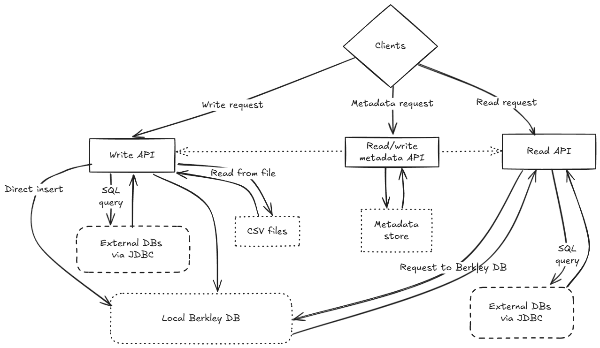
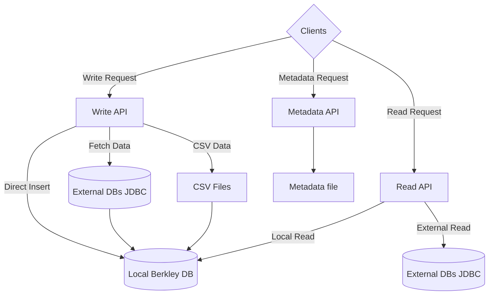
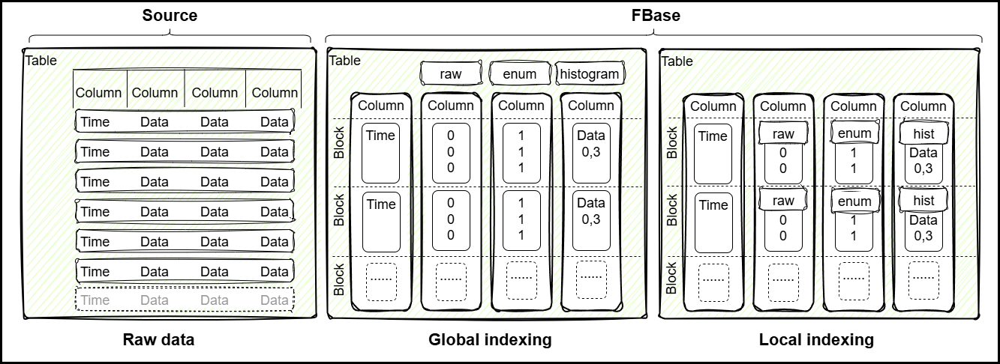
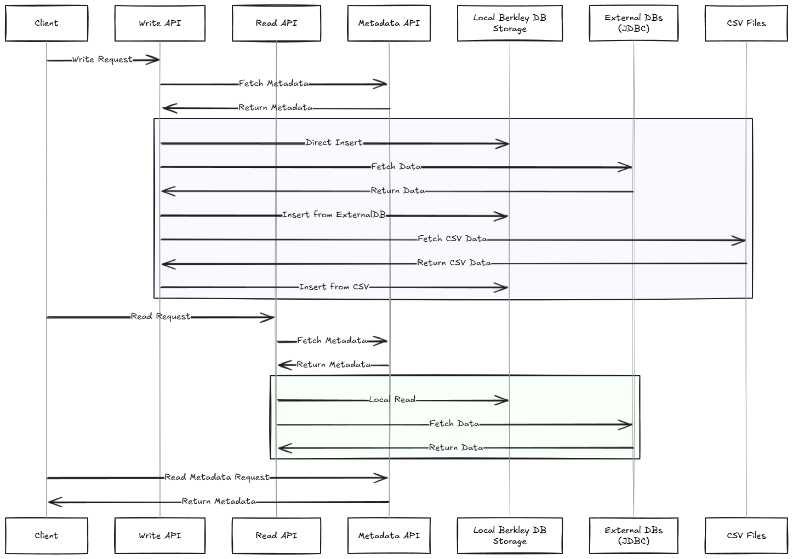
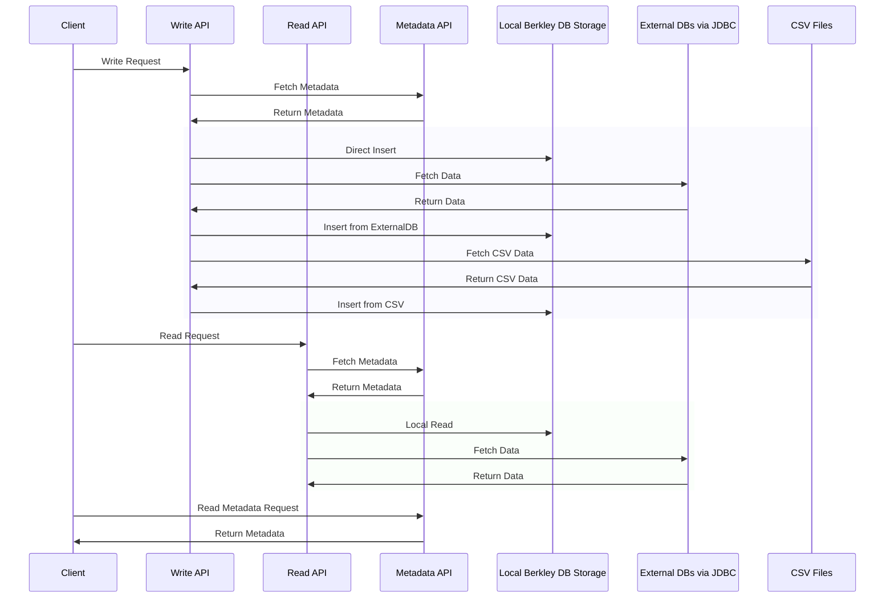

# FBase


Hybrid time-series column storage database engine written in Java

## Contents

- [Program Description](#program-description)
  - [General Information](#general-information)
  - [Application Areas](#application-areas)
  - [Minimum Technical Requirements](#minimum-technical-requirements)
  - [Getting Started with the Project](#getting-started-with-the-project)
    - [Building the Project](#building-the-project)
    - [Using the Project](#using-the-project)
    - [Prepare the environment to run unit tests](#prepare-the-environment-to-run-unit-tests)
    - [Prepare the environment to run integration tests](#prepare-the-environment-to-run-integration-tests)
      - [PostgreSQL](#postgresql)
      - [Oracle](#oracle)
      - [MS SQL](#ms-sql)
      - [Clickhouse](#clickhouse)
      - [Loading test data into Clickhouse](#loading-test-data-into-clickhouse)
  - [Description of the logical structure](#description-of-the-logical-structure)
  - [DB architecture](#db-architecture)
    - [Data storage format](#data-storage-format)
  - [Algorithms](#algorithms)
    - [DB initialization algorithm](#db-initialization-algorithm)
  - [Program API](#program-api)
    - [API sequence diagram](#api-sequence-diagram)
    - [Used methods](#used-methods)
      - [FStore interface](#fstore-interface)
      - [FBase class](#fbase-class)
      - [Parameters](#parameters)
        - [Table type - enum TType](#table-type---enum-ttype)
        - [Table indexing type - enum IType](#table-indexing-type---enum-itype)
        - [Table backend type - enum BType](#table-backend-type---enum-btype)
        - [Data grouping function type - enum GroupFunction](#data-grouping-function-type---enum-groupfunction)
        - [Table column storage parameters - CSType class](#table-column-storage-parameters---cstype-class)
          - [Data storage type - enum SType](#data-storage-type---enum-stype)
          - [Java data storage type - enum CType](#java-data-storage-type---enum-ctype)
          - [JDBC/CSV data storage type - enum DataType](#jdbccsv-data-storage-type---enum-datatype)
      - [Input parameters](#input-parameters)
        - [DB settings - FBaseConfig class](#db-settings---fbaseconfig-class)
        - [SProfile table settings](#sprofile-table-settings)
      - [Output parameters](#output-parameters)
        - [Table settings - TProfile class](#table-settings---tprofile-class)
        - [Table column settings - CProfile class](#table-column-settings---cprofile-class)
        - [Object to get data aggregates from stacked API - StackedColumn class](#object-to-get-data-aggregates-from-stacked-api---stackedcolumn-class)
        - [Object to get data aggregates from gantt API - class GanttColumn](#object-to-get-data-aggregates-from-the-gantt-api---the-ganttcolumn-class)
    - [Code use cases](#code-use-cases)
      - [Load table metadata](#load-table-metadata)
      - [Load table metadata directly](#load-table-metadata-directly)
      - [Load metadata via JDBC](#load-metadata-via-jdbc)
      - [Load metadata from CSV file](#load-metadata-from-csv-file)
      - [Load data into table directly](#load-data-into-table-directly)
      - [Load data into table from JDBC ResultSet](#load-data-into-a-table-from-a-jdbc-resultset)
      - [Load data into table from JDBC ResultSet in batch mode](#load-data-into-table-from-jdbc-resultset-in-batch-mode)
      - [Get a list of grouped data by column](#get-a-list-of-grouped-data-by-column)
        - [Example for COUNT grouping function using Stacked API and SQL](#example-for-count-grouping-function-using-stacked-api-and-sql)
        - [Example for SUM and AVG grouping function using Stacked API and SQL](#example-for-sum-and-avg-grouping-function-using-stacked-api-and-sql)
      - [Get a list of grouped data by column with filter](#get-a-list-of-grouped-data-by-a-column-with-a-filter)
        - [Example with filter for COUNT grouping function using Stacked API and SQL](#example-with-filter-for-count-grouping-function-using-stacked-api-and-sql)
      - [Get a list of data with two-level grouping](#get-a-list-of-data-with-two-level-grouping)
        - [Example of two-level grouping using Gantt API and SQL](#example-of-two-level-grouping-using-gantt-api-and-sql)
      - [Get raw data by column](#get-raw-data-by-column)
      - [Get raw data by table](#get-raw-data-for-table)
      - [Get raw data for table with filter](#get-raw-data-for-table-with-filter)
        - [Example to get raw data for all table columns with filter using Raw API and SQL](#example-to-get-raw-data-for-all-table-columns-with-filter-using-raw-api-and-sql)
      - [Get raw data for regular tables using BatchResultSet](#get-raw-data-for-regular-tables-using-batchresultset)
      - [Get raw data for time-series tables in time range using BatchResultSet](#get-raw-data-for-time-series-tables-in-a-time-range-using-batchresultset)
      - [Get latest timestamp from table](#get-latest-timestamp-from-table)
      - [Synchronize data with Berkley DB persistent storage](#synchronize-data-with-berkley-db-persistent-storage)
        - [Example of implementation of syncBackendDb FBase API call for Berkley DB backend](#example-of-implementation-of-the-syncbackenddb-fbase-api-call-for-the-berkley-db-backend)
      - [Close Berkley DB persistent storage](#close-berkley-db-persistent-storage)
        - [Example of implementation of the closeBackendDb FBase API call for the Berkley DB backend](#example-of-implementation-of-the-closebackenddb-fbase-api-call-for-the-berkley-db-backend)
- [Download](#download)
- [Development](#development)
- [Documentation](#documentation)
- [License](#license)
- [Support](#support)
- [Contact](#contact)

## Program Description

### General Information
FBase is a hybrid columnar database for storing time series data. Written in the Java programming language.

Key Features:
- Columnar data storage format;
- Storage of time series data;
- Storage format with built-in support for data deduplication and compression;
- Setting the storage format at the table and block level;
- Automatic selection of the deduplication algorithm based on the collected data;
- Use of the Berkley DB database as a backend for local storage;
- Support for basic JDBC data types for PostgreSQL, Oracle, MS SQL and ClickHouse databases;
- In read-only mode, automatic generation of SQL queries to tables with time series data;

[Return to Contents](#contents)

### Application areas
The library can be used as a lightweight analytical database for backend data processing systems on the Java platform to solve the following application problems;
- storing collected data and analytical processing of small and medium amounts of data for various embedded Java applications;
- storing and processing Internet of Things (IoT) data on the devices themselves as temporary storage, cache, and other tasks related to local data processing;
- metadata storage for querying external data sources using automatic SQL generation based on the data model for analytical applications.

[Return to Contents](#contents)

## Minimum technical requirements
**FBase** is compatible with Java 21+ and comes with a small set of dependencies.

### Hardware requirements

Table 1. Hardware requirements

| Parameter        | Description                                                                                                                        |
|:-----------------|:-----------------------------------------------------------------------------------------------------------------------------------|
| CPU and RAM      | Processor with a frequency of at least 500 MHz and a memory capacity of at least 250 MB, depending on the volume of processed data |
| CPU architecture | Intel 64-bit (x86_64), AMD 64-bit (x86_64), Arm 64-bit (aarch64)                                                                   |
| Disk             | Disk size depending on the volume of processed data                                                                                |

### Software requirements

Table 2. Software requirements

| Software | Requirements             |
|:---------|:-------------------------|
| Java     | Java version 21+         |
| Maven    | Not lower than version 3 |
| Git      | Latest current version   |

### Operating system requirements

Table 3. Operating system requirements

| Software         | Requirements          |
|:-----------------|:----------------------|
| Operating system | Windows, Linux, MacOS |

[Return to Contents](#contents)

### Getting started with the project

#### Building the project
Make sure you have JDK 21+, Maven and the latest Git
  ```shell
    java -version
    mvn -version
    git --version
  ```

Download the FBase repository sources:
  ```shell
    git clone <<url>>
    cd fbase
  ```

To compile the project sources, run:
  ```shell
    mvn clean compile
  ```

To run unit tests, run:
  ```shell
    mvn clean test
  ```

To build the project into a **FBase** jar file, run:
  ```shell
    mvn clean package
  ```

To build and install the **FBase** jar file into your local Maven repository, run:
  ```shell
    mvn clean install
  ```

Notes:
- Running project build includes execution of unit tests, which take about 7-8 minutes.
- This is mainly the execution time of tests from the **FBaseRunnerTest** class, in which various configurations for 45 tests are launched.
- Information on tests from **FBaseRunnerTest** is presented in the table:

Table 4. Parameters and statistics for **FBaseRunnerTest** tests

| Test name              | PermutationState | Number of configurations | Total tests | Execution time |
|------------------------|------------------|--------------------------|-------------|----------------|
| testPermutationNone    | NONE             | 36                       | 1 620       | ~ 3 seconds    |
| testPermutationPartial | PARTIAL          | 648                      | 29 160      | ~ 30 seconds   |
| testPermutationAll     | ALL              | 8748                     | 393 660     | ~ 6-7 minutes  |

- To reduce the time of building and installing the project, you can disable the launch of all tests from this class using the **-Dtest=!FBaseRunnerTest** switch or use the **@Disabled** annotation for a class or method
```shell
mvn clean test -Dtest=!FBaseRunnerTest
mvn clean package -Dtest=!FBaseRunnerTest
mvn clean install -Dtest=!FBaseRunnerTest
```

[Return to Contents](#contents)

#### Using the project
To use the **FBase** database in a Java application, you need to add the jar file as a dependency to the Maven pom.xml settings file

Add the **FBase** jar file as a dependency to your project's pom.xml settings file:
```xml
<?xml version="1.0" encoding="UTF-8"?>
<project>
  <properties>
    <fbase-version>1.0.0</fbase-version>
  </properties>
  <!--.....-->
  <!--.....-->
  <!--.....-->
  <dependencies>
    <dependency>
      <groupId>ru.real-time-intelligence</groupId>
      <artifactId>fbase</artifactId>
      <version>{fbase-version}</version>
    </dependency>
  </dependencies>
</project>
```

Notes:
- The library is published on [Maven Central](https://central.sonatype.com/artifact/ru.real-time-intelligence/fbase/);
- To build and install the latest current version of the **FBase** library in the local Maven repository, download the application source codes and run:
```shell
mvn clean install
```
Details on building and installing the project are described in the [Building the project](#building-the-project) section
- You can find a full list of FBase use cases in your application in the [Code use cases](#code-use-cases) section.

[Return to Contents](#contents)

#### Prepare the environment to run unit tests
To run unit tests, you need to follow the steps to build the project from the [Building the project](#building-the-project) section

[Return to Contents](#contents)

#### Prepare the environment to run integration tests
Preparing the environment to run integration tests requires a local database installation using Docker Desktop

Instructions for installing Docker Desktop for [Windows](https://docs.docker.com/desktop/install/windows-install/) and [Linux](https://docs.docker.com/desktop/install/linux/)

[Return to Contents](#contents)

##### PostgreSQL
Install and run a container with PostgreSQL DB
  ```shell
  docker run -d --name db \
  -e 'POSTGRES_PASSWORD=postgres' \
  -p 5432:5432 \
  -v pgdata:/var/lib/postgresql/data \
  postgres \
  postgres -c 'max_connections=200'
  ```

[Return to Contents](#contents)

##### Oracle
- Install locally [repository](https://github.com/oracle/docker-images) of scripts for installing Oracle DB
- Download the DB distribution from the [Oracle](https://www.oracle.com/database/technologies/oracle19c-linux-downloads.html) website. For the Linux x86 platform and DB version 19.3, copy the LINUX.X64_193000_db_home.zip file to the local directory of the OracleDatabase/SingleInstance/dockerfiles/19.3.0 script repository
- Run the buildContainerImage.sh script from the script repository and specify the parameters (example for DB version 19.3.0)
  ```shell
  OracleDatabase/SingleInstance/dockerfiles/buildContainerImage.sh -v 19.3.0 -e -i
  ```
- Install and run a container with an Oracle DB instance from the command line (example of running the Docker run command for DB version 19.3.0)
  ```shell
  docker run --name database19ee \
  -p 1523:1521 -p 5522:5500 -e \
  ORACLE_SID=orcl -e ORACLE_PDB=pdb_orcl -e ORACLE_PWD=sys \
  -e ORACLE_CHARACTERSET=AL32UTF8 \
  -v /opt/oracle/oradata oracle/database:19.3.0-ee
  ```

[Return to Contents](#contents)

##### MS SQL
Install and run container with MS SQL DB
  ```shell
  docker run -e 'ACCEPT_EULA=Y' \
  -e 'SA_PASSWORD=QOEfSsa51234!' \
  -p 1433:1433 \
  -v |(pwd)/drive:/var/opt/mssql/data \
  --name mssql \
  mcr.microsoft.com/mssql/server
  ```

[Return to Contents](#contents)

##### Clickhouse
Install and run container with Clickhouse DB
  ```shell
  docker run -d --name clickhouse-server \
  -e CLICKHOUSE_USER=admin -e CLICKHOUSE_DEFAULT_ACCESS_MANAGEMENT=1 -e CLICKHOUSE_PASSWORD=admin \
  -p 8123:8123 -p 9000:9000 \
  -v C:\clickhouse:/var/lib/clickhouse clickhouse/clickhouse-server
  ```

[Return to Contents](#contents)

##### Loading test data into Clickhouse
- Install [Clickhouse](#clickhouse) locally and check the connection to ClickHouse on a local PC using the URL **"jdbc:clickhouse://localhost:8123"** or use another connection string and make changes to the tests;
- Load test data [New York taxi orders](https://clickhouse.com/docs/en/getting-started/example-datasets/nyc-taxi#download-of-prepared-partitions) into a local ClickHouse instance (the format of pre-prepared partitions loaded into the datasets schema is used);
- Check that the data has loaded `clickhouse-client --query "select count(*) from datasets.trips_mergetree"`;
- Create a directory for local storage of **FBase** data (example for Windows) **"C:\\Users\\.temp"**;
- Load test data into the local **FBase** database using any of the methods in **FBaseCHLoadDataTest** marked with the @Test annotation;
– Run integration tests in **FBaseCHQueryGanttTest**, **FBaseCHQueryStackedTest** or **FBaseCHQueryRawTest** which are marked with the @Test annotation.

Notes:
- Integration tests use the **@Disabled** annotation to disable them when running FBase unit tests, if necessary, it should be removed for correct data loading and testing.
- Test data from the trips_mergetree table is loaded into the datasets schema
  ```
  CREATE DATABASE datasets;
  ```
- Trips_mergetree table definition

<details>
  <summary>CREATE TABLE trips_mergetree</summary>

```
    CREATE TABLE trips_mergetree (
      trip_id UInt32,
      vendor_id Enum8('1' = 1, '2' = 2, 'CMT' = 3, 'VTS' = 4, 'DDS' = 5, 'B02512' = 10, 'B02598' = 11, 'B02617' = 12, 'B02682' = 13, 'B02764' = 14),
      pickup_date Date,
      pickup_datetime DateTime,
      dropoff_date Date,
      dropoff_datetime DateTime,
      store_and_fwd_flag UInt8,
      rate_code_id UInt8,
      pickup_longitude Float64,
      pickup_latitude Float64,
      dropoff_longitude Float64,
      dropoff_latitude Float64,
      passenger_count UInt8,
      trip_distance Float64,
      fare_amount Float32,
      extra Float32,
      mta_tax Float32,
      tip_amount Float32,
      tolls_amount Float32,
      ehail_fee Float32,
      improvement_surcharge Float32,
      total_amount Float32,
      payment_type_ Enum8('UNK' = 0, 'CSH' = 1, 'CRE' = 2, 'NOC' = 3, 'DIS' = 4),
      trip_type UInt8,
      pickup FixedString(25),
      dropoff FixedString(25),
      cab_type Enum8('yellow' = 1, 'green' = 2, 'uber' = 3),
      pickup_nyct2010_gid UInt8,
      pickup_ctlabel Float32,
      pickup_borocode UInt8,
      pickup_boroname Enum8('' = 0, 'Manhattan' = 1, 'Bronx' = 2, 'Brooklyn' = 3, 'Queens' = 4, 'Staten Island' = 5),
      pickup_ct2010 FixedString(6),
      pickup_boroct2010 FixedString(7),
      pickup_cdeligibil Enum8(' ' = 0, 'E' = 1, 'I' = 2),
      pickup_ntacode FixedString(4),
      pickup_ntaname Enum16('' = 0, 'Airport' = 1, 'Allerton-Pelham Gardens' = 2, 'Annadale-Huguenot-Prince\'s Bay-Eltingville' = 3, 'Arden Heights' = 4, 'Astoria' = 5, 'Auburndale' = 6, 'Baisley Park' = 7, 'Bath Beach' = 8, 'Battery Park City-Lower Manhattan' = 9, 'Bay Ridge' = 10, 'Bayside-Bayside Hills' = 11, 'Bedford' = 12, 'Bedford Park-Fordham North' = 13, 'Bellerose' = 14, 'Belmont' = 15, 'Bensonhurst East' = 16, 'Bensonhurst West' = 17, 'Borough Park' = 18, 'Breezy Point-Belle Harbor-Rockaway Park-Broad Channel' = 19, 'Briarwood-Jamaica Hills' = 20, 'Brighton Beach' = 21, 'Bronxdale' = 22, 'Brooklyn Heights-Cobble Hill' = 23, 'Brownsville' = 24, 'Bushwick North' = 25, 'Bushwick South' = 26, 'Cambria Heights' = 27, 'Canarsie' = 28, 'Carroll Gardens-Columbia Street-Red Hook' = 29, 'Central Harlem North-Polo Grounds' = 30, 'Central Harlem South' = 31, 'Charleston-Richmond Valley-Tottenville' = 32, 'Chinatown' = 33, 'Claremont-Bathgate' = 34, 'Clinton' = 35, 'Clinton Hill' = 36, 'Co-op City' = 37, 'College Point' = 38, 'Corona' = 39, 'Crotona Park East' = 40, 'Crown Heights North' = 41, 'Crown Heights South' = 42, 'Cypress Hills-City Line' = 43, 'DUMBO-Vinegar Hill-Downtown Brooklyn-Boerum Hill' = 44, 'Douglas Manor-Douglaston-Little Neck' = 45, 'Dyker Heights' = 46, 'East Concourse-Concourse Village' = 47, 'East Elmhurst' = 48, 'East Flatbush-Farragut' = 49, 'East Flushing' = 50, 'East Harlem North' = 51, 'East Harlem South' = 52, 'East New York' = 53, 'East New York (Pennsylvania Ave)' = 54, 'East Tremont' = 55, 'East Village' = 56, 'East Williamsburg' = 57, 'Eastchester-Edenwald-Baychester' = 58, 'Elmhurst' = 59, 'Elmhurst-Maspeth' = 60, 'Erasmus' = 61, 'Far Rockaway-Bayswater' = 62, 'Flatbush' = 63, 'Flatlands' = 64, 'Flushing' = 65, 'Fordham South' = 66, 'Forest Hills' = 67, 'Fort Greene' = 68, 'Fresh Meadows-Utopia' = 69, 'Ft. Totten-Bay Terrace-Clearview' = 70, 'Georgetown-Marine Park-Bergen Beach-Mill Basin' = 71, 'Glen Oaks-Floral Park-New Hyde Park' = 72, 'Glendale' = 73, 'Gramercy' = 74, 'Grasmere-Arrochar-Ft. Wadsworth' = 75, 'Gravesend' = 76, 'Great Kills' = 77, 'Greenpoint' = 78, 'Grymes Hill-Clifton-Fox Hills' = 79, 'Hamilton Heights' = 80, 'Hammels-Arverne-Edgemere' = 81, 'Highbridge' = 82, 'Hollis' = 83, 'Homecrest' = 84, 'Hudson Yards-Chelsea-Flatiron-Union Square' = 85, 'Hunters Point-Sunnyside-West Maspeth' = 86, 'Hunts Point' = 87, 'Jackson Heights' = 88, 'Jamaica' = 89, 'Jamaica Estates-Holliswood' = 90, 'Kensington-Ocean Parkway' = 91, 'Kew Gardens' = 92, 'Kew Gardens Hills' = 93, 'Kingsbridge Heights' = 94, 'Laurelton' = 95, 'Lenox Hill-Roosevelt Island' = 96, 'Lincoln Square' = 97, 'Lindenwood-Howard Beach' = 98, 'Longwood' = 99, 'Lower East Side' = 100, 'Madison' = 101, 'Manhattanville' = 102, 'Marble Hill-Inwood' = 103, 'Mariner\'s Harbor-Arlington-Port Ivory-Graniteville' = 104, 'Maspeth' = 105, 'Melrose South-Mott Haven North' = 106, 'Middle Village' = 107, 'Midtown-Midtown South' = 108, 'Midwood' = 109, 'Morningside Heights' = 110, 'Morrisania-Melrose' = 111, 'Mott Haven-Port Morris' = 112, 'Mount Hope' = 113, 'Murray Hill' = 114, 'Murray Hill-Kips Bay' = 115, 'New Brighton-Silver Lake' = 116, 'New Dorp-Midland Beach' = 117, 'New Springville-Bloomfield-Travis' = 118, 'North Corona' = 119, 'North Riverdale-Fieldston-Riverdale' = 120, 'North Side-South Side' = 121, 'Norwood' = 122, 'Oakland Gardens' = 123, 'Oakwood-Oakwood Beach' = 124, 'Ocean Hill' = 125, 'Ocean Parkway South' = 126, 'Old Astoria' = 127, 'Old Town-Dongan Hills-South Beach' = 128, 'Ozone Park' = 129, 'Park Slope-Gowanus' = 130, 'Parkchester' = 131, 'Pelham Bay-Country Club-City Island' = 132, 'Pelham Parkway' = 133, 'Pomonok-Flushing Heights-Hillcrest' = 134, 'Port Richmond' = 135, 'Prospect Heights' = 136, 'Prospect Lefferts Gardens-Wingate' = 137, 'Queens Village' = 138, 'Queensboro Hill' = 139, 'Queensbridge-Ravenswood-Long Island City' = 140, 'Rego Park' = 141, 'Richmond Hill' = 142, 'Ridgewood' = 143, 'Rikers Island' = 144, 'Rosedale' = 145, 'Rossville-Woodrow' = 146, 'Rugby-Remsen Village' = 147, 'Schuylerville-Throgs Neck-Edgewater Park' = 148, 'Seagate-Coney Island' = 149, 'Sheepshead Bay-Gerritsen Beach-Manhattan Beach' = 150, 'SoHo-TriBeCa-Civic Center-Little Italy' = 151, 'Soundview-Bruckner' = 152, 'Soundview-Castle Hill-Clason Point-Harding Park' = 153, 'South Jamaica' = 154, 'South Ozone Park' = 155, 'Springfield Gardens North' = 156, 'Springfield Gardens South-Brookville' = 157, 'Spuyten Duyvil-Kingsbridge' = 158, 'St. Albans' = 159, 'Stapleton-Rosebank' = 160, 'Starrett City' = 161, 'Steinway' = 162, 'Stuyvesant Heights' = 163, 'Stuyvesant Town-Cooper Village' = 164, 'Sunset Park East' = 165, 'Sunset Park West' = 166, 'Todt Hill-Emerson Hill-Heartland Village-Lighthouse Hill' = 167, 'Turtle Bay-East Midtown' = 168, 'University Heights-Morris Heights' = 169, 'Upper East Side-Carnegie Hill' = 170, 'Upper West Side' = 171, 'Van Cortlandt Village' = 172, 'Van Nest-Morris Park-Westchester Square' = 173, 'Washington Heights North' = 174, 'Washington Heights South' = 175, 'West Brighton' = 176, 'West Concourse' = 177, 'West Farms-Bronx River' = 178, 'West New Brighton-New Brighton-St. George' = 179, 'West Village' = 180, 'Westchester-Unionport' = 181, 'Westerleigh' = 182, 'Whitestone' = 183, 'Williamsbridge-Olinville' = 184, 'Williamsburg' = 185, 'Windsor Terrace' = 186, 'Woodhaven' = 187, 'Woodlawn-Wakefield' = 188, 'Woodside' = 189, 'Yorkville' = 190, 'park-cemetery-etc-Bronx' = 191, 'park-cemetery-etc-Brooklyn' = 192, 'park-cemetery-etc-Manhattan' = 193, 'park-cemetery-etc-Queens' = 194, 'park-cemetery-etc-Staten Island' = 195),
      pickup_puma UInt16,
      dropoff_nyct2010_gid UInt8,
      dropoff_ctlabel Float32,
      dropoff_borocode UInt8,
      dropoff_boroname Enum8('' = 0, 'Manhattan' = 1, 'Bronx' = 2, 'Brooklyn' = 3, 'Queens' = 4, 'Staten Island' = 5),
      dropoff_ct2010 FixedString(6),
      dropoff_boroct2010 FixedString(7),
      dropoff_cdeligibil Enum8(' ' = 0, 'E' = 1, 'I' = 2),
      dropoff_ntacode FixedString(4),
      dropoff_ntaname Enum16('' = 0, 'Airport' = 1, 'Allerton-Pelham Gardens' = 2, 'Annadale-Huguenot-Prince\'s Bay-Eltingville' = 3, 'Arden Heights' = 4, 'Astoria' = 5, 'Auburndale' = 6, 'Baisley Park' = 7, 'Bath Beach' = 8, 'Battery Park City-Lower Manhattan' = 9, 'Bay Ridge' = 10, 'Bayside-Bayside Hills' = 11, 'Bedford' = 12, 'Bedford Park-Fordham North' = 13, 'Bellerose' = 14, 'Belmont' = 15, 'Bensonhurst East' = 16, 'Bensonhurst West' = 17, 'Borough Park' = 18, 'Breezy Point-Belle Harbor-Rockaway Park-Broad Channel' = 19, 'Briarwood-Jamaica Hills' = 20, 'Brighton Beach' = 21, 'Bronxdale' = 22, 'Brooklyn Heights-Cobble Hill' = 23, 'Brownsville' = 24, 'Bushwick North' = 25, 'Bushwick South' = 26, 'Cambria Heights' = 27, 'Canarsie' = 28, 'Carroll Gardens-Columbia Street-Red Hook' = 29, 'Central Harlem North-Polo Grounds' = 30, 'Central Harlem South' = 31, 'Charleston-Richmond Valley-Tottenville' = 32, 'Chinatown' = 33, 'Claremont-Bathgate' = 34, 'Clinton' = 35, 'Clinton Hill' = 36, 'Co-op City' = 37, 'College Point' = 38, 'Corona' = 39, 'Crotona Park East' = 40, 'Crown Heights North' = 41, 'Crown Heights South' = 42, 'Cypress Hills-City Line' = 43, 'DUMBO-Vinegar Hill-Downtown Brooklyn-Boerum Hill' = 44, 'Douglas Manor-Douglaston-Little Neck' = 45, 'Dyker Heights' = 46, 'East Concourse-Concourse Village' = 47, 'East Elmhurst' = 48, 'East Flatbush-Farragut' = 49, 'East Flushing' = 50, 'East Harlem North' = 51, 'East Harlem South' = 52, 'East New York' = 53, 'East New York (Pennsylvania Ave)' = 54, 'East Tremont' = 55, 'East Village' = 56, 'East Williamsburg' = 57, 'Eastchester-Edenwald-Baychester' = 58, 'Elmhurst' = 59, 'Elmhurst-Maspeth' = 60, 'Erasmus' = 61, 'Far Rockaway-Bayswater' = 62, 'Flatbush' = 63, 'Flatlands' = 64, 'Flushing' = 65, 'Fordham South' = 66, 'Forest Hills' = 67, 'Fort Greene' = 68, 'Fresh Meadows-Utopia' = 69, 'Ft. Totten-Bay Terrace-Clearview' = 70, 'Georgetown-Marine Park-Bergen Beach-Mill Basin' = 71, 'Glen Oaks-Floral Park-New Hyde Park' = 72, 'Glendale' = 73, 'Gramercy' = 74, 'Grasmere-Arrochar-Ft. Wadsworth' = 75, 'Gravesend' = 76, 'Great Kills' = 77, 'Greenpoint' = 78, 'Grymes Hill-Clifton-Fox Hills' = 79, 'Hamilton Heights' = 80, 'Hammels-Arverne-Edgemere' = 81, 'Highbridge' = 82, 'Hollis' = 83, 'Homecrest' = 84, 'Hudson Yards-Chelsea-Flatiron-Union Square' = 85, 'Hunters Point-Sunnyside-West Maspeth' = 86, 'Hunts Point' = 87, 'Jackson Heights' = 88, 'Jamaica' = 89, 'Jamaica Estates-Holliswood' = 90, 'Kensington-Ocean Parkway' = 91, 'Kew Gardens' = 92, 'Kew Gardens Hills' = 93, 'Kingsbridge Heights' = 94, 'Laurelton' = 95, 'Lenox Hill-Roosevelt Island' = 96, 'Lincoln Square' = 97, 'Lindenwood-Howard Beach' = 98, 'Longwood' = 99, 'Lower East Side' = 100, 'Madison' = 101, 'Manhattanville' = 102, 'Marble Hill-Inwood' = 103, 'Mariner\'s Harbor-Arlington-Port Ivory-Graniteville' = 104, 'Maspeth' = 105, 'Melrose South-Mott Haven North' = 106, 'Middle Village' = 107, 'Midtown-Midtown South' = 108, 'Midwood' = 109, 'Morningside Heights' = 110, 'Morrisania-Melrose' = 111, 'Mott Haven-Port Morris' = 112, 'Mount Hope' = 113, 'Murray Hill' = 114, 'Murray Hill-Kips Bay' = 115, 'New Brighton-Silver Lake' = 116, 'New Dorp-Midland Beach' = 117, 'New Springville-Bloomfield-Travis' = 118, 'North Corona' = 119, 'North Riverdale-Fieldston-Riverdale' = 120, 'North Side-South Side' = 121, 'Norwood' = 122, 'Oakland Gardens' = 123, 'Oakwood-Oakwood Beach' = 124, 'Ocean Hill' = 125, 'Ocean Parkway South' = 126, 'Old Astoria' = 127, 'Old Town-Dongan Hills-South Beach' = 128, 'Ozone Park' = 129, 'Park Slope-Gowanus' = 130, 'Parkchester' = 131, 'Pelham Bay-Country Club-City Island' = 132, 'Pelham Parkway' = 133, 'Pomonok-Flushing Heights-Hillcrest' = 134, 'Port Richmond' = 135, 'Prospect Heights' = 136, 'Prospect Lefferts Gardens-Wingate' = 137, 'Queens Village' = 138, 'Queensboro Hill' = 139, 'Queensbridge-Ravenswood-Long Island City' = 140, 'Rego Park' = 141, 'Richmond Hill' = 142, 'Ridgewood' = 143, 'Rikers Island' = 144, 'Rosedale' = 145, 'Rossville-Woodrow' = 146, 'Rugby-Remsen Village' = 147, 'Schuylerville-Throgs Neck-Edgewater Park' = 148, 'Seagate-Coney Island' = 149, 'Sheepshead Bay-Gerritsen Beach-Manhattan Beach' = 150, 'SoHo-TriBeCa-Civic Center-Little Italy' = 151, 'Soundview-Bruckner' = 152, 'Soundview-Castle Hill-Clason Point-Harding Park' = 153, 'South Jamaica' = 154, 'South Ozone Park' = 155, 'Springfield Gardens North' = 156, 'Springfield Gardens South-Brookville' = 157, 'Spuyten Duyvil-Kingsbridge' = 158, 'St. Albans' = 159, 'Stapleton-Rosebank' = 160, 'Starrett City' = 161, 'Steinway' = 162, 'Stuyvesant Heights' = 163, 'Stuyvesant Town-Cooper Village' = 164, 'Sunset Park East' = 165, 'Sunset Park West' = 166, 'Todt Hill-Emerson Hill-Heartland Village-Lighthouse Hill' = 167, 'Turtle Bay-East Midtown' = 168, 'University Heights-Morris Heights' = 169, 'Upper East Side-Carnegie Hill' = 170, 'Upper West Side' = 171, 'Van Cortlandt Village' = 172, 'Van Nest-Morris Park-Westchester Square' = 173, 'Washington Heights North' = 174, 'Washington Heights South' = 175, 'West Brighton' = 176, 'West Concourse' = 177, 'West Farms-Bronx River' = 178, 'West New Brighton-New Brighton-St. George' = 179, 'West Village' = 180, 'Westchester-Unionport' = 181, 'Westerleigh' = 182, 'Whitestone' = 183, 'Williamsbridge-Olinville' = 184, 'Williamsburg' = 185, 'Windsor Terrace' = 186, 'Woodhaven' = 187, 'Woodlawn-Wakefield' = 188, 'Woodside' = 189, 'Yorkville' = 190, 'park-cemetery-etc-Bronx' = 191, 'park-cemetery-etc-Brooklyn' = 192, 'park-cemetery-etc-Manhattan' = 193, 'park-cemetery-etc-Queens' = 194, 'park-cemetery-etc-Staten Island' = 195),
      dropoff_puma UInt16
    ) ENGINE = MergeTree() ORDER BY (pickup_date, pickup_datetime);
```
</details>

[Return to Contents](#contents)

### Description of the logical structure

#### DB architecture


<details>
  <summary>Mermaid flow chart</summary>


</details>

[Return to Contents](#contents)

##### Data storage format


Three data storage formats are supported:
- **RAW** - when data is stored as a key of the Java type **int** for string data and a suitable Java type for the rest (numeric, special, etc.);
- **ENUM** - when data is stored as a key of the Java type **byte** value;
- **HISTOGRAM** - when the start and end index of repeating data from the range and the value itself are stored.

Metadata of the storage format, indexing type and compression are stored in the block header.

[Return to Contents](#contents)

#### Algorithms
The main methods of the FBase Java API are located in the **FStore** interface.
Access to **FStore** must be obtained after initialization of the FBase DB by calling the constructor of the **FBase** class, examples are presented in the [DB initialization algorithm](#DB-initialization-algorithm) section.

A complete list of methods of the main classes and interfaces with input and output parameters is posted in the [Used methods](#used-methods) section.

##### DB initialization algorithm
1. Define a local directory for storing FBase DB settings;
2. Create the FBase DB configuration **FBaseConfig**;
3. Initialize the backend DB;
4. Initialize the FBase DB by calling the constructor from the **FBase** class;
5. Get a reference to the **FStore** interface from the **FBase** class to access the FBase DB Java API.

Example of DB initialization for Berkley DB backend
```
@TempDir
static File databaseDir;
...
FBaseConfig fBaseConfig = new FBaseConfig().setConfigDirectory(databaseDir.getAbsolutePath());
BerkleyDB berkleyDB = new BerkleyDB(databaseDir.getAbsolutePath(), true);
FBase fBase = new FBase(fBaseConfig, berkleyDB.getStore());
FStore fStore = fBase.getFStore();
```

Example of DB initialization for ClickHouse backend 
```
@TempDir
static File databaseDir;
...
BType bType = BType.CLICKHOUSE;
String driverClassName = "com.clickhouse.jdbc.ClickHouseDriver";
String dbUrl = "jdbc:clickhouse://localhost:8123";

SqlDB sqlDB = new SqlDB(bType, driverClassName, dbUrl, "admin", "admin");
BasicDataSource basicDataSource = sqlDB.getDatasource();
FBaseConfig fBaseConfig = new FBaseConfig().setConfigDirectory(databaseDir.getAbsolutePath());

FBase fBase = new FBase(fBaseConfig, bType, basicDataSource);
FStore fStore = fBase.getFStore();
```

Notes:
- The temporary directory **databaseDir** is created automatically using the **@TempDir** annotation of the JUnit library;
- For the example with the Berkley DB backend, FBase settings and backend data are located in the same temporary directory **databaseDir**;
- Code examples are taken from unit and integration tests.

[Return to Contents](#contents)

#### Program API

**FBase** offers advanced capabilities for interacting with the database through a set of methods capable of performing various data storage and retrieval tasks. These APIs are specifically designed to provide flexibility and optimal work with time series data in a Java environment for both locally stored data and external data storage systems with an SQL interface.

- **Main API**. The main functions for working with data are built into the **FStore** interface, which provides standardized access to write and read methods. **FStore** is a key element of the **FBase** architecture, providing an interface point for interacting with the database for client applications.

- **Writing data**. Several approaches are supported for writing information to the FBase database:

  - **Direct** - inserting data into a local database using an intermediate Java table-type data structure.
  - **JDBC** — insert data into a local database using data received from an external data source via JDBC, which allows integration with other systems that can work with JDBC.
  - **JDBC Batch** — batch loading into a local database using data received from an external data source via JDBC, minimizing the number of transactions for large-scale insertion.
  - **CSV Batch** — batch loading from CSV files, for transferring large amounts of data from files to a local database (experimental).

- **Reading data**. The process of extracting data from **FBase** uses APIs, each of which is optimized for the corresponding types of queries:

  - **Stacked** — retrieving data based on aggregation functions such as COUNT SUM and AVG, obtaining information on the distribution of data by selected attributes and parameters.
  - **Gantt** — complex distribution calculation using COUNT aggregation at two levels, which is useful for analyzing dependencies and relationships between different indicators.
  - **Raw** — extracting source data in tabular format to view detailed information on the entire array of collected data.
  - **BatchResultSet** — extracting source data in tabular format with row-by-row access to get only part of the rows from the result set in the DB.

- **Loading metadata**. To work with external data sources, you need to perform queries to sources via JDBC, CSV files and Java table structures. To store information on tables and data types used for local storage and access to external data sources via JDBC, an API is used to load and view this information in a local FBase metadata storage file.

The APIs for writing data only work with the local Berkley DB key-value data storage. API methods for reading data can work with both local Berkley DB storage and external data sources via JDBC using automatic generation of SQL queries.

Table 5. Supported databases for working with API in FBase

| Item No. | FBase API support | Database             | Database type |
|----------|-------------------|----------------------|---------------|
| 1        | Read/Write        | Berkley DB           | key-value     |
| 2        | Read              | ClickHouse           | analytical    |
| 3        | Read              | Oracle               | relational    |
| 4        | Read              | PostgreSQL           | relational    |
| 5        | Read              | Microsoft SQL Server | relational    |
| 6        | Read              | CSV files            | file          |

Before you start writing data, you need to set storage parameters and metadata for tables and columns in the **SProfile** object.

The database table configuration allows you to switch between global and local indexing, and enable or disable data compression on the fly. This is achieved by placing storage type metadata in the block header for both indexing types and a flag to enable or disable compression.

[Return to Contents](#contents)

##### API Sequence Diagram



<details>
  <summary>Mermaid sequence diagram</summary>


</details>

[Return to Contents](#contents)

##### Used methods
- The **FStore** interface contains the main contracts and method signatures for interaction between the **FBase** database and client applications;
- Initialization of database objects occurs when calling the **FBase** class constructor;
- The reference to the **FStore** interface for accessing the application API is called from the **FBase** class object.

###### FStore interface

Table 6. List of APIs for working with the FBase database of the FStore interface

###### Interface FStore

Table 6. List of APIs for working with FBase database (FStore interface)

| #  | Method Name             | API Type | Description                                  | Input Parameters                                                                                                                                                      | Output Parameters         |
|----|-------------------------|----------|----------------------------------------------|-----------------------------------------------------------------------------------------------------------------------------------------------------------------------|---------------------------|
| 1  | getTProfile             | Metadata | Get table metadata by name                   | String tableName                                                                                                                                                      | TProfile                  |
| 2  | loadDirectTableMetadata | Metadata | Load metadata from SProfile                  | SProfile sProfile                                                                                                                                                     | TProfile                  |
| 3  | loadJdbcTableMetadata   | Metadata | Load metadata via JDBC connection with query | Connection connection, String query, SProfile sProfile                                                                                                                | TProfile                  |
| 4  | loadJdbcTableMetadata   | Metadata | Load metadata via JDBC (schema and table)    | Connection connection, String sqlSchemaName, String sqlTableName, SProfile sProfile                                                                                   | TProfile                  |
| 5  | loadCsvTableMetadata    | Metadata | Load metadata from CSV file                  | String fileName, String csvSplitBy, SProfile sProfile                                                                                                                 | TProfile                  |
| 6  | setTimestampColumn      | Metadata | Set timestamp column                         | String tableName, String timestampColumnName                                                                                                                          | void                      |
| 7  | putDataDirect           | Write    | Save data using Java structure               | String tableName, List<List<Object>> data                                                                                                                             | void                      |
| 8  | putDataJdbc             | Write    | Save data from JDBC ResultSet                | String tableName, ResultSet resultSet                                                                                                                                 | long (last row timestamp) |
| 9  | putDataJdbcBatch        | Write    | Batch save from JDBC ResultSet               | String tableName, ResultSet resultSet, Integer fBaseBatchSize                                                                                                         | void                      |
| 10 | putDataCsvBatch         | Write    | Batch save from CSV file                     | String tableName, String fileName, String csvSplitBy, Integer fBaseBatchSize                                                                                          | void                      |
| 11 | getBlockKeyTailList     | Read     | Get blocks with keys and ranges              | String tableName, long begin, long end                                                                                                                                | List<BlockKeyTail>        |
| 12 | getStacked              | Read     | Get aggregated data (COUNT/SUM/AVG)          | String tableName, CProfile cProfile, GroupFunction groupFunction, long begin, long end                                                                                | List<StackedColumn>       |
| 13 | getStacked              | Read     | Get aggregated data with filter              | String tableName, CProfile cProfile, GroupFunction groupFunction, CProfile cProfileFilter, String[] filterData, CompareFunction compareFunction, long begin, long end | List<StackedColumn>       |
| 14 | getGantt                | Read     | Two-level COUNT grouping (basic)             | String tableName, CProfile firstGrpBy, CProfile secondGrpBy, long begin, long end                                                                                     | List<GanttColumnCount>    |
| 15 | getGantt                | Read     | Two-level COUNT grouping (multithreaded)     | String tableName, CProfile firstGrpBy, CProfile secondGrpBy, int batchSize, long begin, long end                                                                      | List<GanttColumnCount>    |
| 16 | getGantt                | Read     | Two-level COUNT grouping with filter         | String tableName, CProfile firstGrpBy, CProfile secondGrpBy, CProfile cProfileFilter, String[] filterData, CompareFunction compareFunction, long begin, long end      | List<GanttColumnCount>    |
| 17 | getGanttSum             | Read     | Two-level SUM grouping (basic)               | String tableName, CProfile firstGrpBy, CProfile secondGrpBy, long begin, long end                                                                                     | List<GanttColumnSum>      |
| 18 | getGanttSum             | Read     | Two-level SUM grouping with filter           | String tableName, CProfile firstGrpBy, CProfile secondGrpBy, CProfile cProfileFilter, String[] filterData, CompareFunction compareFunction, long begin, long end      | List<GanttColumnSum>      |
| 19 | getDistinct             | Read     | Get distinct values (basic)                  | String tableName, CProfile cProfile, OrderBy orderBy, int limit, long begin, long end                                                                                 | List<String>              |
| 20 | getDistinct             | Read     | Get distinct values with filter              | String tableName, CProfile cProfile, OrderBy orderBy, int limit, long begin, long end, CProfile cProfileFilter, String[] filterData, CompareFunction compareFunction  | List<String>              |
| 21 | getRawDataAll           | Read     | Get raw data (all columns, no filter)        | String tableName, long begin, long end                                                                                                                                | List<List<Object>>        |
| 22 | getRawDataAll           | Read     | Get raw data (all columns, with filter)      | String tableName, CProfile cProfileFilter, String filter, long begin, long end                                                                                        | List<List<Object>>        |
| 23 | getRawDataByColumn      | Read     | Get raw data for specific column             | String tableName, CProfile cProfile, long begin, long end                                                                                                             | List<List<Object>>        |
| 24 | getBatchResultSet       | Read     | Batch read (regular tables)                  | String tableName, int fetchSize                                                                                                                                       | BatchResultSet            |
| 25 | getBatchResultSet       | Read     | Batch read (time-series tables)              | String tableName, long begin, long end, int fetchSize                                                                                                                 | BatchResultSet            |
| 26 | getFirst                | Metadata | Get first timestamp                          | String tableName, long begin, long end                                                                                                                                | long                      |
| 27 | getLast                 | Metadata | Get last timestamp                           | String tableName, long begin, long end                                                                                                                                | long                      |
| 28 | syncBackendDb           | Backend  | Sync Berkley DB to disk                      | -                                                                                                                                                                     | void                      |
| 29 | closeBackendDb          | Backend  | Close Berkley DB                             | -                                                                                                                                                                     | void                      |

[Return to Contents](#contents)

###### FBase class

Table 7. FBase class where DB objects are initialized

| Item # | Constructor name |  API type  | Description                                      | Input parameters                                                                                                                                                                              | Output parameters |
|:------:|:-----------------|:----------:|:-------------------------------------------------|:----------------------------------------------------------------------------------------------------------------------------------------------------------------------------------------------|:------------------|
|   1    | FBase            | Read/Write | Create FBase storage for Berkley DB backend      | FBaseConfig fBaseConfig - local FBase storage configuration,<br> EntityStore - Berkley DB data storage                                                                                        | Constructor       |
|   2    | FBase            |    Read    | Create FBase storage for a specific backend type | FBaseConfig fBaseConfig - FBase local storage configuration,<br> BType backendType - backend type for reading,<br> BasicDataSource basicDataSource - Apache DBCP2 JDBC connection pool object | Constructor       |

[Return to Contents](#contents)

###### Parameters

###### Table type - enum TType

Table 8. Enum TType for storing supported table types

| Property name | Type  | Description                        |
|:--------------|:------|:-----------------------------------|
| REGULAR       | TType | Table for storing regular tables   |
| TIME_SERIES   | TType | Table for storing time series data |

[Return to Contents](#contents)

###### Table indexing type - enum IType

Table 9. Enum IType for storing table indexing type

| Property name | Type  | Description                                                                                                                            |
|---------------|-------|----------------------------------------------------------------------------------------------------------------------------------------|
| GLOBAL        | IType | The type of index used (RAW, HISTOGRAM, ENUM), defined by the user at the table level for each column in the SProfile input parameters |
| LOCAL         | IType | The type of index used (RAW, HISTOGRAM, ENUM), determined automatically by the system at the data block level for each table column    |

[Return to Contents](#contents)

###### Table backend type - enum BType

Table 10. Enum BType for storing supported DB types used as a backend for the API for reading and writing data

| Property name | Type  | Description          |
|---------------|-------|----------------------|
| BERKLEYDB     | BType | BerkleyDB            |
| CLICKHOUSE    | BType | ClickHouse           |
| ORACLE        | BType | Oracle               |
| POSTGRES      | BType | PostgreSQL           |
| MSSQL         | BType | Microsoft SQL Server |

[Return to Contents](#contents)

###### Data grouping function type - enum GroupFunction

Table 11. Enum GroupFunction for passing the grouping function when calling Stacked API

| Property name | Type          | Description                                                                                   |
|---------------|---------------|-----------------------------------------------------------------------------------------------|
| COUNT         | GroupFunction | Calculating the number of occurrences of unique indicators in the data by the cProfile column |
| SUM           | GroupFunction | Calculating the sum in the data by the cProfile column                                        |
| AVG           | GroupFunction | Calculating the average value in the data by the cProfile column                              |

[Return to Contents](#contents)

###### Table column storage parameters - CSType class

Table 12. CSType class for storing storage parameters and data types of table columns

| Property name | Type     | Default value | Description                                                                                                 |
|---------------|----------|---------------|-------------------------------------------------------------------------------------------------------------|
| isTimeStamp   | boolean  | false         | Flag indicating the column that stores the timestamp                                                        |
| sType         | SType    | null          | Data storage type in the table (RAW, HISTOGRAM, ENUM)                                                       |
| cType         | CType    | null          | Java data type used to store data in Berkley DB (Int, Long, Double, String ... etc.)                        |
| dType         | DataType | null          | JDBC/CSV data type used to convert data to Berkley DB Java type (INTEGER, DATE, DATETIME, VARCHAR ... etc.) |

[Return to Contents](#contents)

###### Data storage type - enum SType

Table 13. SType class for storing the table data storage type used in a column or block

| Property name | Type  | Default value | Description                                  |
|---------------|-------|---------------|----------------------------------------------|
| RAW           | SType | 1             | Data as is or as a key for string data types |
| HISTOGRAM     | SType | 2             | Data as a histogram                          |
| ENUM          | SType | 3             | Data as a list of constants                  |

[Return to Contents](#contents)

###### Java data storage type - enum CType

Table 14. CType class for storing the Java data type used to store data in the Berkley DB table column

| Property name | Type | Default Value | Description                         |
|---------------|------|---------------|-------------------------------------|
| BYTE          | int  | 1             | Represents a byte                   |
| INT           | int  | 2             | Represents an integer               |
| LONG          | int  | 3             | Represents a long integer           |
| FLOAT         | int  | 4             | Represents a float                  |
| DOUBLE        | int  | 5             | Represents a double-precision float |
| STRING        | int  | 6             | Represents a string                 |

[Return to Contents](#contents)

###### JDBC/CSV Data Storage Type - enum DataType

Table 15. DataType class for storing JDBC/CSV data types, which is used to convert data to Java storage format in Berkley DB database of FBase database table column

| Property name | Type | Default value | Description                 |
|---------------|------|---------------|-----------------------------|
| BIT           | byte | 0             | Postgres: bit data type     |
| ...           | ...  | ...           | ...                         |
| RAW           | byte | 23            | Oracle: raw data            |
| ...           | ...  | ...           | ...                         |
| INT           | byte | 31            | MS SQL: integer             |
| ...           | ...  | ...           | ...                         |
| DEC           | byte | 47            | ClickHouse: Decimal Numbers |

<details>
  <summary>Full list of properties</summary>

| Property Name    | Type | Default Value | Description                                  |
|------------------|------|---------------|----------------------------------------------|
| BIT              | byte | 0             | Postgres: bit data type                      |
| BOOL             | byte | 1             | Postgres: boolean data type                  |
| CHAR             | byte | 2             | Postgres: character data type                |
| DATE             | byte | 3             | Postgres: date                               |
| INT2             | byte | 4             | Postgres: short integer                      |
| INT4             | byte | 5             | Postgres: standard integer                   |
| INT8             | byte | 6             | Postgres: long integer                       |
| TEXT             | byte | 7             | Postgres: text data type                     |
| TIME             | byte | 8             | Postgres: time                               |
| UUID             | byte | 9             | Postgres: unique identifier                  |
| BYTEA            | byte | 10            | Postgres: byte array                         |
| MONEY            | byte | 11            | Postgres: Monetary data type                 |
| BPCHAR           | byte | 12            | Postgres: Fixed character type               |
| FLOAT4           | byte | 13            | Postgres: Floating point (low precision)     |
| FLOAT8           | byte | 14            | Postgres: Floating point (high precision)    |
| SERIAL           | byte | 15            | Postgres: Serial identifier (small)          |
| TIMETZ           | byte | 16            | Postgres: Time with time zone                |
| NUMERIC          | byte | 17            | Postgres: Numeric type                       |
| VARCHAR          | byte | 18            | Postgres: Variable-length string type        |
| BIGSERIAL        | byte | 19            | Postgres: Serial identifier (large)          |
| TIMESTAMP        | byte | 20            | Postgres: Timestamp                          |
| SMALLSERIAL      | byte | 21            | Postgres: Small Serial Identifier            |
| TIMESTAMPTZ      | byte | 22            | Postgres: Timestamp with Time Zone           |
| RAW              | byte | 23            | Oracle: Raw Data                             |
| CLOB             | byte | 24            | Oracle: Character Large Datasets             |
| FLOAT            | byte | 25            | Oracle: Floating Point Numeric Type          |
| NCHAR            | byte | 26            | Oracle: National Character Large Datasets    |
| NCLOB            | byte | 27            | Oracle: National Character Large Datasets    |
| NUMBER           | byte | 28            | Oracle: Numeric Type                         |
| VARCHAR2         | byte | 29            | Oracle: Variable Length String Type          |
| NVARCHAR2        | byte | 30            | Oracle: Variable Length National String Type |
| INT              | byte | 31            | MS SQL: Integer                              |
| REAL             | byte | 32            | MS SQL: Floating Point Numbers               |
| NTEXT            | byte | 33            | MS SQL: Long Text                            |
| BIGINT           | byte | 34            | MS SQL: Large Integer                        |
| BINARY           | byte | 35            | MS SQL: Binary Data                          |
| DECIMAL          | byte | 36            | MS SQL: Decimal Numbers                      |
| SYSNAME          | byte | 37            | MS SQL: System Name                          |
| TINYINT          | byte | 38            | MS SQL: Small Integer                        |
| DATETIME         | byte | 39            | MS SQL: Date and Time                        |
| NVARCHAR         | byte | 40            | MS SQL: National Variable-Length String Type |
| SMALLINT         | byte | 41            | MS SQL: Small Integer                        |
| DATETIME2        | byte | 42            | MS SQL: High-Precision Date and Time         |
| VARBINARY        | byte | 43            | MS SQL: Variable Length Binary Data          |
| SMALLMONEY       | byte | 44            | MS SQL: Small Monetary Values                |
| SMALLDATETIME    | byte | 45            | MS SQL: Less Precision Date and Time         |
| UNIQUEIDENTIFIER | byte | 46            | MS SQL: unique identifier                    |
| DEC              | byte | 47            | ClickHouse: decimal numbers                  |
| BYTE             | byte | 48            | ClickHouse: byte                             |
| ENUM             | byte | 49            | ClickHouse: enumeration                      |
| INT1             | byte | 51            | ClickHouse: integer (1 byte)                 |
| ENUM8            | byte | 52            | ClickHouse: enumeration (8 bits)             |
| INT16            | byte | 53            | ClickHouse: integer (16 bits)                |
| INT32            | byte | 54            | ClickHouse: integer (32 bits)                |
| INT64            | byte | 55            | ClickHouse: integer (64 bits)                |
| UINT8            | byte | 56            | ClickHouse: unsigned integer (8 bits)        |
| DATE32           | byte | 57            | ClickHouse: 32-bit date                      |
| ENUM16           | byte | 58            | ClickHouse: enumeration (16 bits)            |
| INT128           | byte | 59            | ClickHouse: integer (128 bits)               |
| INT256           | byte | 60            | ClickHouse: integer (256 bits)               |
| UINT16           | byte | 61            | ClickHouse: unsigned integer (16 bits)       |
| UINT32           | byte | 62            | ClickHouse: unsigned integer (32 bits)       |
| UINT64           | byte | 63            | ClickHouse: unsigned integer (64 bits)       |
| FLOAT32          | byte | 64            | ClickHouse: floating point number (32 bits)  |
| FLOAT64          | byte | 65            | ClickHouse: floating point number (64 bits)  |
| BOOLEAN          | byte | 66            | ClickHouse: boolean data type                |
| FIXEDSTRING      | byte | 67            | ClickHouse: fixed string                     |
| NULLABLE         | byte | 68            | ClickHouse: allows `null` values             |
| IPV4             | byte | 69            | ClickHouse: IPv4 address                     |
| IPV6             | byte | 70            | ClickHouse: IPv6 address                     |
| ARRAY            | byte | 71            | ClickHouse: array                            |
| MAP              | byte | 72            | ClickHouse: data map                         |
| INTEGER          | byte | 122           | Data type for integer                        |
| OID              | byte | 123           | Postgres: object identifier                  |
| NAME             | byte | 124           | Postgres: system identifier                  |
| LONG             | byte | 125           | CSV: long integer                            |
| DOUBLE           | byte | 126           | CSV: double                                  |
| STRING           | byte | 127           | CSV: string                                  |
</details>

[Return to Contents](#contents)

###### Input parameters

###### DB settings - FBaseConfig class

Table 16. FBaseConfig class for storing settings

| Property name   | Type   | Default value   | Description                                                                           |
|-----------------|--------|-----------------|---------------------------------------------------------------------------------------|
| configDirectory | String |                 | Absolute path to the directory for storing the configuration file with FBase metadata |
| configFileName  | String | "metamodel.obj" | Name of the configuration file with FBase metadata                                    |

[Return to Contents](#contents)

###### SProfile table settings

Table 17. SProfile class for storing table/column settings in the FBase database (used in input parameters)

| Property name | Type                | Default value | Description                                         |
|---------------|---------------------|---------------|-----------------------------------------------------|
| tableName     | String              | null          | Table name                                          |
| tableType     | TType               | TIME_SERIES   | Table type                                          |
| indexType     | IType               | GLOBAL        | Index type                                          |
| backendType   | BType               | BERKLEYDB     | Backend type for storing data                       |
| compression   | Boolean             | FALSE         | Whether to use data compression in the table or not |
| csTypeMap     | Map<String, CSType> | null          | Key-value structure mapping column names to CSTypes |

[Return to Contents](#contents)

###### Output Parameters

###### Table Settings - TProfile Class

Table 18. TProfile Class for Getting Table/Column Settings from Metadata (Used in Output Parameters)

| Property Name | Type           | Default Value      | Description                         |
|---------------|----------------|--------------------|-------------------------------------|
| tableName     | String         | null               | Table Name                          |
| tableType     | TType          | null               | Table Type                          |
| indexType     | IType          | null               | Index Type                          |
| backendType   | BType          | null               | Backend Type                        |
| compression   | Boolean        | false              | Whether data compression is enabled |
| cProfiles     | List<CProfile> | null or empty list | List of table column settings       |

[Return to Contents](#contents)

###### Table Column Settings - CProfile Class

Table 19. CProfile Class for Storing Table Column Settings

| Property Name  | Type   | Default Value | Description                                                              |
|----------------|--------|---------------|--------------------------------------------------------------------------|
| colId          | int    | 0             | Unique Identifier                                                        |
| colIdSql       | int    | 0             | Column Identifier in SQL                                                 |
| colName        | String | null          | Column Name                                                              |
| colDbTypeName  | String | null          | Data Type Name in DB                                                     |
| colSizeDisplay | int    | 0             | Size for display                                                         |
| colSizeSqlType | int    | 0             | SQL Type Size                                                            |
| csType         | CSType | null          | The CSType type stores the storage parameters and data types of a column |

[Return to Contents](#contents)

###### Object to get data aggregates from stacked API - StackedColumn class

Timestamps store the date in milliseconds that have passed since January 1, 1970 - [Unix-time](https://en.wikipedia.org/wiki/Unix_time)

Table 20. StackedColumn class for get data aggregates from stacked API

| Property name | Type                 | Default value | Description                                                                                                                                                                      |
|---------------|----------------------|---------------|----------------------------------------------------------------------------------------------------------------------------------------------------------------------------------|
| key           | long                 | N/A           | Object identifier - timestamp of the beginning of the range by which the values of the aggregates in keyCount, keySum, keyAvg are calculated                                     |
| tail          | long                 | 0             | End timestamp of the range over which the aggregate values in keyCount, keySum, keyAvg are calculated                                                                            |
| keyCount      | Map<String, Integer> | Empty map     | Key-value structure for storing the number of occurrences of each indicator in the cProfile table column data when calling the Stacked API (for numeric and symbolic data types) |
| keySum        | Map<String, Double>  | Empty map     | Key-value structure for storing the sum of values for each key (only for numeric data types)                                                                                     |
| keyAvg        | Map<String, Double>  | Empty map     | Key-value structure for storing the average value for each key (only for numeric data types)                                                                                     |

[Return to Contents](#contents)

###### Object to get data aggregates from the gantt API - the GanttColumnCount and GanttColumnSum classes

Table 21a.  GanttColumnCount Class for Two-Level COUNT Aggregation Results

| Property name | Type                 | Default value | Description                                                                                                                                                                 |
|---------------|----------------------|---------------|-----------------------------------------------------------------------------------------------------------------------------------------------------------------------------|
| key           | String               | N/A           | Key, stores a unique metric in the firstGrpBy table column data when calling the Gantt API                                                                                  |
| gantt         | Map<String, Integer> | Empty map     | Key-value structure, for storing the number of occurrences of each unique value from secondGrpBy with the key filter by the data from firstGrpBy when calling the Gantt API |


Table 21b. GanttColumnSum Class for Two-Level SUM Aggregation Results

| Property name | Type   | Default value | Description                                                             |
|---------------|--------|---------------|-------------------------------------------------------------------------|
| key           | String | N/A           | The unique value from the first grouping level column                   |
| value         | Double | 0             | Total sum of all values from the second (numeric) column for this group |

[Return to Contents](#contents)

### Code Use Cases
- All code use cases make **FBase** API calls through the **FStore** interface;
- A detailed description of the contracts and method signatures of the **FStore** interface are presented in the [Used Methods](#used-methods) section;
- Before each call to a method of the **FStore** interface, it is initialized according to the instructions in the [DB Initialization Algorithm](#db-initialization-algorithm) section;
- A test case has been developed for each use case in [FBaseUseCasesCodeTest](src/test/java/org/fbase/FBaseUseCasesCodeTest.java).

[Return to Contents](#contents)

#### Load table metadata

Table 22. Use case for query table metadata

| **Section**         | Description                                                                                                                                                                                                 |
|---------------------|-------------------------------------------------------------------------------------------------------------------------------------------------------------------------------------------------------------|
| **Name**            | UC-getTProfile                                                                                                                                                                                              |
| **Description**     | Get profile by table name                                                                                                                                                                                   |
| **Actor**           | System/Client                                                                                                                                                                                               |
| **Preconditions**   | The system must contain a valid table with the specified name.                                                                                                                                              |
| **Postconditions**  | Returns a `TProfile` object for the specified table name.                                                                                                                                                   |
| **Main Flow**       | 1. The client passes in the table name. <br> 2. The system calls `getTProfile` with the specified parameters. <br> 3. The system returns a `TProfile` object to the client corresponding to the table name. |
| **Alternate Flows** | *A1: Empty table name* <br> If `tableName` is empty, the system throws `TableNameEmptyException`.                                                                                                           |
| **Exceptions**      | *E1: TableNameEmptyException* <br> This exception is thrown when the table name is empty.                                                                                                                   |
| **Assumptions**     | The table metadata is already populated and available.                                                                                                                                                      |
| **Notes**           | Consider checking `tableName` before calling to avoid exceptions.                                                                                                                                           |
| **Test Case**       | [getTProfile](src/test/java/org/fbase/FBaseUseCasesCodeTest.java)                                                                                                                                           |

[Return to Contents](#contents)

#### Load table metadata directly

Table 23. Use case to load table metadata

| Section         | Description                                                                                                                                                                                          |
|-----------------|------------------------------------------------------------------------------------------------------------------------------------------------------------------------------------------------------|
| Name            | UC-loadDirectTableMetadata                                                                                                                                                                           |
| Description     | Loading metadata from storage profile directly                                                                                                                                                       |
| Actor           | System/Client                                                                                                                                                                                        |
| Preconditions   | The `SProfile` storage profile must have the table name and other settings as needed.                                                                                                                |
| Postconditions  | A `TProfile` object containing the table metadata is returned.                                                                                                                                       |
| Main Flow       | 1. The client passes the `sProfile` storage profile. <br> 2. The system calls `loadDirectTableMetadata` with the specified parameters. <br> 3. The system returns a `TProfile` object to the client. |
| Alternate Flows | *A1: Invalid storage profile* <br> If the storage profile is empty or invalid, the system throws `TableNameEmptyException` or a similar exception.                                                   |
| Exceptions      | *E1: TableNameEmptyException* <br> This exception is thrown when the storage profile contains an empty table name.                                                                                   |
| Assumptions     | The table data and associated metadata in the storage profile are current and not corrupted.                                                                                                         |
| Notes           | Ensure the integrity and correctness of the storage profile data before using it to avoid exceptions and errors.                                                                                     |
| Test Case       | [loadDirectTableMetadata](src/test/java/org/fbase/FBaseUseCasesCodeTest.java)                                                                                                                        |

[Return to Contents](#contents)

#### Load metadata via JDBC

Table 24. Use case to load table metadata via JDBC connection

| Section         | Description                                                                                                                                                                                                  |
|-----------------|--------------------------------------------------------------------------------------------------------------------------------------------------------------------------------------------------------------|
| Name            | UC-loadJdbcTableMetadata                                                                                                                                                                                     |
| Description     | Load table metadata from a JDBC connection using a query                                                                                                                                                     |
| Actor           | System/Client                                                                                                                                                                                                |
| Preconditions   | The JDBC connection must be established and available. The storage profile `SProfile` must be set to the table name and other settings as needed.                                                            |
| Postconditions  | A `TProfile` object with the table metadata is returned.                                                                                                                                                     |
| Main Flow       | 1. The client passes in the JDBC connection and the query text.<br> 2. The system calls `loadJdbcTableMetadata` with the specified parameters. <br> 3. The system returns a `TProfile` object to the client. |
| Alternate Flows | *A1: SQL Exception* <br> A SQLException is thrown if there is an error in the SQL query.                                                                                                                     |
| Exceptions      | *E1: SQLException*, *E2: TableNameEmptyException* <br> Exception thrown when an empty table name is specified.                                                                                               |
| Assumptions     | Table metadata is available and matches the query.                                                                                                                                                           |
| Notes           | Ensure that your SQL query and connection are correct beforehand to avoid exceptions.                                                                                                                        |
| Test Case       | [loadJdbcTableMetadata](src/test/java/org/fbase/FBaseUseCasesCodeTest.java)                                                                                                                                  |

[Return to Contents](#contents)

### Load metadata from CSV file

Table 25. Use case for loading table metadata from CSV file

| Section         | Description                                                                                                                                                                                                   |
|-----------------|---------------------------------------------------------------------------------------------------------------------------------------------------------------------------------------------------------------|
| Name            | UC-loadCsvTableMetadata                                                                                                                                                                                       |
| Description     | Load table metadata from CSV file                                                                                                                                                                             |
| Actor           | System/Client                                                                                                                                                                                                 |
| Preconditions   | The CSV file must exist and be accessible. The storage profile `SProfile` must have the table name and other settings as needed.                                                                              |
| Postconditions  | A `TProfile` object with the table metadata is returned.                                                                                                                                                      |
| Main Flow       | 1. The client passes the CSV file name and `sProfile` parameters.<br> 2. The system calls `loadCsvTableMetadata` with the specified parameters. <br> 3. The system returns a `TProfile` object to the client. |
| Alternate Flows | *A1: Error reading file* <br> If the file is not found or cannot be read, an error message is returned.                                                                                                       |
| Exceptions      | *E1: TableNameEmptyException* <br> Exception thrown if an empty table name is specified.                                                                                                                      |
| Assumptions     | The CSV file is valid and has the correct formatting.                                                                                                                                                         |
| Notes           | Make sure the delimiter in the CSV file is correct.                                                                                                                                                           |
| Test Case       | [loadCsvTableMetadata](src/test/java/org/fbase/FBaseUseCasesCodeTest.java)                                                                                                                                    |

[Return to Contents](#contents)

#### Load data into table directly

Table 26. Use case for direct data saving to a table using an intermediate Java table structure

| Section           | Description                                                                                                                                                                                                        |
|-------------------|--------------------------------------------------------------------------------------------------------------------------------------------------------------------------------------------------------------------|
| Name              | UC-putDataDirect                                                                                                                                                                                                   |
| Description       | Direct data saving to a table using the intermediate table structure `List<List<Object>>`                                                                                                                          |
| Actor             | System/Client                                                                                                                                                                                                      |
| Preconditions     | The table must exist and be correctly configured in the system.                                                                                                                                                    |
| Postconditions    | The data is successfully saved to the table.                                                                                                                                                                       |
| Main Flow         | 1. The client passes the table name and input data in the table form `List<List<Object>>`. <br> 2. The system calls `putDataDirect` with the specified parameters. <br> 3. The system saves the data to the table. |
| Alternative Flows | *A1: SQL column metadata error* <br> A SqlColMetadataException is thrown if there is an error in the SQL metadata.                                                                                                 |
| Exceptions        | *E1: SqlColMetadataException*, *E2: EnumByteExceedException* <br> Exceptions are thrown when there is a data mismatch or when the byte limit is exceeded.                                                          |
| Assumptions       | The data is fully prepared to be saved and matches the table structure.                                                                                                                                            |
| Notes             | Develop error tracking and validation mechanisms before sending data to the table.                                                                                                                                 |
| Test Case         | [putDataDirect](src/test/java/org/fbase/FBaseUseCasesCodeTest.java)                                                                                                                                                |

[Return to Contents](#contents)

#### Load data into a table from a JDBC ResultSet

Table 27. Use case for loading data into a table from a JDBC ResultSet

| Section             | Description                                                                                                                                                                               |
|---------------------|-------------------------------------------------------------------------------------------------------------------------------------------------------------------------------------------|
| Name                | UC-putDataJdbc                                                                                                                                                                            |
| Description         | Saving data to a table directly from a JDBC `ResultSet`                                                                                                                                   |
| Actor               | System/Client                                                                                                                                                                             |
| Preconditions       | The table must exist and be writable.                                                                                                                                                     |
| Postconditions      | The timestamp of the last row is returned.                                                                                                                                                |
| Main Thread         | 1. The client provides the table name and `ResultSet`. <br> 2. The system calls `putDataJdbc` with the specified parameters. <br> 3. The system saves the data and returns the timestamp. |
| Alternative Threads | *A1: SQL Metadata Error* <br> A SqlColMetadataException is thrown if the column metadata is not available.                                                                                |
| Exceptions          | *E1: SqlColMetadataException* <br> Thrown when there is no SQL metadata for a column. <br> *E2: EnumByteExceedException* <br> Thrown when the data exceeds the limits of the Enum type.   |
| Assumptions         | The database connection is active and the ResultSet is valid.                                                                                                                             |
| Notes               | Ensure that the ResultSet is valid before passing it to the method.                                                                                                                       |
| Test Case           | [putDataJdbc](src/test/java/org/fbase/FBaseUseCasesCodeTest.java)                                                                                                                         |

[Return to Contents](#contents)

#### Load data into table from JDBC ResultSet in batch mode

Table 28. Use case to load data into table from JDBC ResultSet in batch mode

| Section             | Description                                                                                                                                                                                                                           |
|---------------------|---------------------------------------------------------------------------------------------------------------------------------------------------------------------------------------------------------------------------------------|
| Name                | UC-putDataJdbcBatch                                                                                                                                                                                                                   |
| Description         | Saving data to a table in batch mode from a JDBC ResultSet                                                                                                                                                                            |
| Actor               | System/Client                                                                                                                                                                                                                         |
| Preconditions       | The table must exist and be writable.                                                                                                                                                                                                 |
| Postconditions      | Data is loaded as a batch without a specific return value.                                                                                                                                                                            |
| Main Thread         | 1. Client provides the table name, `ResultSet`, and batch size. <br> 2. The system calls `putDataJdbcBatch` with the specified parameters. <br> 3. The system saves the data in batches.                                              |
| Alternative Threads | *A1: SQL Metadata Error* <br> A SqlColMetadataException is thrown if the column metadata is not available.                                                                                                                            |
| Exceptions          | *E1: SqlColMetadataException* <br> Thrown when there is no SQL metadata for a column. <br> *E2: EnumByteExceedException* <br> Thrown when the data exceeds the limits of the Enum type (Java byte values ​​in the range -128 to 127). |
| Assumptions         | The batch size is within acceptable limits.                                                                                                                                                                                           |
| Notes               | Ensure that the ResultSet and batch size are correct before passing to the method.                                                                                                                                                    |
| Test Case           | [putDataJdbcBatch](src/test/java/org/fbase/FBaseUseCasesCodeTest.java)                                                                                                                                                                |

[Return to Contents](#contents)

#### Get a list of grouped data by column

Table 29. Use case for getting a list of grouped data by column

| Section           | Description                                                                                                                                                                                                                                        |
|-------------------|----------------------------------------------------------------------------------------------------------------------------------------------------------------------------------------------------------------------------------------------------|
| Name              | UC-getSColumnListByCProfile                                                                                                                                                                                                                        |
| Description       | Gets a list of data grouped by a column, given the specified grouping functions (COUNT, SUM, and AVG) and time range.                                                                                                                              |
| Actor             | System/Client                                                                                                                                                                                                                                      |
| Preconditions     | There must be a table with the specified name and type TIME-SERIES with a valid column profile.                                                                                                                                                    |
| Postconditions    | A list of `StackedColumn` objects is returned for the given parameters.                                                                                                                                                                            |
| Main Flow         | 1. Client passes the table name, column profile, and grouping function (COUNT, SUM, or AVG). <br> 2. The system calls `getSColumnListByCProfile` with the specified parameters. <br> 3. The system returns the `StackedColumn` list to the client. |
| Alternate Streams | *A1: Invalid begin and end order* <br> If begin is greater than end, the system throws BeginEndWrongOrderException.                                                                                                                                |
| Exceptions        | *E1: SqlColMetadataException* <br> Exception thrown when column metadata is not available or valid. <br> *E2: BeginEndWrongOrderException* <br> This exception is thrown when the start and end time order is incorrect.                           |
| Assumptions       | The column metadata is correct and available, and grouping functions are supported.                                                                                                                                                                |
| Notes             | Ensure that the time range parameters are correct to avoid exceptions.                                                                                                                                                                             |
| Test Case         | [getSColumnListByCProfile](src/test/java/org/fbase/FBaseUseCasesCodeTest.java)                                                                                                                                                                     |

Based on the test data [New York Taxi Orders](https://clickhouse.com/docs/en/getting-started/example-datasets/nyc-taxi#download-of-prepared-partitions) loaded into the local FBase DB according to the instructions in the section [Loading Test Data into Clickhouse](#downloading-test-data-in-clickhouse), examples of obtaining data using the FBase Stacked API and SQL queries from ClickHouse are presented

[Return to Contents](#contents)

##### Example for COUNT grouping function using Stacked API and SQL

- Example of calling FBase Stacked API (test `stackedColumnPassengerCountTest` in class [FBaseCHQueryStackedTest](src/test/java/org/fbase/integration/ch/FBaseCHQueryStackedTest.java))

```
...
List<StackedColumn> actual =
        fStore.getSColumnListByCProfile(
            "datasets.trips_mergetree",
            getCProfileByName("PASSENGER_COUNT"),
            GroupFunction.COUNT,
            getUnixTimestamp(LocalDateTime.of(2016, 1, 1, 0, 0, 0, 0)),
            getUnixTimestamp(LocalDateTime.of(2016, 12, 31, 23, 59, 59, 999999999)));
...
```

Output:
```
[StackedColumn(
   key=1451588400000,
   tail=1483210799999,
   keyCount={
     0=14094,
     1=56869858,
     2=10663866,
     3=3047310,
     4=1409891,
     5=3998114,
     6=2420487,
     7=379,
     8=368,
     9=183
   },
   keySum={},
   keyAvg={}
 )
]
```

- The result of executing an SQL query in ClickHouse is presented in Table 30:
```
        SELECT passenger_count, COUNT(passenger_count)
        FROM datasets.trips_mergetree
        WHERE toYear(pickup_date) = 2016
        GROUP BY passenger_count;
```

Table 30. Result of execution of the query of the group function COUNT

| passenger_count | COUNT(passenger_count) |
|-----------------|-----------------------:|
| 0               |                  14094 |
| 1               |               56869858 |
| 2               |               10663866 |
| 3               |                3047310 |
| 4               |                1409891 |
| 5               |                3998114 |
| 6               |                2420487 |
| 7               |                    379 |
| 8               |                    368 |
| 9               |                    183 |

[Return to Contents](#contents)

##### Example for SUM and AVG grouping function using Stacked API and SQL

- Example of calling FBase Stacked API (test `stackedColumnTripIdSumTest` in the class [FBaseCHQueryStackedTest](src/test/java/org/fbase/integration/ch/FBaseCHQueryStackedTest.java))

```
...
List<StackedColumn> actualSum =
        fStore.getSColumnListByCProfile(
            "datasets.trips_mergetree",
            getCProfileByName("TRIP_ID"),
            GroupFunction.SUM,
            getUnixTimestamp(LocalDateTime.of(2016, 1, 1, 0, 0, 0, 0)),
            getUnixTimestamp(LocalDateTime.of(2016, 12, 31, 23, 59, 59, 999999999)));
            
List<StackedColumn> actualAvg =
        fStore.getSColumnListByCProfile(
            "datasets.trips_mergetree",
            getCProfileByName("TRIP_ID"),
            GroupFunction.AVG,
            getUnixTimestamp(LocalDateTime.of(2016, 1, 1, 0, 0, 0, 0)),
            getUnixTimestamp(LocalDateTime.of(2016, 12, 31, 23, 59, 59, 999999999)));
...
```

Output for SUM function:
```
[StackedColumn(
   key=1451588400000,
   tail=1483210799999,
   keyCount={},
   keySum={
     trip_id=8.505431475684443E16
   },
   keyAvg={}
 )
]
```

Output for AVG function:
```
[StackedColumn(
   key=1451588400000,
   tail=1483210799999,
   keyCount={},
   keySum={},
   keyAvg={
     trip_id=1.0845368542993798E9
   }
 )
]
```

- The results of executing SQL queries in ClickHouse are presented in Table 31 and Table 32:
```
        SELECT SUM(trip_id)
        FROM datasets.trips_mergetree
        WHERE toYear(pickup_date) = 2016;
        
        SELECT AVG(trip_id)
        FROM datasets.trips_mergetree
        WHERE toYear(pickup_date) = 2016;
```

Table 31. Result of executing the query of the group function SUM

|      SUM(trip_id) |
|------------------:|
| 85054314756844435 |

Table 32. Result of executing the AVG group function query

|       AVG(trip_id) |
|-------------------:|
| 1084536854.2993798 |

[Return to Contents](#contents)

#### Get a list of grouped data by a column with a filter

Table 33. Use case for getting a list of grouped data by a column taking into account filtering

| Section         | Description                                                                                                                                                                                                                                                                                                    |
|-----------------|----------------------------------------------------------------------------------------------------------------------------------------------------------------------------------------------------------------------------------------------------------------------------------------------------------------|
| Name            | UC-getStacked                                                                                                                                                                                                                                                                              |
| Description     | Getting a list of data grouped by a column with filtering by another column profile and a specified time range.                                                                                                                                                                                                |
| Actor           | System/Client                                                                                                                                                                                                                                                                                                  |
| Preconditions   | There must be a table with the specified name and TIME-SERIES type and valid column profiles for filtering and grouping.                                                                                                                                                                                       |
| Postconditions  | A list of `StackedColumn` objects is returned for the specified filtering and grouping parameters.                                                                                                                                                                                                             |
| Main Thread     | 1. The client passes the table name, the column profile to group by, the grouping function, the column profile to filter on, and the filter value. <br> 2. The system calls `getStacked` with the specified parameters. <br> 3. The system returns the `StackedColumn` list to the client. |
| Alternate Flows | *A1: Invalid begin and end order* <br> If begin is greater than end, the system throws BeginEndWrongOrderException. <br> *A2: Invalid filter profile* <br> If cProfileFilter or the filter value are not correct, the system skips the step without filtering.                                                 |
| Exceptions      | *E1: SqlColMetadataException* <br> Exception thrown when column metadata is not available or valid. <br> *E2: BeginEndWrongOrderException* <br> This exception is thrown when the begin and end time order is incorrect.                                                                                       |
| Assumptions     | Column metadata is correct and available, grouping functions are supported, and filtering is applicable.                                                                                                                                                                                                       |
| Notes           | Make sure the filtering parameters are correct and the time range is set correctly to avoid exceptions.                                                                                                                                                                                                        |
| Test Case       | [getStacked](src/test/java/org/fbase/FBaseUseCasesCodeTest.java)                                                                                                                                                                                                                           |

[Return to Contents](#contents)

##### Example with filter for COUNT grouping function using Stacked API and SQL

- Example of calling FBase Stacked API (test `stackedColumnTripTypeFilterVendorIdTest` in the class [FBaseCHQueryStackedTest](src/test/java/org/fbase/integration/ch/FBaseCHQueryStackedTest.java))

```
...
List<StackedColumn> actual =
        fStore.getStacked(
            "datasets.trips_mergetree",
            getCProfileByName("TRIP_TYPE"),
            GroupFunction.COUNT,
            getCProfileByName("VENDOR_ID"),
            "1",
            getUnixTimestamp(LocalDateTime.of(2016, 1, 1, 0, 0, 0, 0)),
            getUnixTimestamp(LocalDateTime.of(2016, 12, 31, 23, 59, 59, 999999999)));
...
```

Output:
```
[StackedColumn(
   key = 1451588400000,
   tail = 1483210799999,
   keyCount = {
    0 = 32554463,
    1 = 1863526,
    2 = 46891
   },
   keySum = {},
   keyAvg = {}
)
]
```

- The result of executing an SQL query in ClickHouse is presented in Table 34:
```
        SELECT trip_type, COUNT(trip_type)
        FROM datasets.trips_mergetree
        WHERE toYear(pickup_date) = 2016 and vendor_id = 1
        GROUP BY trip_type;
```

Table 34. Result of executing a two-level grouping query

| trip_type | COUNT(trip_type) |
|-----------|------------------|
| 0         | 32554463         |
| 1         | 1863526          |
| 2         | 46891            |

[Return to Contents](#contents)

#### Get a list of data with two-level grouping

Table 35. Use case for getting a list of data with two-level grouping

| Section           | Description                                                                                                                                                                                                                                                                                                                                                    |
|-------------------|----------------------------------------------------------------------------------------------------------------------------------------------------------------------------------------------------------------------------------------------------------------------------------------------------------------------------------------------------------------|
| Name              | UC-getGantt                                                                                                                                                                                                                                                                                                                               |
| Description       | Getting a list of data for building a resulting dataset with two-level grouping by the specified column profiles and time range.                                                                                                                                                                                                                               |
| Actor             | System/Client                                                                                                                                                                                                                                                                                                                                                  |
| Preconditions     | There must be a table with the specified name and TIME-SERIES type and valid column profiles for two-level grouping.                                                                                                                                                                                                                                           |
| Postconditions    | A list of `GanttColumn` objects for the specified profiles and time range is returned.                                                                                                                                                                                                                                                                         |
| Main Thread       | 1. The client passes the table name, column profiles for the first and second grouping levels. <br> 2. The system calls `getGantt` with the specified parameters. <br> 3. The system returns a list of `GanttColumn` objects to the client.                                                                                               |
| Alternate Streams | *A1: Invalid begin and end order* <br> If begin is greater than end, the system throws BeginEndWrongOrderException. <br> *A2: Unsupported profile for working with Gantt API* <br> If Gantt API support is not possible, a GanttColumnNotSupportedException is returned.                                                                                       |
| Exceptions        | *E1: SqlColMetadataException* <br> Exception thrown when column metadata is not available or invalid. <br> *E2: BeginEndWrongOrderException* <br> This exception is thrown when the order of the start and end times is incorrect. <br> *E3: GanttColumnNotSupportedException* <br> This exception is thrown when grouping is not supported for the Gantt API. |
| Assumptions       | The column metadata is valid and available, the retrieval format as `GanttColumn` is supported, and the groups match the feature requirements.                                                                                                                                                                                                                 |
| Notes             | Ensure that both the grouping levels and the time range are set correctly to avoid possible errors.                                                                                                                                                                                                                                                            |
| Test Case         | [getGantt](src/test/java/org/fbase/FBaseUseCasesCodeTest.java)                                                                                                                                                                                                                                                                            |

[Return to Contents](#contents)

##### Example of two-level grouping using Gantt API and SQL

- Example of calling Gantt API FBase (test `getGanttHistHist` in the class [FBaseCHQueryGanttTest](src/test/java/org/fbase/integration/ch/FBaseCHQueryGanttTest.java))

```
...
List<GanttColumn> actual = getGanttDataActual("TRIP_TYPE", "PICKUP_BORONAME", Long.MIN_VALUE, Long.MAX_VALUE);
...
```

Output:
```
[GanttColumn(
   key=0,
   gantt={
     =1046518,
     Queens=4023391,
     Staten Island=3217,
     Manhattan=63040503,
     Brooklyn=1235146,
     Bronx=58189
   }
 ),
  GanttColumn(
   key=1,
   gantt={
     =14393,
     Queens=2388899,
     Staten Island=1020,
     Manhattan=2540533,
     Brooklyn=3488677,
     Bronx=387983
   }
 ),
  GanttColumn(
   key=2,
   gantt={
     =6929,
     Queens=33119,
     Staten Island=955,
     Manhattan=43593,
     Brooklyn=31495,
     Bronx=79990
   }
 )
]
```

- The results of executing the SQL query for the two-level grouping COUNT in ClickHouse are presented in Table 36:
```
        SELECT trip_type, pickup_boroname, COUNT(pickup_boroname) AS trip_count
        FROM datasets.trips_mergetree
        WHERE toYear(pickup_date) = 2016
        GROUP BY trip_type, pickup_boroname
        ORDER BY trip_type, pickup_boroname;
```

Table 36. Result of execution of the two-level grouping query COUNT

| trip_type | pickup_boroname | trip_count |
|-----------|-----------------|------------|
| 0         |                 | 1046518    |
| 0         | Manhattan       | 63040503   |
| 0         | Bronx           | 58189      |
| 0         | Brooklyn        | 1235146    |
| 0         | Queens          | 4023391    |
| 0         | Staten Island   | 3217       |
| 1         |                 | 14393      |
| 1         | Manhattan       | 2540533    |
| 1         | Bronx           | 387983     |
| 1         | Brooklyn        | 3488677    |
| 1         | Queens          | 2388899    |
| 1         | Staten Island   | 1020       |
| 2         |                 | 6929       |
| 2         | Manhattan       | 43593      |
| 2         | Bronx           | 79990      |
| 2         | Brooklyn        | 31495      |
| 2         | Queens          | 33119      |
| 2         | Staten Island   | 955        |

[Return to Contents](#contents)

#### Get raw data by column

Table 37. Use case for getting raw data by column

| Section           | Description                                                                                                                                                                                            |
|-------------------|--------------------------------------------------------------------------------------------------------------------------------------------------------------------------------------------------------|
| Name              | UC-getRawDataByColumn                                                                                                                                                                                  |
| Description       | Gets a list of raw data from the specified table column in the specified time range.                                                                                                                   |
| Actor             | System/Client                                                                                                                                                                                          |
| Preconditions     | There must be a table with the specified name and type TIME-SERIES and a valid column profile to read data.                                                                                            |
| Postconditions    | A list of objects representing raw data for the specified column and time range is returned.                                                                                                           |
| Main Flow         | 1. Client passes the table name, column profile, and time range. <br> 2. System calls `getRawDataByColumn` with the specified parameters. <br> 3. The system returns a list of raw data to the client. |
| Alternate Streams | *A1: Invalid range* <br> If begin is greater than end, the function returns an empty list or identifies the error in the logs.                                                                         |
| Exceptions        | *E1: Invalid column profile* <br> If the column profile is invalid, the system returns an error in the logs or an empty list.                                                                          |
| Assumptions       | The data in the table is current, and the time range matches the period for which data is available.                                                                                                   |
| Notes             | Check the validity of the time range and column profile before calling the function to minimize errors.                                                                                                |
| Test Case         | [getRawDataByColumn](src/test/java/org/fbase/FBaseUseCasesCodeTest.java)                                                                                                                               |

[Return to Contents](#contents)

#### Get raw data for table

Table 38. Use case for getting raw data for all columns of a table

| Section         | Description                                                                                                                                                                     |
|-----------------|---------------------------------------------------------------------------------------------------------------------------------------------------------------------------------|
| Name            | UC-getRawDataAll                                                                                                                                                                |
| Description     | Getting raw data from a table for all columns in the specified time range.                                                                                                      |
| Actor           | System/Client                                                                                                                                                                   |
| Preconditions   | A table with the specified name and type TIME-SERIES must exist and the data must be available in the specified time range.                                                     |
| Postconditions  | A list of lists of objects representing all raw data for the specified time range is returned.                                                                                  |
| Main Flow       | 1. Client passes the table name and time range. <br> 2. The system calls `getRawDataAll` with the specified parameters. <br> 3. The system returns a list of lists of raw data. |
| Alternate Flows | *A1: Invalid range* <br> If begin is greater than end, the function returns an empty list or displays an error in the logs.                                                     |
| Exceptions      | *E1: Data access error* <br> If the data is not available, the system may return an error in the logs or an empty list.                                                         |
| Assumptions     | The data in the table is current and ready to be retrieved within the specified time range.                                                                                     |
| Notes           | Check the validity of the time range to avoid getting an empty list of data.                                                                                                    |
| Test case       | [getRawDataAll](src/test/java/org/fbase/FBaseUseCasesCodeTest.java)                                                                                                             |

[Return to Contents](#contents)

#### Get raw data for table with filter

Table 39. Use case for getting raw data for all table columns with a filter

| Section           | Description                                                                                                                                                                                                |
|-------------------|------------------------------------------------------------------------------------------------------------------------------------------------------------------------------------------------------------|
| Name              | UC-getRawDataAll                                                                                                                                                                                           |
| Description       | Getting raw data from a table for all columns in the specified time range with a filter.                                                                                                                   |
| Actor             | System/Client                                                                                                                                                                                              |
| Preconditions     | A table with the specified name and type TIME-SERIES must exist and the data must be available in the specified time range.                                                                                |
| Postconditions    | A list of lists of objects representing all raw data for the specified time range is returned.                                                                                                             |
| Main Thread       | 1. The client passes the table name, column, filter value, and time range. <br> 2. The system calls `getRawDataAll` with the specified parameters. <br> 3. The system returns a list of lists of raw data. |
| Alternate Streams | *A1: Invalid range* <br> If begin is greater than end, the function returns an empty list or displays an error in the logs.                                                                                |
| Exceptions        | *E1: Data access error* <br> If the data is not available, the system may return an error in the logs or an empty list.                                                                                    |
| Assumptions       | The data in the table is current and ready to be retrieved within the specified time range and value filter by the table column.                                                                           |
| Notes             | Check the validity of the time range to avoid receiving an empty list of data.                                                                                                                             |
| Test Case         | [getRawDataAll](src/test/java/org/fbase/FBaseUseCasesCodeTest.java)                                                                                                                                        |

[Return to Contents](#contents)

##### Example to get raw data for all table columns with filter using Raw API and SQL

- Example of calling Raw API FBase (test `stackedColumnTripTypeCountGroupByTest` in the class [FBaseCHQueryRawTest](src/test/java/org/fbase/integration/ch/FBaseCHQueryRawTest.java))

```
...
List<List<Object>> actualRawFilter = fStore.getRawDataAll(tProfile.getTableName(), cProfile, filter, begin, end);
...
```

Output:
```
[
  [
    1189193759,
    2,
    "2016-01-17",
    1453040857000,
    "2016-01-17",
    "18.01.2016 00:40:07",
    0,
    1,
    -73.98863220214842,
    40.75360488891601,
    -73.97935485839844,
    40.770511627197266,
    2,
    2.83,
    12.0,
    0.5,
    0.5,
    3.0,
    0.0,
    0.0,
    0.30,
    16.3,
    "CSH",
    0,
    "...",
    "...",
    "yellow",
    21,
    113.0,
    1,
    "Manhattan",
    "011300",
    "1011300",
    "I",
    "MN17",
    "Midtown-Midtown South",
    3807,
    43,
    143.0,
    1,
    "Manhattan",
    "014300",
    "1014300",
    "I",
    "MN99",
    "park-cemetery-etc-Manhattan",
    3806
  ]
]
```

- The result of executing a SQL query to obtain all rows from a table with a filter in ClickHouse is presented in table 40
```
        SELECT *
        FROM datasets.trips_mergetree
        WHERE trip_id = 1189193759
        AND pickup_datetime = toDateTime('2016-01-17 19:27:37');
```

Table 40. Result of executing a query to get all rows from a table with a filter (transposed)

| Field                 | Value                       |
|-----------------------|-----------------------------|
| trip_id               | 1189193759                  |
| vendor_id             | 2                           |
| pickup_date           | 2016-01-17                  |
| pickup_datetime       | 2016-01-17 19:27:37         |
| dropoff_date          | 2016-01-17                  |
| dropoff_datetime      | 2016-01-17 19:40:07         |
| store_and_fwd_flag    | 0                           |
| rate_code_id          | 1                           |
| pickup_longitude      | -73.98863220214842          |
| pickup_latitude       | 40.75360488891601           |
| dropoff_longitude     | -73.97935485839844          |
| dropoff_latitude      | 40.770511627197266          |
| passenger_count       | 2                           |
| trip_distance         | 2.8299999999999996          |
| fare_amount           | 12.0                        |
| extra                 | 0.5                         |
| mta_tax               | 0.5                         |
| tip_amount            | 3.0                         |
| tolls_amount          | 0.0                         |
| ehail_fee             | 0.0                         |
| improvement_surcharge | 0.3                         |
| total_amount          | 16.3                        |
| payment_type_         | CSH                         |
| trip_type             | 0                           |
| pickup                | ...                         |
| dropoff               | ...                         |
| cab_type              | yellow                      |
| pickup_nyct2010_gid   | 21                          |
| pickup_ctlabel        | 113                         |
| pickup_borocode       | 1                           |
| pickup_boroname       | Manhattan                   |
| pickup_ct2010         | 011300                      |
| pickup_boroct2010     | 1011300                     |
| pickup_cdeligibil     | I                           |
| pickup_ntacode        | MN17                        |
| pickup_ntaname        | Midtown-Midtown South       |
| pickup_puma           | 3807                        |
| dropoff_nyct2010_gid  | 43                          |
| dropoff_ctlabel       | 143                         |
| dropoff_borocode      | 1                           |
| dropoff_boroname      | Manhattan                   |
| dropoff_ct2010        | 014300                      |
| dropoff_boroct2010    | 1014300                     |
| dropoff_cdeligibil    | I                           |
| dropoff_ntacode       | MN99                        |
| dropoff_ntaname       | park-cemetery-etc-Manhattan |
| dropoff_puma          | 3806                        |

[Return to Contents](#contents)

#### Get raw data for regular tables using BatchResultSet

Table 41. Use case for getting source data for regular tables using BatchResultSet

| Section           | Description                                                                                                                                                                                                                                                                      |
|-------------------|----------------------------------------------------------------------------------------------------------------------------------------------------------------------------------------------------------------------------------------------------------------------------------|
| Name              | UC-getBatchResultSet                                                                                                                                                                                                                                                             |
| Description       | Getting table data in portions using `BatchResultSet`, which allows you to control the number of rows to read.                                                                                                                                                                   |
| Actor             | System/Client                                                                                                                                                                                                                                                                    |
| Preconditions     | There must be a table with the specified name and type REGULAR.                                                                                                                                                                                                                  |
| Postconditions    | A `BatchResultSet` object containing the source data in the specified number of rows is returned.                                                                                                                                                                                |
| Main Thread       | 1. The client passes the table name and the number of rows to fetch. <br> 2. The system calls `getBatchResultSet` with the specified parameters. <br> 3. The system returns a `BatchResultSet` object to the client. <br> 4. The client requests data from the `BatchResultSet`. |
| Alternate Streams | *A1: Invalid number of rows to fetch* <br> If fetchSize is less than or equal to zero, the system returns an empty result or generates a warning.                                                                                                                                |
| Exceptions        | *E1: Data access error* <br> Exception or warning about unavailable data, or connection error.                                                                                                                                                                                   |
| Assumptions       | The data in the table is available and ready to be fetched in the specified number of rows.                                                                                                                                                                                      |
| Notes             | Ensure that fetchSize is set correctly to optimize performance.                                                                                                                                                                                                                  |
| Test Case         | [getBatchResultSet](src/test/java/org/fbase/FBaseUseCasesCodeTest.java)                                                                                                                                                                                                          |

[Return to Contents](#contents)

#### Get raw data for time-series tables in a time range using BatchResultSet

Table 42. Use case for getting source data for a table for storing time-series data in a specified time range using BatchResultSet

| Section           | Description                                                                                                                                                                                                                                                                               |
|-------------------|-------------------------------------------------------------------------------------------------------------------------------------------------------------------------------------------------------------------------------------------------------------------------------------------|
| Name              | UC-getBatchResultSetTimeSeries                                                                                                                                                                                                                                                            |
| Description       | Getting data in a specified time range from a table in batches using `BatchResultSet`, which allows you to control the number of rows read in a given time range.                                                                                                                         |
| Actor             | System/Client                                                                                                                                                                                                                                                                             |
| Preconditions     | The table must exist and contain data with the specified time range.                                                                                                                                                                                                                      |
| Postconditions    | A `BatchResultSet` object containing data in the specified time range and number of rows is returned.                                                                                                                                                                                     |
| Main Thread       | 1. The client passes the table name, time range, and number of rows to fetch. <br> 2. The system calls `getBatchResultSet` with the specified parameters. <br> 3. The system returns a `BatchResultSet` object to the client. <br> 4. The client requests data from the `BatchResultSet`. |
| Alternate Streams | *A1: Invalid time range* <br> If begin is greater than end, the system returns an empty result or logs an error.                                                                                                                                                                          |
| Exceptions        | *E1: Data access error* <br> An exception or warning about unavailable data, or a connection error.                                                                                                                                                                                       |
| Assumptions       | The data in the table is current and ready to be fetched within the specified time range and in the specified number of rows.                                                                                                                                                             |
| Notes             | To ensure optimal functionality, ensure that the time range and fetchSize parameter are valid.                                                                                                                                                                                            |
| Test Case         | [getBatchResultSetTimeSeries](src/test/java/org/fbase/FBaseUseCasesCodeTest.java)                                                                                                                                                                                                         |

[Return to Contents](#contents)

#### Get latest timestamp from table

Timestamps store the date in milliseconds that have passed since January 1, 1970 - [Unix-time](https://en.wikipedia.org/wiki/Unix_time)

Table 43. Use case for getting the latest timestamp from a table

| Section         | Description                                                                                                                                                                                   |
|-----------------|-----------------------------------------------------------------------------------------------------------------------------------------------------------------------------------------------|
| Name            | UC-getLastTimestamp                                                                                                                                                                           |
| Description     | Getting the latest timestamp from a table in the specified time range.                                                                                                                        |
| Actor           | System/Client                                                                                                                                                                                 |
| Preconditions   | The table must exist and the data must be available in the specified time range.                                                                                                              |
| Postconditions  | Returns the latest timestamp in the specified range.                                                                                                                                          |
| Main Flow       | 1. The client passes the table name and time range. <br> 2. The system calls `getLastTimestamp` with the specified parameters. <br> 3. The system returns the latest timestamp to the client. |
| Alternate Flows | *A1: Invalid time range* <br> If begin is greater than end, the function returns -1 or generates a notification.                                                                              |
| Exceptions      | *E1: Time series not available* <br> Exception or error occurs when time series data is not available.                                                                                        |
| Assumptions     | The data in the table is current and contains timestamps within the specified time range.                                                                                                     |
| Notes           | Ensure that the time range is valid to avoid errors and incorrect data.                                                                                                                       |
| Test Case       | [getLastTimestamp](src/test/java/org/fbase/FBaseUseCasesCodeTest.java)                                                                                                                        |

[Return to Contents](#contents)

#### Synchronize data with Berkley DB persistent storage

Table 44. Use case for synchronizing data with Berkley DB persistent storage

| Section         | Description                                                                                                                                                                        |
|-----------------|------------------------------------------------------------------------------------------------------------------------------------------------------------------------------------|
| Name            | UC-syncBackendDb                                                                                                                                                                   |
| Description     | Synchronize data to the Berkley DB database, ensuring the current state on disk.                                                                                                   |
| Actor           | System                                                                                                                                                                             |
| Preconditions   | The Berkley DB database has already been initialized and the storage objects are available.                                                                                        |
| Postconditions  | The data has been successfully synchronized with the persistent storage.                                                                                                           |
| Main Flow       | 1. Check for an available storage object. <br> 2. If the object is available, call the synchronization method.                                                                     |
| Alternate Flows | *A1: No storage object* <br> The flow terminates without doing anything because there is no object to synchronize.                                                                 |
| Exceptions      | There are no explicit exceptions to this use case.                                                                                                                                 |
| Assumptions     | Synchronization is required to maintain the current state.                                                                                                                         |
| Notes           | It is recommended to synchronize regularly to minimize data loss.                                                                                                                  |
| Test case       | [Example implementation of the syncBackendDb FBase API call for the Berkley DB backend](#example-of-implementation-of-the-syncbackenddb-fbase-api-call-for-the-berkley-db-backend) |

[Return to Contents](#contents)

##### Example of implementation of the syncBackendDb FBase API call for the Berkley DB backend

Example of implementation of the `syncBackendDb` **FBase** API call for the Berkley DB backend in the application [Real-time-intelligence-desktop](https://gitflic.ru/project/akardapolov/real-time-intelligence-desktop)

```
public class LocalDB implements FStore {
...
private final BerkleyDB berkleyDB;
...
public LocalDB(FilesHelper filesHelper) {
    ...
    berkleyDB = new BerkleyDB(filesHelper.getDatabaseDir());
    fBase = new FBase(fBaseConfig, berkleyDB.getStore());
    fStore = fBase.getFStore();
    ...
  }
...
  @Override
  public void syncBackendDb() {
    if (this.berkleyDB.getStore() != null) {
      this.berkleyDB.getStore().sync();
    }
  }
...  
```

[Return to Contents](#contents)

#### Close Berkley DB persistent storage

Table 45. Use case for closing Berkley DB persistent storage

| Section           | Description                                                                                                                                                                             |
|-------------------|-----------------------------------------------------------------------------------------------------------------------------------------------------------------------------------------|
| Name              | UC-closeBackendDb                                                                                                                                                                       |
| Description       | Close Berkley DB persistent storage objects and clean up resources.                                                                                                                     |
| Actor             | System                                                                                                                                                                                  |
| Preconditions     | Berkley DB database storage and environment objects are initialized and opened.                                                                                                         |
| Postconditions    | All objects have been successfully closed, resources have been released.                                                                                                                |
| Main Thread       | 1. Check for an available storage object. <br> 2. Attempt to close storage. <br> 3. Check for an environment object. <br> 4. Attempt to close environment.                              |
| Alternate Threads | *A1: No objects to close* <br> The thread terminates without doing anything, since there is nothing to close.                                                                           |
| Exceptions        | *E1: DatabaseException* <br> Thrown if an error occurs while closing objects.                                                                                                           |
| Assumptions       | Closing is necessary to free up system resources.                                                                                                                                       |
| Notes             | Check logs for errors when closing to prevent resource leaks.                                                                                                                           |
| Test Case         | [Example of implementation of the closeBackendDb FBase API call for the Berkley DB backend](#example-of-implementation-of-the-closebackenddb-fbase-api-call-for-the-berkley-db-backend) |

[Return to Contents](#contents)

##### Example of implementation of the closeBackendDb FBase API call for the Berkley DB backend

Example of implementation of the `closeBackendDb` **FBase** API call for the Berkley DB backend in the application [Real-time-intelligence-desktop](https://gitflic.ru/project/akardapolov/real-time-intelligence-desktop)

```
public class LocalDB implements FStore {
...
private final BerkleyDB berkleyDB;
...
public LocalDB(FilesHelper filesHelper) {
    ...
    berkleyDB = new BerkleyDB(filesHelper.getDatabaseDir());
    fBase = new FBase(fBaseConfig, berkleyDB.getStore());
    fStore = fBase.getFStore();
    ...
  }
...
  @Override
  public void closeBackendDb() {
    if (this.berkleyDB.getStore() != null) {
      try {
        this.berkleyDB.getStore().close();
      } catch (DatabaseException dbe) {
        log.error("Error closing store: " + dbe);
      }
    }
    if (this.berkleyDB.getEnv() != null) {
      try {
        this.berkleyDB.getEnv().close();
      } catch (DatabaseException dbe) {
        log.error("Error closing env: " + dbe);
      }
    }
  }
```

[Return to Contents](#contents)

## Download
- The current published version of the FBase library is available on [Maven Central](https://central.sonatype.com/artifact/ru.real-time-intelligence/fbase/);
- Building and installing FBase from source codes to a local Maven repository is described in the [Building the project](#building-the-project) section.

[Return to Contents](#contents)

## Development
- If you find an error in the code or have suggestions for improvement, create a ticket;
- Before starting work, you must check the project build and successful completion of unit tests according to the instructions in the [Building the project](#building-the-project) section;
- Integration tests are used to check the correctness and performance of the FBase API. For more details, see [Preparing the Environment to Run Integration Tests](#preparing-the-environment-to-run-integration-tests) and [Code Use Cases](#code-use-cases).

[Return to Contents](#contents)

## Documentation

| EN                             | RU                                |
|:-------------------------------|:----------------------------------|
| [README in English](README.md) | [README на русском](README-RU.md) |

[Return to Contents](#contents)

## License
[](https://opensource.org/licenses/Apache-2.0)
Code released under the Apache License Version 2.0

[Return to Contents](#contents)

## Support
Created with support of ["Innovation Promotion Fund"](https://fasie.ru/) by competition ["Code-Digital Technologies"](https://fasie.ru/press/fund/kod-dt/) - ["Results"](https://fasie.ru/press/fund/kod-dt-results/) within the framework of the national program [“Digital Economy of the Russian Federation”](https://digital.gov.ru/ru/activity/directions/858/).

[Return to Contents](#contents)

## Contact
Created by [@akardapolov](mailto:akardapolov@gmail.com) - feel free to contact me!

[Return to Contents](#contents)